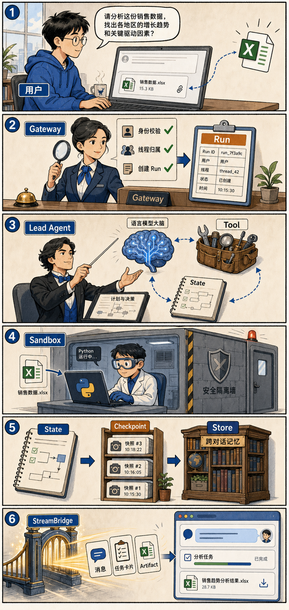
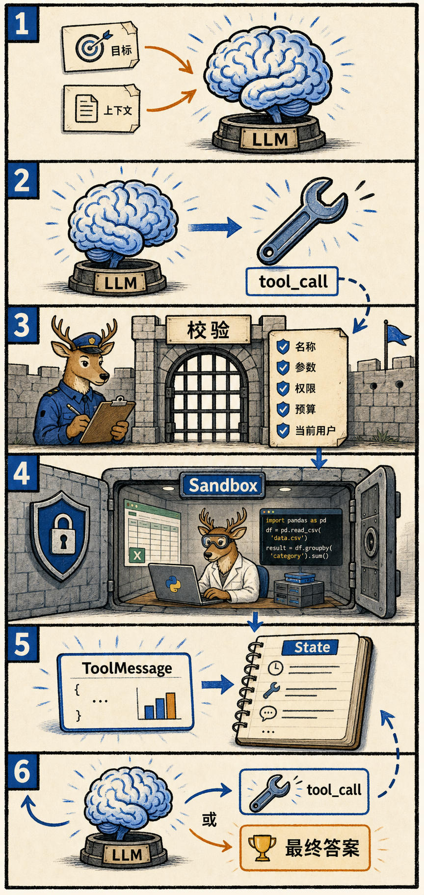
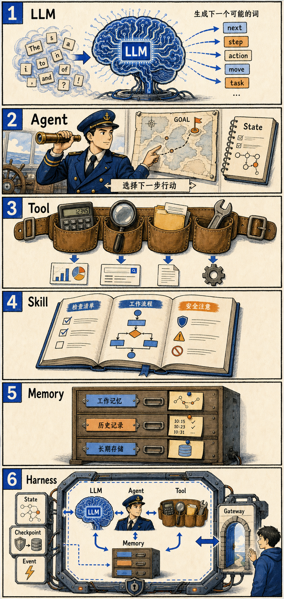

# DeerFlow 极简教学图解

这些图片是电子书的视觉教学样章。设计原则是：一张图只解释一个核心关系，尽量少角色、少文字、少箭头。

## 推荐阅读顺序

### 1. 一条消息的旅程

解释用户消息如何经过 Gateway、Run、Lead Agent、Tool、Sandbox、State、Checkpoint、Store 和 StreamBridge。

### 2. Agent 循环

解释模型为什么不能直接改变外部世界，以及 `tool_call → 校验 → Sandbox → ToolMessage → State → 再次调用模型` 的循环。

### 3. 理论分层

解释 LLM、Agent、Tool、Skill、Memory、Harness 和 Gateway 的职责区别。

### 4. Harness 极简解释

这张图只保留一个比喻：Harness 就像安全带或车架。LLM 负责产生思路，Tools 负责行动，State 负责记录；Harness 负责把它们组织起来，并提供安全规则、事件和恢复能力。

### 5. 框架整体架构

这张图只保留四层：用户界面、Gateway、Harness，以及底部的执行与持久化。它表达的是主路径：用户界面把请求交给 Gateway，Gateway 进入 Harness，Harness 组织 Lead Agent、LLM 和 Tools，再使用 Sandbox、State、Checkpoint/Store 完成任务并保存过程。

## 图解写作原则

- 先画关系，再补术语。
- 先解释“谁负责什么”，再解释实现细节。
- 不把代码、配置和所有异常塞进同一张图。
- 一张图最多突出一个主循环或一个边界。
- 复杂机制拆成多张连续图，而不是制作一张巨型架构图。
