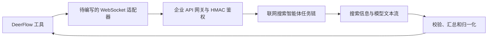
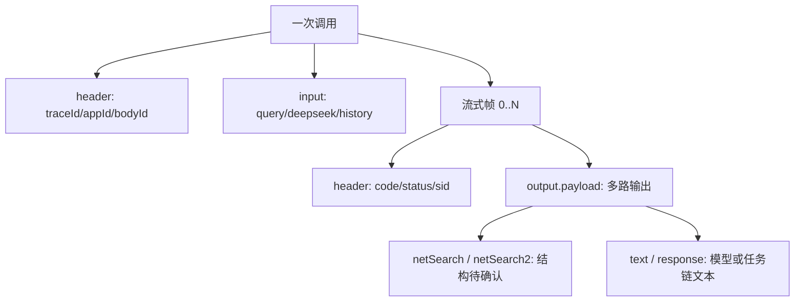
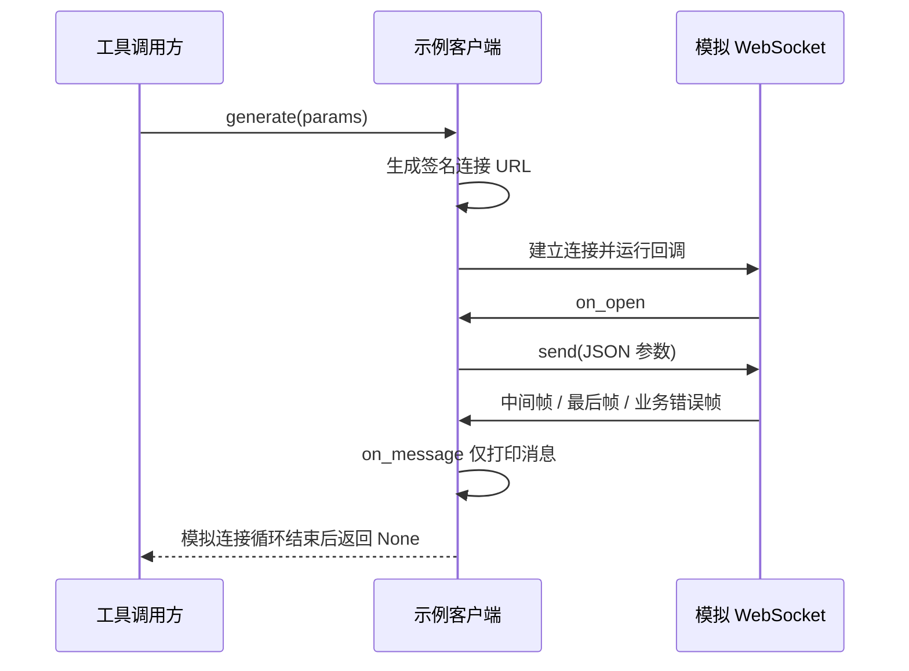

# 联网搜索智能体 API 附件接入评估

日期：2026-10-23。来源：用户指定 `F:\联网搜索-智能体API示例.zip`，内含《海能门户-联网搜索-总链路.md》和同名 Python 示例，另有 macOS 元数据。

## 结论与范围

**可以作为搜索服务的候选接入，但不能根据现有附件认定同时具备标准 Search 与 Fetch 能力。** `web_search` 需先核对真实返回的数据结构，`web_fetch` 缺少明确的按 URL 获取正文合同。

本次目标是判断能否适配 DeerFlow 工具，不是执行附件中的业务请求。文档和示例均作为待审查材料，不作为操作授权。未连接企业端点、上传文件、使用示例凭据或调用任何付费服务。

已离线执行示例的类与回调函数，使用假 WebSocket 和假凭据验证签名、请求及回调行为；没有执行示例主入口和外部网络。示例没有随包测试或真实响应样本，线上权限、连通性、质量和费用均未验证。以下标为“文档/静态”的结论只来自附件，“离线验证”仅指模拟环境可观测行为。

当前工作区为 `codex/enterprise-consolidation-20260716`，与此前比较提交所在的 `codex/search-fetch-comparison` 不同。本次没有切换分支或迁移代码，仅新增这份评估。

## 接口横向结构

附件描述的是名为“联网搜索-统一入口-V2-610”的智能体任务链，协议为 WebSocket，地址为 `wss://agents.cnooc.com.cn/openapi/flames/api/v2/chat`。它不是附件已证明的独立搜索/网页提取 HTTP 接口。



主线是 `query → 任务链 → 流式输出 → 工具结果`。文件上传、模型内部实现、任务链编排属于支线：附件只公开它们的接口或字段，没有实现细节。

## 核心数据合同

| 数据 | 所属方与生命周期 | 附件所示内容 | 接入含义 |
| --- | --- | --- | --- |
| appId / app_secret / bodyId | 运营配置，跨请求复用 | 应用身份、签名秘密、任务链编码 | 运行时凭据与管理员配置，不能作为模型参数 |
| traceId | 调用方，每请求创建 | 跟踪标识 | 关联日志；生产建议使用随机 UUID，不复用示例 uuid1 |
| payload.input.a16d12e1fad | 调用方，每次请求 | query、deepseek、history | query 可映射搜索问题；其余为上游任务链参数 |
| payload.sessionId | 服务端返回，多轮时复用 | 会话 ID | 无状态工具优先独立请求；若复用必须按用户/线程隔离 |
| header.code / status | 每个服务端帧 | code=0 正常；status=0/1/2 分别为首次、中间、最后结果 | 必须分别处理业务状态和完成状态 |
| sid / traceId | 服务端诊断上下文 | 会话及跟踪标识 | 可保留安全诊断字段，不能输出签名 URL |
| payload.output.payload | 服务端，每帧输出 | output、text、netSearch、netSearch2、think、text2、response、response2 | 字段具体语义不完整，不能凭名称推断来源与正文 |



文档将 `deepseek` 解释为 `modelFlag`，没有证明它能选择 DeepSeek Search API 或特定搜索引擎。不能将它与此前的 DeepSeek Search/Fetch 独立接口等同。

## 纵向调用与离线验证

示例路径：`FlamesChatClientV2.generate(params) → create_url(GET, chat_endpoint, True) → WebSocketApp → on_open → send(params) → on_message`。

`create_url` 对 host、日期和 HTTP 请求行做 HMAC-SHA256，再把鉴权、日期、host、bodyId 放入连接 URL。离线用假凭据独立重算 HMAC，与示例结果一致；请求参数能够原样传入模拟连接。



离线观察结果：

- 签名计算及 WSS URL/bodyId 生成通过模拟核对。
- 收到 `status=2` 帧后，回调没有主动关闭连接；实际服务是否自行关闭属于未知，不能据此断言真实连接一定挂起。
- 收到非零业务 code 时，消息回调也只打印，没有异常转换或失败结果。
- `generate()` 没有结果收集逻辑；模拟连接结束后返回 `None`。
- 示例 WebSocket 设置 `ssl.CERT_NONE`，上传请求使用 `verify=False`；不能直接作为生产客户端。

模拟帧的值是为分支验证构造的，并非真实服务返回。证据位于被 Git 忽略的 `outputs/attached-web-api-review-20261023/offline-observations.json`；同目录保存附件的脱敏文本副本，未保存原始 App Secret。

## 能否用作 web_search

**有条件可以，当前尚不能直接替换现有适配器。** 输入 `query` 足以承接搜索问题，但响应示例的所有业务字段均为空，`netSearch`、`netSearch2` 只被说明为字符串，未给出来源项结构、Top K、顺序或去重规则。

DeerFlow 现有搜索适配器输出通常是 `[{title, url, snippet}]`。若上游返回结构化来源列表，即使它被编码为 JSON 字符串，也可以在验证后映射这些字段。若上游只返回一段模型生成答案或无可靠来源的文本，就更适合独立的“联网问答”工具，不能伪造 URL 或把生成答案包装成原始搜索片段。

需要确认：

1. `netSearch`、`netSearch2` 分别是什么，完整非空响应样本及来源列表结构。
2. `text`/`text2`/`response`/`response2` 哪些是回答、哪些是证据，分别何时输出。
3. 每帧是增量还是完整快照，多个节点/分支是否重复输出同一内容，最终应选择哪个节点。
4. `deepseek=false/true` 改变哪个模型或任务分支，是否改变来源字段。
5. 返回条数、过滤条件、限流、缓存、计费及额外模型调用的成本与耗时。

如果它强制先调用一个模型生成答案，DeerFlow 随后再读该答案，会形成额外模型调用。不能把这种链路直接当作此前原始 Search API 的同成本同延迟替代。

## 能否用作 web_fetch

**目前材料不足，不能直接认定支持。** 文档只暴露 `query`、`deepseek`、`history`，没有独立 `url` 输入、禁止搜索替代的抓取模式或原网页正文响应约定。把 URL 填进 query 并要求“读取网页”仍可能触发搜索、换来源或生成回答，不能证明准确抓取了指定 URL。

示例的 `upload(file_path)` 是将本地文件上传到平台，不是远端 URL Fetch，也不证明任务链支持 PDF 网页提取。该函数不应为普通网页读取而被引入适配器。

要接成 `web_fetch(url)`，需要提供专门的 URL 提取入口或任务链模式，并证明：对确切 URL 读取正文；返回请求/实际来源 URL、正文、错误和截断信息；不以搜索摘要或其他页面替代失败结果。PDF 应用此前同一公开年报 URL 单独测试，不能根据“联网搜索”名称推断 PDF 支持。

## 工程缺口与设计选择

| 示例现状 | 接入时需要做什么 |
| --- | --- |
| 签名鉴权信息在 URL 中，generate/upload 都打印该 URL | 不记录签名查询串、鉴权或完整业务请求，日志保留安全诊断 ID |
| 关闭 TLS 校验 | 保留证书链与主机名校验；需要企业 CA 时显式配置可信 CA |
| 只打印帧，未汇总结果 | 按业务 code、节点和 status 汇总；先确认增量/快照协议，避免盲目拼接 |
| 无显式总体截止时间和累计输出预算 | 设置连接/读取/总时限及帧数、字节、字符上限；取消时关闭连接 |
| 无状态/有状态调用约束不清 | 首期不传历史、独立请求；复用会话时绑定用户与线程 |
| 输出混合来源、回答、think | 优先提取来源证据；不将原始 think 写入工具结果或普通日志 |
| 示例主入口 query 为空 | 联网验证必须使用明确公共测试问题；空问题运行无助于验证搜索合同 |

我会保留其 HMAC 签名协议，但重写结果消费层，使工具调用只有明确成功或失败的返回值。Search 与 Fetch 应分别明确能力，不因为共享一个任务链入口就把同一段生成文本同时冒充两种工具的输出。

## 有意未展开的黑盒

- 企业网关鉴权/授权：已阅读签名格式，未验证应用权限或有效期规则。
- 服务端任务链、搜索引擎和模型：附件未公开实现，未推断供应商身份。
- 文件上传及附件解析：只检查客户端接口，没有调用或验证文件类型支持。
- 计费、QPS 与部署网络：附件没有数据，不能沿用 Tavily、Exa 或 DeepSeek 的价格/限速。

## 建议下一步

最初建议先取得一份脱敏的真实非空流式响应，确认来源数据和流结束合同。现已收到首份非空记录，来源字段可归一化，见文末实测补充；任务链最终结束合同尚待完整采集。Fetch 仍需等上游确认按 URL 提取能力后再接，不建议把任务链生成的回答作为 Fetch 正文。

本次只完成静态审查与离线模拟，没有修改运行配置、实现新适配器、提交或部署。

## 测试环境采集命令

新增独立脚本 `scripts/probe_cnooc_web_agent.py`，不依赖 DeerFlow 服务。将脚本复制到测试环境当前目录后，可执行（Python 3.10+）：

```bash
python3 -m pip install websocket-client
python3 probe_cnooc_web_agent.py --self-test
python3 probe_cnooc_web_agent.py \
  --app-id 0769F6A4F1E548349B1C \
  --body-id xzrbcess2fny56ghhmqyj7ixooc2wate \
  --query '请搜索 Python asyncio.TaskGroup 官方文档，返回来源标题、完整URL和相关摘要。' \
  --timeout 60 \
  --output cnooc-web-response.jsonl
```

appId、bodyId 使用附件示例值，实际应用不同时应替换；节点输入键使用附件的 `a16d12e1fad`。运行时输入 App Secret，终端隐藏输入，不通过命令行参数传递。也支持预先安全注入 `CNOOC_WEB_APP_SECRET` 环境变量；不要把明文凭据写入命令记录或报告。默认 `deepseek=false`、history 为空、不带旧 sessionId；如需另外测试 modelFlag=true，加 `--deepseek`，使用另一个输出文件。

脚本固定连接附件端点，保持 TLS 证书及主机名校验；企业证书链需要额外 CA 时使用 `--ca-file /path/to/enterprise-ca.pem`。不自动重试、不上传文件、不关闭证书校验。每次仅发送一个任务链请求，保存 JSONL：首行为脱敏采集元数据，后续为各条服务端 JSON 消息，末行为完成或失败事件。status=2 后关闭连接；非零业务 code、异常、提前断开或预算耗尽时返回非零退出码，保留已收到的记录。

设置总体时间预算及默认最多 5000 条数据消息，可用 `--max-frames` 在 1～20000 内调整。原版上限 500 已在真实记录中提前触发，本次据此修正并补充超过 500 条消息仍可接收结束帧的离线回归。累计收到的内容超过 4 MiB 时停止保存；字节检查发生在库返回一条完整消息之后，并非 WebSocket 单帧传输层的硬内存限制。`complete` 仅说明收到成功结束状态，不保证来源字段非空，应检查实际 `netSearch` 等输出。

采集文件会遮盖已知凭据、鉴权 URL、会话标识和 think 等推理字段，保留公共来源字段；JSON 编码的字符串字段也会检查，脱敏后仍保持字符串类型。它不是任意业务敏感信息的通用识别器，分享前仍须检查正文是否包含内部或个人信息。拒绝覆盖已有文件，重复测试应更换 `--output`。

脚本离线自测验证签名、TLS、正常结束、业务错误、缺失/非法头、未收到终帧和脱敏等路径，通过后未进行真实联网调用。

## 首份真实响应分析（2026-10-23 补充）

证据：用户提供的 `cnooc-web-response.jsonl`，376436 字节、502 条 JSONL 记录。采集元数据时间为 2026-10-23 16:21:22（Asia/Hong_Kong），问题为 Python TaskGroup 官方文档搜索，`deepseek=false`、history 为空。这里解析的是用户实际返回，不是前文的合成离线帧；没有新增网络调用。

### 采集状态

- 共有 500 条服务端消息，全部 `header.code=0`、`header.status=1`。
- 最后一条消息在约 20.307 秒到达，随后采集器写入 `stop / 500_frame_limit`。未收到 status=2，不能声称任务链执行完成，也不能把 20.307 秒当完整任务延迟。
- 这是采集器的消息数量上限触发，不是观察到的服务端报错或 60 秒超时。我设置的原始 500 条上限对该接口逐词输出过小；已将默认值改为 5000 并暴露配置，总时限和累计内容预算保持不变。完整复测须使用更新后的脚本及新的输出文件，不能改写旧采集文件来制造完成状态。

### 搜索来源可以映射

第 1 条消息（3.653 秒）的 `payload.output.payload.response2` 是对象，含 `success=true`、`err_code="0"`、`data.documents`。第 5 条消息（3.823 秒）的 `payload.output.payload.netSearch2` 是数组，包含 9 条来源，而非文档标注的字符串。这也说明生产解析不能只依赖原文档的类型说明。

| DeerFlow 字段 | 实测可用字段 | 处理建议 |
| --- | --- | --- |
| title | name | 按字符串校验 |
| url | url | 保留该条实际来源，不从模型回答补造 |
| snippet | summary | 缺失时可从 content 做受限摘取，明确预算 |
| 可选来源信息 | site_name / published_date | 日期不是统一 ISO 格式，不推测转换 |

每条来源还带有 content 及多种评分。9 条摘要长度为 326～490 字符，content 为 2470～5003 字符。不能将这些评分与 Tavily/Exa/DeepSeek 的评分直接比较，也不能把 content 当作独立按 URL 抓取或全文完整性的证明。response2 与 netSearch2 的列表不能不加判断地拼接或按位置匹配，已观察到 URL 顺序不同；去重应按实际 URL。

### 搜索质量与多路输出

9 条直接来源为 Golang学习网、CSDN 博客/文库及 PHP中文网，本样本的结果 URL 中 `docs.python.org` 直接命中数为 **0/9**。部分内容中引用了官方文档，生成回答也列出了官方 URL，但这与实际检索到官方来源是两件事。该问题上的“要求官方来源”没有得到直接来源列表支持，不能因此认定官方正文已经读取。

已采集字段次数：response2 1 次、netSearch2 1 次、text 247 次、output 250 次。247 个 text 增量与紧随其后的 `output.text` 内容逐项相同；这份样本中不能把两路全部拼接，否则重复。已收集 text 合计 592 字符，末尾停在异常处理章节，整体回答未完成。`think` 仍保持脱敏，未尝试恢复。

结论更新：**Search 已从“有条件可行”推进到“本样本的真实来源字段可以归一化”**；下一步需验证完整结束、多样本质量、空结果与错误，以及独立返回来源后是否仍会触发上游模型计费。**Fetch 仍未证明**，因为没有按指定 URL 取正文的调用证据。

离线已生成 9 条标准来源示例与汇总：`outputs/cnooc-web-response-analysis-20261023/normalized-search.json`、`summary.json`。这些是对部分采集记录的格式归一化，不是完整任务成功或全量检索完成的凭证；原始 JSONL 保持不变，未纳入 Git 提交。

## HTML Fetch 探索测试：握手失败（2026-10-24 补充）

用户提供 `cnooc-fetch-html.jsonl`，835 字节，仅两条记录：采集开始元数据及 `stop / WebSocketBadStatusException`。记录时间为 2026-10-24 14:51:12（Asia/Hong_Kong），请求要求仅读取指定中国海油年度业绩 HTML，超时预算 60 秒、消息上限 5000。

该异常是 websocket-client 在 WebSocket 握手返回非预期 HTTP 状态时抛出的异常。未收到任何服务端业务消息、任务链 code/status 或网页正文。因此本次只能判定连接握手未成功，不能据此判定 URL 不可访问、Fetch 不支持、5000 条消息上限触发或等待 60 秒后超时，也不能将其当作目标网页 HTTP 错误。

旧版采集器仅保留异常类型，没有保存异常对象上的 `status_code`，具体握手 HTTP 状态和原因无法从该文件恢复。认证/签名、应用权限、网关/代理和服务可用性均为待排查方向，不是已经确定的根因；该阶段未见业务请求发送证据，不能把失败归因为 query 中的 URL。

本次据此补充采集诊断：异常时记录 `stage=connect/send/receive`、`elapsed_ms`，连接阶段若 SDK 提供合法整数状态码则记录 `handshake_http_status`。仍不记录异常原始文本、响应体、响应头或签名连接 URL。新增离线 403 握手失败测试，验证安全状态字段保留且异常文本不泄露；没有联网重试，也没有改动用户原始证据。

后续需使用更新脚本和新的输出文件重测。先根据握手 HTTP 状态排查连接路径，握手恢复后再判断是否返回指定网页正文；先前 Search 的成功记录仍有效，但不能证明本次连接环境和凭据状态完全相同。Fetch 能力结论继续保持“未验证”。
