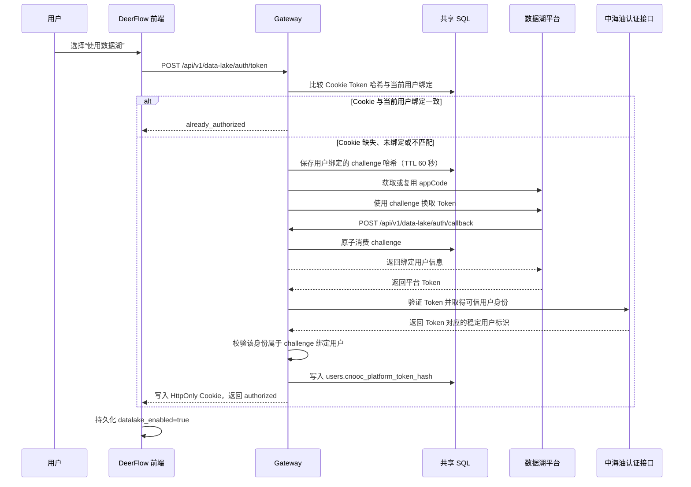

# 对话框数据湖权限获取设计

## 1. 背景与目标

对话框中的 Data Lake 功能默认关闭。用户明确选择“使用数据湖”后，
DeerFlow 才为当前登录用户获取数据湖平台 Token，并在授权成功后启用
文件列表和 Data Lake 智能体工具。

本设计实现以下目标：

- 缺失或无效的 `datalake_enabled` 一律按 `false` 处理。
- 数据湖 Token 不暴露给浏览器 JavaScript。
- 将永久有效且用户唯一的 `cnooc.platform_token` 以哈希形式直接绑定到
  `users` 表，不新增独立 Token 绑定表。
- 使用一个与 DeerFlow 用户绑定、60 秒有效、只能消费一次的 challenge
  完成数据湖平台回调。
- 支持数据湖平台对同一回调进行安全的幂等重试，并拒绝重放或内容冲突。
- 用户关闭 Data Lake 后，所有会话都停止提供文件列表和 Data Lake 工具。
- 用户登出时，将 Data Lake 偏好重置为关闭，并清除平台 Token Cookie。

本设计取代早期 Data Lake 会话范围设计中“缺失设置默认启用”的历史行为；
当前权威行为是默认关闭，只有授权成功后才启用。

## 2. 核心状态与边界

系统将用户偏好和访问凭证分开管理：

| 状态 | 存储位置 | 用途 | 安全属性 |
| --- | --- | --- | --- |
| `datalake_enabled` | 浏览器共享本地设置 | 控制 Data Lake UI 和智能体工具是否可用 | 不是授权凭证 |
| `cnooc.platform_token` | HttpOnly Cookie | 调用数据湖文件、外部智能体等服务 | 前端 JavaScript 不可读 |
| `users.cnooc_platform_token_hash` | 共享 SQL 数据库 | 绑定 DeerFlow 用户与平台 Token | 只保存 SHA-256，唯一且不对外序列化 |
| Data Lake challenge | 共享 SQL 数据库 | 将数据湖回调绑定到具体 DeerFlow 用户 | 只保存 SHA-256，不保存明文 |
| appCode | Gateway 进程内缓存 | 调用数据湖平台接口 | 最长缓存 110 分钟 |

`datalake_enabled` 只表达用户是否希望使用 Data Lake，不能替代服务端认证和
授权。即使该值为 `true`，文件列表打开前仍必须确认 Cookie 中的平台 Token
与当前 DeerFlow 用户在数据库中的 Token 哈希一致。

关闭 Data Lake 不删除用户已经添加到对话的附件，因为这些文件已经成为明确的
对话输入。关闭操作也不立即删除平台 Token，以便用户在同一登录会话中快速重新
启用；登出时才统一清除 Token。

## 3. 总体架构



## 4. 前端设计

### 4.1 默认状态

`datalake_enabled` 保存在用户共享的本地设置文档中，对所有会话生效：

- 默认值为 `false`。
- 持久化值缺失、类型错误或无法解析时按 `false` 处理。
- 普通会话、自定义智能体、重新生成和分支运行都发送解析后的明确布尔值。

### 4.2 启用流程

用户选择“使用数据湖”时：

1. 前端通过已有的 CSRF 感知认证请求封装调用
   `POST /api/v1/data-lake/auth/token`。
2. 请求进行期间禁用重复授权操作。
3. 只有接口成功返回后才写入 `datalake_enabled=true`。
4. 授权失败时显示安全错误，不修改设置，也不打开文件列表。

该调用仍使用统一封装注入 DeerFlow Cookie 和 CSRF Header，但关闭封装的通用 401
登录跳转。Gateway 返回 `data_lake_login_required` 时，前端只显示“请先登录数据湖”，
不得短暂显示 `Unauthorized`，也不得离开当前对话。其他 API 的 401 自动登录行为保持
不变。

### 4.3 文件列表

即使持久化设置已经是 `true`，每次打开文件列表仍重复调用 Token 接口：

- Cookie 存在且其哈希与当前用户绑定一致时，接口幂等返回
  `already_authorized`。
- Cookie 存在但属于其他用户、尚未绑定或绑定已变化时，不得直接放行。
- Cookie 已过期或被删除时，Gateway 自动重新执行授权流程。
- 授权失败时不加载文件。

关闭 Data Lake 时，前端立即关闭弹窗、清空列表并递增请求序号。旧的异步加载
即使稍后返回，也不能重新写入已经关闭的界面。

### 4.4 智能体工具

当运行上下文中的 `datalake_enabled` 为 `false` 时，以下工具必须从主智能体和
子智能体的工具集合中移除，并在工具调用边界再次拒绝执行：

- `datalake_smart_qa`
- `datalake_metrics_qa`
- `datalake_detail_qa`

`datalake_md_search` is not a Data Lake-toggle tool. It uses its own
Gateway-only AppForge credential to query registered exploration-and-production
master data and ownership relations, and therefore remains available when
`datalake_enabled=false`. It must not receive the browser platform Token or be
added to this filtered set.

### 4.5 登出

登出流程执行以下动作：

1. 立即清除前端用户状态。
2. 尽力将 `datalake_enabled` 重置为 `false`。
3. 调用 `POST /api/v1/auth/logout` 清除服务端 Cookie。
4. 返回首页；Gateway 不可用时使用硬导航销毁现有前端订阅状态。

本地设置重置会捕获 `localStorage` 读取或写入异常。企业浏览器禁用本地存储、
配额耗尽或安全策略抛错时，异常不能阻止真正的服务端登出。

## 5. Gateway 接口

### 5.1 获取 Token

```http
POST /api/v1/data-lake/auth/token
```

该接口必须通过 DeerFlow 登录认证和 CSRF 校验。

Gateway 读取 `cnooc.platform_token` Cookie，计算 SHA-256，并使用恒定时间比较
确认它与当前用户的 `users.cnooc_platform_token_hash` 一致。只有匹配时才返回：

```json
{"code":"already_authorized"}
```

如果 Cookie 缺失、当前用户尚未绑定哈希或哈希不匹配：

1. 使用安全随机源生成符合 `[A-Za-z0-9_-]{32,256}` 的 challenge。
2. 将 challenge 的 SHA-256、当前用户 ID 和 60 秒过期时间写入共享 SQL。
3. 获取或复用数据湖 appCode。
4. 调用数据湖 Token 交换接口。
5. 对交换结果执行第 8.2 节规定的 Token 有效性和用户归属校验。
6. 校验通过后，先把 Token SHA-256 持久化到当前用户记录。
7. 数据库提交成功后，才将原始 Token 写入 HttpOnly Cookie。
8. 返回：

```json
{"code":"authorized"}
```

任何持久化或上游调用失败都必须保持前端 Data Lake 关闭。
Cookie 与数据库绑定不匹配时，不允许用现有 Cookie 自动覆盖数据库绑定，也不允许
把现有 Cookie 自动绑定给当前用户；必须重新完成可信授权。

若数据湖平台签发的 Token 随后被中海油身份接口拒绝，Gateway 保留 HTTP 401，但
必须返回稳定业务码 `data_lake_login_required` 和安全提示，不得返回会被误判为
DeerFlow 登录失效的通用错误。

### 5.2 校验当前数据湖会话

```http
GET /api/v1/data-lake/auth/session
```

该接口要求 DeerFlow 登录认证，不修改状态，因此不要求 CSRF Token。它只返回当前
请求是否满足以下条件，不返回原始 Token 或 Token 哈希：

- `cnooc.platform_token` Cookie 存在；
- 当前用户存在且未禁用；
- Cookie Token 的 SHA-256 与当前用户数据库绑定恒定时间比较一致。

Next.js 所有直接消费平台 Token 的服务端路由，包括购物车文件列表、文件下载和
五个外部智能体启动路由，都必须在使用 Token 前调用该校验。校验失败时返回未授权，
清除失配的平台 Cookie，不得把 Token 转发给数据湖或拼入外部智能体跳转地址。
浏览器收到平台 Token 绑定校验产生的 401 后关闭数据湖界面，并把共享设置中的
`datalake_enabled` 重置为 `false`；Gateway 暂时不可用时返回 503，保留可能仍然
有效的 Cookie 和用户偏好，避免把基础设施故障误判为身份切换。

购物车列表上游以 HTTP 401 返回业务响应 `code=1`、`msg=invalid_token` 时，表示
用户尚未登录数据湖平台，而不是 DeerFlow 用户与平台 Token 的绑定失配。Next.js
列表路由将其映射为稳定错误码 `data_lake_login_required`，前端提示“请先登录数据湖”，
同时保留 HttpOnly 平台 Cookie 和 `datalake_enabled=true`。其他 401 仍沿用失配清理策略。

### 5.3 数据湖平台回调

```http
POST /api/v1/data-lake/auth/callback
Content-Type: application/json
```

回调是机器到机器的公开接口，因此不要求 DeerFlow 浏览器登录态，也不使用浏览器
CSRF Cookie。它的访问凭证是数据库中已持久化、短时有效、与用户绑定的一次性
challenge。

请求示例：

```json
{
  "challenge": "6W9Kp0x4r8Qm2vY7nB3sL5dT1cF0aZ8R",
  "callback_id": "cb_20260820_000001",
  "timestamp": 1787212800
}
```

校验规则：

- 请求体最大 16 KiB。
- 禁止未知 JSON 字段。
- `challenge` 长度为 32 至 256，只允许字母、数字、下划线和连字符。
- `callback_id` 可选，最大 128 个字符。
- `timestamp` 可选，必须是严格的有符号 int64。
- challenge 必须放在 JSON 请求体中，不能放在 URL 查询参数中。

成功响应：

```json
{
  "code": "accepted",
  "challenge": "6W9Kp0x4r8Qm2vY7nB3sL5dT1cF0aZ8R",
  "user_info": {
    "subject": "用户唯一标识",
    "account": "登录账号",
    "email": "user@cnooc.com.cn",
    "display_name": "用户姓名"
  }
}
```

其中 `subject` 优先使用用户 OAuth 标识，否则使用 DeerFlow 用户 ID；`account`
从用户邮箱的本地部分派生。用户不存在或已禁用时，不向上游返回身份信息。

challenge 只证明回调属于某次 DeerFlow 授权请求，不能单独证明最终交换得到的
Token 属于该 DeerFlow 用户。因此，回调被接受后仍不能立即建立永久 Token 绑定；
Gateway 必须等待 Token 交换完成，并按照第 8.2 节验证 Token 和用户归属。

### 5.4 CNOOC 登录绑定

```http
GET /api/v1/auth/cnooc/login?token=<platform-token>&next=<path>
```

该接口的请求参数 `token` 与最终写入 Cookie 的 `cnooc.platform_token` 是同一个
Token。登录流程必须按以下顺序执行：

1. 调用中海油认证接口验证请求 Token，并取得可信的稳定用户标识。
2. 根据该身份解析或创建 DeerFlow 用户。
3. 计算 Token SHA-256，并通过专用仓储方法绑定到该用户。
4. 数据库提交成功后，才签发 DeerFlow 登录 Cookie 和
   `cnooc.platform_token` Cookie。

不得在认证接口验证成功前绑定 Token。唯一约束冲突、用户被禁用或数据库写入失败
时必须失败关闭，不得签发任何成功登录 Cookie。

本地账号、OIDC、IAM 等不携带 CNOOC Token 的登录方式在成功建立新用户会话时，
必须清除浏览器中可能遗留的 `cnooc.platform_token` Cookie，避免切换账号后继续
携带上一用户的永久标识。

## 6. 用户与平台 Token 绑定

`users` 表新增可空字段：

| 字段 | 说明 |
| --- | --- |
| `cnooc_platform_token_hash` | `cnooc.platform_token` 的 SHA-256 十六进制摘要，长度 64，唯一且可空 |

设计约束：

- 一个 Token 最多绑定一个 DeerFlow 用户；数据库唯一约束是最终并发边界。
- 多个尚未授权的用户可以同时保持 `NULL`。
- 原始 Token 永不写入数据库、日志、接口响应或前端状态。
- 该字段属于认证内部数据，不加入普通用户、管理员或审计接口的响应模型。
- 绑定使用专用的原子仓储方法，不能通过携带陈旧完整用户对象的通用更新覆盖。
- 已绑定用户发生合法 Token 轮换时，用新哈希覆盖旧哈希；若新哈希已属于其他用户，
  则拒绝更新。
- 登出只删除 Cookie，不删除数据库哈希。永久绑定将在下一次同一 Token 登录或授权时
  继续使用。

本设计采用 SHA-256 的前提是平台 Token 具有不可枚举的高熵。如果平台不能保证该
属性，应改用带独立服务端密钥的 HMAC-SHA-256，并为密钥轮换设计版本字段。

存量用户数据库哈希为空时，不能根据浏览器中已有 Cookie 自动回填。只有新的 CNOOC
登录或完成完整的数据湖授权、Token 验证和身份一致性校验后才能建立绑定。

## 7. Challenge 持久化

数据库迁移新增 `data_lake_auth_challenges` 表：

| 字段 | 说明 |
| --- | --- |
| `challenge_hash` | challenge 的 SHA-256，主键 |
| `user_id` | 绑定的 DeerFlow 用户，删除用户时级联删除 |
| `expires_at` | 60 秒有效期的绝对过期时间 |
| `callback_id` | 第一次成功回调的标识 |
| `callback_timestamp` | 上游事件时间，仅作为元数据 |
| `callback_payload_hash` | 规范化回调内容的 SHA-256 |
| `consumed_at` | 首次成功消费时间 |
| `created_at` | 创建时间 |

首次消费通过带条件的 `UPDATE ... RETURNING` 原子完成，而不是只依赖
`SELECT ... FOR UPDATE`。这保证 PostgreSQL 和 SQLite 下的并发行为一致：

- 未消费且未过期：原子接受。
- 已消费且请求内容完全相同：作为幂等重试再次返回成功。
- 已消费且 `callback_id` 不同：返回 `callback_replayed`。
- 已消费但请求内容不同：返回 `callback_payload_mismatch`。
- 不存在或过期：返回 `invalid_or_expired_challenge`。

创建新 challenge 时顺带删除过期超过 5 分钟的历史记录，避免依赖后台清理任务。

## 8. 数据湖上游调用

### 8.1 appCode

Gateway 调用：

```http
GET /apigateway/appauth/getappid
```

参数为 `appName`、`appId` 和当前 Unix 秒数字符串的前 8 位。数据湖平台不接受
完整的 10 位 Unix 秒值。appCode 在单个 Gateway 进程内缓存 110 分钟，比上游
声明的 2 小时有效期少 10 分钟安全余量。

### 8.2 Token 交换与身份校验

Gateway 调用：

```http
POST /apigateway/zcshf/zcjksjfw_9725
```

请求头包含 `appCode`、`loginUserCode` 和 `apiToken`，请求体为：

```json
{
  "jsonObj": {
    "callbackId": "deerflow",
    "challenge": "一次性挑战值"
  }
}
```

网络超时、传输错误和上游 5xx 按配置进行有限次数重试。非临时失败可能表示
appCode 已失效，此时 Gateway 清空 appCode 缓存，重新获取后再尝试一次。

如果 Token 交换接口以 HTTP 200 返回，但刷新 appCode 重试后业务 `code` 仍不为
`200`，Gateway 将其视为当前账号没有数据湖权限，返回 HTTP 403 和错误码
`data_lake_permission_denied`。前端显示“无数据湖权限”，并保持
`datalake_enabled=false`。网络、超时、非法 JSON 和上游 5xx 继续作为服务故障
处理，不能误报为权限不足。

上游客户端默认启用 TLS 证书和主机名验证，并使用 `trust_env=false`，避免将
平台凭证发送到企业互联网代理。

交换完成后，Gateway 必须取得关于返回 Token 的可信用户身份：

- 如果 Token 交换接口的正式契约同时保证 Token 有效，并返回可验证的稳定用户标识，
  可以直接使用交换结果，不重复调用认证接口。
- 如果交换接口只返回 Token，则必须额外调用与
  `/api/v1/auth/cnooc/login` 相同的中海油认证接口验证 Token，并取得稳定用户标识。

随后必须将该稳定身份与 challenge 绑定的 DeerFlow 用户进行比较：

- `oauth_provider=cnooc` 时，必须恒定时间精确比较 DeerFlow `oauth_id` 与数据湖
  `userid`。
- `oauth_provider=iam` 时，IAM 记录必须已有非空 `oauth_id`，并且 DeerFlow 用户邮箱与
  数据湖可信身份派生邮箱都必须是规范的单一 `@cnooc.com.cn` 企业邮箱；只有忽略大小写
  后完全相同时才能绑定。
- 本地账号、其他 OAuth 提供方、缺少 IAM `oauth_id`、非企业邮箱和不同邮箱全部拒绝。

身份不一致时拒绝绑定并清除可能存在的旧平台 Cookie。不能仅凭 challenge、Token
非空、显示名、部门或模糊用户名建立身份关系。

## 9. Cookie 策略

`cnooc.platform_token` Cookie 使用以下属性：

- `HttpOnly=true`
- `SameSite=Lax`
- HTTPS 请求下 `Secure=true`
- `Path=/`
- `Max-Age=7 天`

Token 不得返回给前端 JavaScript，不得写入 `localStorage`，不得硬编码到源码或
卡片配置中。HTTP 客户端日志过滤器会遮蔽可能出现在数据湖 URL 中的 Token。

`POST /api/v1/auth/logout` 同时删除 DeerFlow `access_token` 和
`cnooc.platform_token` Cookie。

## 10. 回调安全与错误契约

所有回调响应携带：

- `Cache-Control: no-store`
- `Referrer-Policy: no-referrer`
- `X-Request-Id`

主要错误响应：

| HTTP 状态 | 错误码 | 场景 |
| --- | --- | --- |
| 400 | `invalid_request` | JSON、字段或类型非法 |
| 403 | `data_lake_permission_denied` | Token 交换业务拒绝，当前账号没有数据湖权限 |
| 409 | `invalid_or_expired_challenge` | challenge 不存在或已过期 |
| 409 | `callback_replayed` | 已使用的 challenge 被不同回调重放 |
| 409 | `callback_payload_mismatch` | 幂等重试内容与首次回调不一致 |
| 413 | `request_too_large` | 请求体超过 16 KiB |
| 429 | `callback_rate_limited` | Nginx 回调限流 |
| 500 | `user_unavailable` | 绑定用户不存在或被禁用 |
| 500 | `internal_error` | 数据库或用户解析失败 |

Token 无效、Token 身份与当前用户不一致或 Token 已绑定其他用户时，对浏览器统一返回
安全的授权失败错误，不暴露 Token 是否存在、属于谁或具体身份字段。

服务端日志记录详细异常，但对外错误不包含堆栈、凭证或数据库细节。

## 11. Nginx 防护

Docker、本地前台和 K8s Nginx 均使用 `^~ /api/v1/data-lake/auth/` 将浏览器
Token 与 Session 接口路由到 Gateway，并将该前缀放在 WeKnora 的通用
`/api/v1/` 路由之前。以下公开回调仍使用精确匹配，因此优先于该前缀并保留独立限流：

```text
/api/v1/data-lake/auth/callback
```

限流规则：

- 按真实客户端 IP 每秒 5 个请求。
- 允许 10 个突发请求，使用 `nodelay`。
- 超限返回 HTTP 429 和统一 JSON 错误体。
- 429 响应同样携带 `no-store`、`no-referrer` 和请求 ID。

K8s TLS 入口通过受信任的本机回环代理恢复 `X-Real-IP`，避免所有外部请求被
错误归为同一个回环地址。

## 12. 运行时配置

部署环境通过 Secret 提供：

```text
CNOOC_OAUTH_BASE_URL
CNOOC_OAUTH_APP_NAME
CNOOC_OAUTH_APP_ID
CNOOC_DATALAKE_TOKEN_API_TOKEN
CNOOC_DATALAKE_TOKEN_LOGIN_USER_CODE
CNOOC_DATALAKE_CALLBACK_ID
CNOOC_OAUTH_TLS_VERIFY
```

通用的连接、读取、写入、连接池超时，以及请求次数和退避时间继续复用
`CNOOC_OAUTH_*` 配置。任何真实凭证都不得提交到 Kubernetes 清单或仓库。

## 13. 部署步骤

1. 执行数据库迁移，创建 `data_lake_auth_challenges`，并为 `users` 增加唯一、可空的
   `cnooc_platform_token_hash` 字段。若 `0013_data_lake_auth_challenges` 尚未部署，
   可以在该迁移中一并加入；若已经部署，则必须新增后续迁移，不得修改已发布迁移。
2. 通过运行时 Secret 注入数据湖平台配置和凭证。
3. 发布包含新 Gateway 路由、Nginx 数据湖认证前缀路由和精确回调路由的版本。
4. 确认数据湖平台能够访问部署环境的 HTTPS 回调地址。
5. 确认 Gateway 与数据湖平台时间同步。
6. 对实际部署配置运行 `nginx -t`，再进行端到端授权验证。

## 14. 测试策略

后端测试至少覆盖：

- 无 Cookie 时创建用户绑定 challenge 并写入 Token Cookie。
- Cookie 哈希与当前用户绑定一致时不重复调用上游。
- Cookie 属于其他用户、用户哈希为空或 Cookie 被篡改时拒绝快速放行。
- CNOOC 登录先验证 Token、持久化哈希，再签发登录和平台 Cookie。
- 数据湖交换只返回 Token 时调用中海油认证接口，并在身份一致后绑定。
- 数据湖交换返回可信身份时复用交换结果，避免重复验证调用。
- Token 无效、身份不一致和唯一约束冲突时不写 Cookie、不改变已有绑定。
- IAM 登录用户仅在非空 IAM 身份和双方规范企业邮箱完全一致时允许绑定；不同邮箱、
  非企业邮箱、本地账号和其他 OAuth 提供方继续拒绝。
- 存量空哈希用户不能由已有 Cookie 自动回填。
- 本地、OIDC 和 IAM 登录成功时清除遗留平台 Cookie。
- `/api/v1/data-lake/auth/session` 不返回 Token，并正确校验当前用户绑定。
- 购物车列表、下载和外部智能体启动路由在校验失败时不消费或转发 Token。
- challenge 过期、重放、内容冲突和完全相同的幂等重试。
- 回调用户不存在或被禁用。
- 16 KiB 请求上限、未知字段、challenge 格式和 int64 边界。
- appCode 缓存、失效刷新、上游重试和安全错误。
- 数据库迁移和模型注册。

前端测试至少覆盖：

- 默认关闭和非法持久化值回退。
- 授权成功后才启用。
- 打开文件列表前重新授权。
- 授权失败时不加载文件。
- 关闭时隐藏列表、关闭弹窗并使旧请求失效。
- 文件列表或下载因平台 Token 绑定失配返回 401 时清除旧授权界面并把共享设置重置为
  `false`。
- 文件列表返回 `data_lake_login_required` 时提示“请先登录数据湖”，保留 Cookie 和
  `datalake_enabled=true`。
- 授权异步完成时只更新最新上下文中的 `datalake_enabled`，不得覆盖期间发生的模型、
  模式或知识库设置变更。
- 登出时重置设置。
- `localStorage.getItem` 或 `setItem` 抛错时仍不中断登出。

部署配置测试至少覆盖：

- 三套 Nginx 配置都将 `/api/v1/data-lake/auth/` 前缀路由到 Gateway，且优先于
  WeKnora 的 `/api/v1/` catch-all。
- 三套 Nginx 配置都有精确回调路由。
- 限流为每秒 5 次、突发 10 次。
- 429 返回统一 JSON 和安全响应头。
- K8s TLS 回环链路保留真实客户端 IP。

## 15. 关键实现位置

- Gateway 路由：`backend/app/gateway/routers/data_lake_auth.py`
- 上游认证客户端：`backend/app/gateway/auth/cnooc.py`
- Cookie 契约：`backend/app/gateway/auth/platform_token_cookie.py`
- 用户模型与 Token 哈希仓储：
  `backend/packages/harness/deerflow/persistence/user/`
- Challenge 仓储：
  `backend/packages/harness/deerflow/persistence/data_lake_auth/`
- 数据库迁移：
  `backend/packages/harness/deerflow/persistence/migrations/versions/0013_data_lake_auth_challenges.py`
- 前端授权请求：`frontend/src/core/data-lake/auth.ts`
- 前端 Data Lake 控件：
  `frontend/src/components/workspace/shop-cart-attachments/shop-cart-attachment-button.tsx`
- 前端登出重置：`frontend/src/core/auth/logout.ts`
- Next.js 平台 Token 服务端校验：
  `frontend/src/server/cnooc-auth/platform-token.ts`
- 直接消费平台 Token 的路由：`frontend/src/app/api/shop-cart/new/list/route.ts`、
  `frontend/src/app/api/shop-cart/new/download/route.ts`、
  `frontend/src/app/api/shop-cart/download/route.ts`、
  `frontend/src/app/api/cnooc/external-agents/[agent]/launch/route.ts`
- Nginx：`docker/nginx/nginx.conf`、`docker/nginx/nginx.local.conf`、
  `k8s/local-pvc/nginx.conf`
