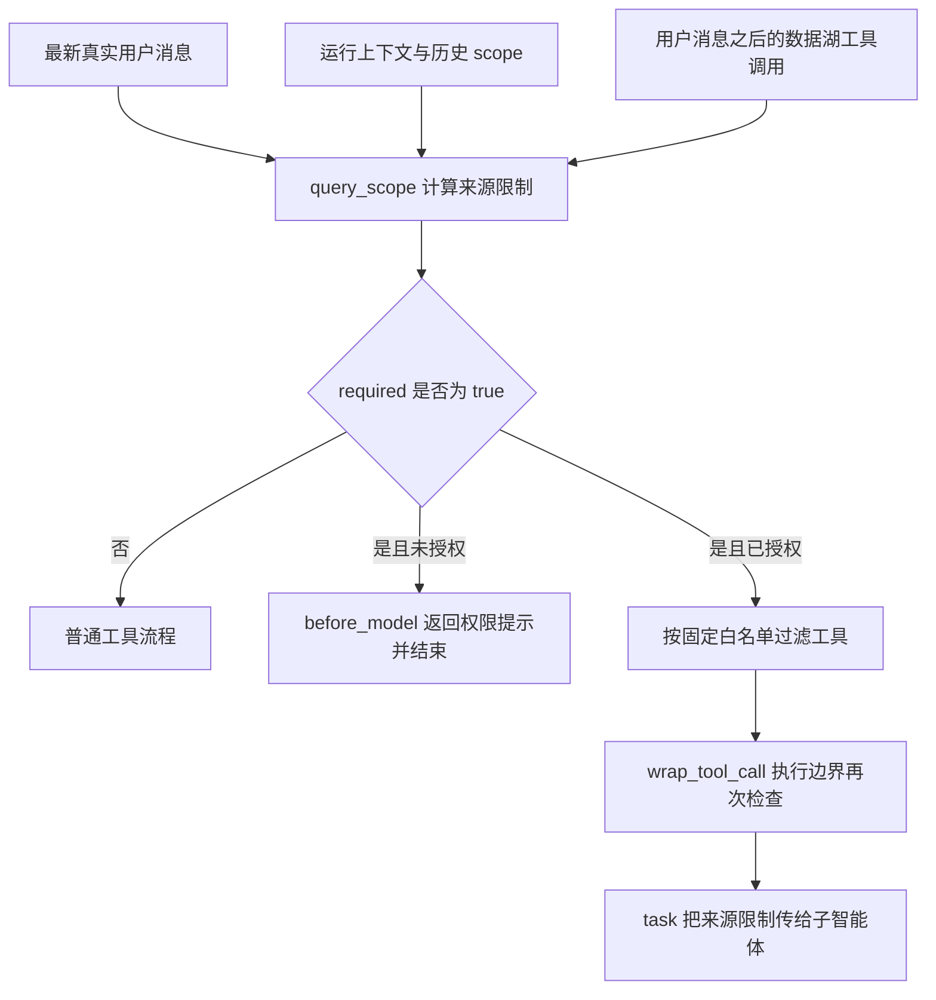
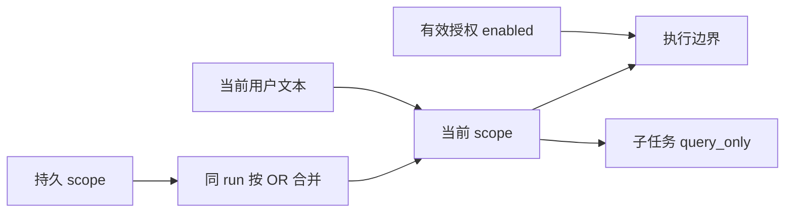

# 数据湖权限提示后普通命令被拦截：原因分析

日期：2026-10-28。下文原因分析记录修复前的工作区源码；后续实施结果见文末。未连接生产、调用真实模型或数据湖接口。

## 结论与验证边界

问题是数据湖来源保护的意图判定与作用域过宽：关键词预判可以将诊断、引用报错和产品使用说明判为问数；限制一旦成立，就按工具名称拦截整轮执行，其中包括全部 Bash。当前轮的限制不能通过普通状态更新清除，部分简短续问还会跨运行继承。

这句权限提示既是拒绝结果，又包含触发预判的词。因此，用户引用它询问原因时，可以再次触发保护。但不能据此认定“历史出现这句话后，整个会话永久锁定”：助手文本本身并不被扫描为数据湖查询意图。

使用现有 `backend/.venv/Scripts/python.exe`（Python 3.12.15、langchain_core 1.3.3），直接导入仓库实际 policy 与 middleware，以真实 HumanMessage/AIMessage 和最小 runtime 执行离线场景。没有启动完整 Gateway/Frontend；尚无本次事故的 thread/run 工具日志，因此重复次数、具体首个触发调用和线上源码身份仍未核实。以下标记“执行验证”的结论是本地代码行为；重复调用链的现场归因仍需日志。

## 架构与主路径



主路径文件：

- `backend/packages/harness/deerflow/runtime/datalake_policy.py:26`：关键词、状态合并和来源作用域。
- `backend/packages/harness/deerflow/agents/middlewares/datalake_source_middleware.py:43`：模型前拒绝、工具过滤和执行边界。
- `backend/packages/harness/deerflow/tools/builtins/task_tool.py:385`：委派继承。
- `backend/packages/harness/deerflow/subagents/executor.py:504`：子智能体工具过滤。
- `backend/packages/harness/deerflow/agents/middlewares/tool_error_handling_middleware.py:284`：共享中间件装配，保护并非仅在某个数据湖专用 Agent 中启用。

## 核心状态与生命周期

| 数据 | 来源与持有者 | 实际含义 |
|---|---|---|
| `runtime.context.datalake_enabled` | Gateway 有效授权上下文 | 是否允许使用数据湖；必须严格为布尔 true |
| `runtime.context.datalake_query_only` | 父任务传给子智能体 | 强制来源限制，不授予权限 |
| `state.datalake_query_scope.run_key` | `query_scope`；保存在 Agent 状态 | 优先使用 run_id，缺失时用用户文本哈希 |
| `state.datalake_query_scope.required` | 预判、数据湖调用、先前状态共同决定 | 本轮任务必须保持数据湖来源 |
| `ALLOWED_TOOLS` | 静态集合 | 来源受限时可用的工具名称；没有 Bash/Python |



授权和来源限制是两条独立轴。打开按钮只可能改变授权，不能使受限任务中的 Bash 自动恢复。

## 具体原因

### 1. 将“提及查询”当成“请求查询”——执行验证

`explicit_data_question()` 只检查整段文字是否同时包含查询词与来源词，不分析二者的语义关系，也不区分引用、否定、错误消息或代码。

查询词包括“使用”“通过”“从”等常见词；来源词包括“数据湖”。概念说明的例外仅对“什么是数据湖”等少数完整句式生效。

因此，“请解释数据湖的使用方法”与“请分析这句报错：<完整权限提示>”均返回 true。完整权限提示本身包含“使用”“查询”“数据湖”，再次引用很容易触发误判。

工具执行边界还对任何工具的 `args.query` 使用相同判定，并不限定数据湖工具。例如普通搜索工具把权限报错作为检索内容，也会被拒绝，并通过 Command 保存来源限制。这条路径可以在模型原本没有被判为问数时启动限制。

### 2. 拦截对象是整轮工具名称，不是当前命令用途——执行验证

`_prepare()` 在 required=true 时过滤工具列表；`_blocked()` 再次按白名单检查。它不会检查 Bash 命令实际是否联网、是否读取本地文件、是否执行本地文档转换。

- 未授权：受限状态下连 `read_file` 也被拒绝，因为放行条件是“已授权且名称在白名单”。正常路径会更早在 before_model 结束；这一点适用于已经进入执行边界的请求。
- 已授权：`read_file` 可以执行，但 Bash 一律返回 `datalake_external_fallback_forbidden`，即使命令只是 `ls`。

防止脚本绕过数据源保护是原有设计意图；缺陷在于错误启动该保护后，影响了普通任务，以及混合任务中的本地处理能力。

### 3. 误判具有粘性，“继续/重试”可能延长影响——执行验证

`query_scope()` 对同一 run 的 required 做 OR；`merge_query_scope()` 也只允许同 run 合并变为 true，不允许 true 变回 false。

新 run 如果用户只发“继续”“继续查询”“再查一下”“重试”“已开启”“权限已开启”，还会直接继承先前 required，不验证这次究竟在继续哪个任务。已经误判的本地任务因此可能在续问后继续被限制。

独立的新问题在新 run 通常会解除该状态。本地验证“计算1加1”未继承限制。不能将该问题表述为无条件的整个会话永久污染。

### 4. 拒绝结果缺乏可恢复的任务诊断——静态分析

工具层拒绝仅返回包含 `retryable:false` 的错误 ToolMessage，以及 scope 状态；没有为该错误单独设置终止跳转或等待用户状态。模型前的未授权分支则会直接 `jump_to=end`。

因此，必须区分两条链路：

1. required=true 且未授权，正常 before_model 路径会直接结束，不应继续产生大量新工具调用。
2. 工具参数临时触发、已有工具批次进入边界，或已授权但仍有禁用工具请求时，会返回工具错误。后续是否重复取决于模型与通用恢复/循环保护，不能只从提示文本推断。

`retryable:false` 是结果 JSON 字段，数据湖中间件没有把它转换成执行图的停止动作。系统另有通用循环保护，且会识别 status=error，不能声称完全没有防循环机制。现场大量重复仍需核实 run 边界、实际错误码和每次调用参数。

### 5. 子智能体继承会扩大影响——静态分析

父任务把 required 映射为 `datalake_query_only`，子智能体据此过滤工具。父任务误判后，委派一个普通文件处理任务不能自动摆脱限制。这是防绕过设计的连带影响。

## 场景结果

| 场景 | 本地实际结果 |
|---|---|
| 查询作业井基本信息表中设计井深最大的2口井 | required=true，符合设计 |
| 什么是数据湖 | required=false |
| 请解释数据湖的使用方法 | required=true，误判 |
| 请分析这句报错：完整权限提示 | required=true，误判；未授权时 before_model 直接结束 |
| 普通搜索工具的 query 引用完整权限提示 | 返回来源禁止错误并记录 scope |
| 已限制后新 run 回复“继续”或“重试” | required=true |
| 同 run 写入 required=false | 合并结果仍为 true |
| 已授权且 required=true，Bash 命令为 ls | `datalake_external_fallback_forbidden` |
| 已授权且 required=true，read_file | 放行 |
| 未授权且 required=true，直接进入 Bash/read_file 执行边界 | `datalake_access_required` |
| 新 run 明确问“计算1加1” | required=false |
| 普通用户问题后仅有助手 ACCESS_HINT 文本 | required=false；助手提示本身不启动锁定 |

## 设计取舍与修复方向

原设计要求禁止真实企业数据查询转用外部资料，这一边界应保留。改进应优先减少错误启动，并精确管理任务范围，不能简单放开 Bash 或删除鉴权。

1. 将真实查询意图与提及、引用、产品说明和故障分析分开；单纯“来源词 + 使用/从”等常见词不应足以锁定任务。不要只对某一句提示做字符串特赦，否则其他引用和真实查询混合表达仍有问题。
2. 为 scope 保存触发原因、原始任务/查询身份和当前阶段。“继续”只恢复匹配的未完成数据查询；独立文件处理、诊断等任务重新判断。
3. 区分来源获取与本地处理。优先提供受控本地处理能力；如需支持脚本，应有独立可验证的网络/来源边界，不能只靠命令关键词判断安全。
4. 把权限不足等不可重试错误映射为明确等待用户的执行状态；已授权但工具不适用时返回具体原因，避免把所有失败都解释成需要点击按钮。
5. 补充负例和多轮回归。现有 `deploy/enterprise/check-data-qa-glm-candidate.py:77` 的候选检查主要覆盖真实问数拒绝、外部工具禁止、失败保持来源与委派继承，没有覆盖引用报错、使用说明、误判后的续问恢复和混合任务本地处理。

## 有意未展开的接口与后续核实

| 黑盒 | 本次使用的契约 | 未展开原因 |
|---|---|---|
| Gateway 会话授权 | 向 runtime 提供经过校验的 enabled | 本次未核验用户实际 Cookie/会话，不读取凭据 |
| AppForge/Retrieve | 未授权时工具还会本地返回同样 ACCESS_HINT（`community/appforge/tools.py:622`、`:648`） | 不需要远程查询即可验证误判；提示不能唯一定位入口 |
| 模型与通用恢复 | 收到错误后可能修改调用或结束，循环保护另行有界 | 无事故流记录，不能确认“海量”具体形成过程 |
| 线上部署源码 | 需要核对当前 Pod 与接受的 source lock | 本次仅分析本地源码，不执行历史部署/激活脚本 |

下一步现场证据应限定为脱敏的时间序列：首个相关 HumanMessage、run_id、scope 的 run_key/required、有效 enabled、工具名、必要的脱敏参数以及错误码。重点区分 `datalake_disabled`（工具自身）、`datalake_access_required`（中间件权限拒绝）、`datalake_external_fallback_forbidden`（已授权但来源禁止）。

仓库未找到“命令被系统拦截（误判为数据湖查询）”“bash 被拦截”的精确固定文案；它们可能是模型对错误的转述，需与原始 ToolMessage 对照。本报告不将这些转述当作另一套已确认的拦截器。

## 第一阶段修复与验证结果

源码修复已完成，尚未部署。修改范围为 `runtime/datalake_policy.py`、`agents/middlewares/datalake_source_middleware.py`，新增 `tests/test_datalake_source_middleware.py`。

- 收紧明确查询词，移除“使用/通过/从”等单独触发条件；区分权限提示、带诊断标记的引用、产品使用说明和局部故障描述，按分句检查，保留混合请求中的真实数据查询。
- scope 增加 `query_id`、`origin`、`status`，不保存原始业务问题。续问恢复最新对应查询；旧的布尔锁需要用户请求或真实数据工具证据，不能仅凭旧 required=true 延续误判。压缩丢失原文时保留已确认任务身份，普通独立任务不附着旧查询。
- 模型输出后、工具执行前检查完整批次，未授权查询或受限阶段的禁用工具会停止整个批次并写入明确等待状态；清除尚未执行的工具调用，保留消息 ID，防止悬空调用。权限提示带有 terminal-stop 和 waiting-for-user 标记，通用终端恢复不会把它当成未完成计划重新执行。
- 工具执行边界仍保留防御检查。拒绝记录等待/停止状态，下一次 before_model 直接结束，不让模型重复换命令。已授权但来源禁止使用独立说明，不再要求重复点击授权按钮。
- 真实数据工具调用、失败/空结果后的来源保护、同轮不可降级规则、父子任务来源继承以及严格布尔授权保持有效。仅有外部工具 query 文本产生的判断不作为后续轮次的持久任务身份。

最终定向回归：**270 passed, 1 skipped**。新增数据湖回归 44 项；关联测试覆盖 AppForge 工具、task 委派、子智能体、工具错误处理及终端恢复。跳过项为既有测试，未通过修改跳过条件掩盖失败。Ruff 检查、格式检查及 `git diff --check` 均通过。

执行图回归使用真实 `create_agent`、模拟模型/工具和内存检查点，验证：未授权批次无副作用；授权后禁用的混合批次无副作用；真实查询被拒绝后可在新 run 授权续查并保持同一 query_id；独立本地任务恢复 Bash；查询失败后的外部兜底不执行。测试没有调用真实企业服务。本机受限执行环境无法初始化异步事件循环的回环套接字，异步回归在允许本机套接字的执行环境中完成，没有为此修改生产代码。

复核命令（在 backend 目录执行）：

```powershell
.\.venv\Scripts\python.exe -m pytest tests/test_datalake_source_middleware.py tests/test_appforge_tools.py tests/test_task_tool_core_logic.py tests/test_subagent_executor.py tests/test_tool_error_handling_middleware.py tests/test_terminal_response_middleware.py -q
```

本阶段仍采用确定性预判与模型来源指导组合，不声称覆盖全部自然语言表达。尚未增加受限查询内部的通用 Bash 放行或网络隔离执行能力；“查询后自动生成文件”等混合任务的受控处理能力属于第二阶段。本次未更改生产 source lock、历史 inventory、集群配置或部署状态；线上问题是否消除仍需候选发布后的浏览器与真实问数验收。
