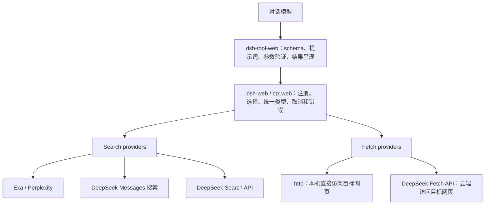
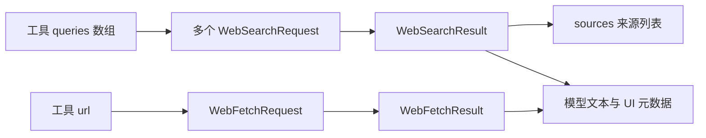
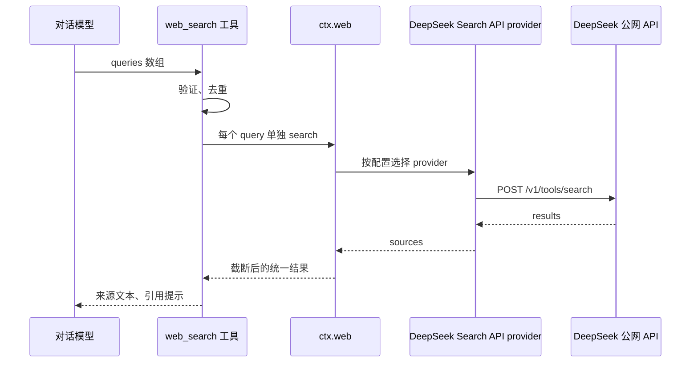

# DeepSeek Harness Web Search / Fetch 设计阅读报告

阅读日期：2026-10-18。依据官方 `deepseek-ai/deepseek-harness` 的 master 源码和包文档；master 会变化，本文没有锁定提交 SHA。

## 1. 范围与验证边界

回答“DeepSeek Harness 如何设计 Web Search 与 Fetch”：关注模型工具合同、WebRuntime、提供方选择、独立 DeepSeek API、直接 HTTP 抓取的区别。

本次没有检出或安装上游 Harness 的 workspace/native 构建依赖，没有启动 Harness，也没有发新的付费请求。采用源码静态跟踪与官方行为文档交叉核对；以下属于 **静态分析**，不宣称是 Harness 实测。工具链要求可查上游 [package.json](https://github.com/deepseek-ai/deepseek-harness/blob/master/package.json)。前面对 DeerFlow 的动态测试不能代替对 Harness 本身的验证。

## 2. 架构：工具、服务和提供方分工

模型只认识 `web_search`、`web_fetch`，后端注册的是能力，不重复注册模型工具。Search、Fetch 各自选择提供方：显式设置优先；没有设置时，仅在恰好一个可用提供方时自动选择，多家不明确时报歧义错误。选择不依赖注册顺序，不暗中换供应商。

工具启用与提供方可用性分开：工具已启用但凭证缺失或后端不可用时，名称仍保留，执行时返回结构化错误，避免工具 schema 随网络状态抖动。

依据：[服务层](https://github.com/deepseek-ai/deepseek-harness/blob/master/packages/web/web/README.md)、[工具层](https://github.com/deepseek-ai/deepseek-harness/blob/master/packages/web/tool-web/README.md)。

## 3. 核心数据结构

| 结构 | 主要字段 | 职责 |
| --- | --- | --- |
| WebSearchRequest | query、可选 maxResults | 单个后端搜索请求 |
| WebSearchResult | 可选 content、sources、truncated | 不绑定厂商的搜索结果 |
| WebSearchSource | url；可选 title/snippet/publishedAt | 可引用来源，不补造缺失元数据 |
| WebFetchRequest | url | 获取一个指定资源 |
| WebFetchResult | url、statusCode、body、truncated | 抓取结果与资源状态 |
| WebError | message、code | 可按代码处理的执行失败 |

依据：[类型定义](https://github.com/deepseek-ai/deepseek-harness/blob/master/packages/web/web/src/types.ts)。

## 4. Search 主线

模型传 `queries` 数组，默认允许 1～4 个非空查询。先检查数量，再按完全相同的字符串去重。多个查询并发执行，按排名轮流合并各查询的来源，按 URL 去重，最后限制总来源数，默认 8 条。

一个子查询失败会取消其余查询，等待已启动请求全部结束，再返回首个错误；它采用整批失败策略，不展示不完整的混合成功集。

结果同时保留模型可读的来源文本和 UI 可重放的结构化元数据，避免界面重新解析有损文本。提示词要求把外部内容视作数据、引用来源；只有 Fetch 同样可见时才建议进一步抓取。

依据：[search.ts](https://github.com/deepseek-ai/deepseek-harness/blob/master/packages/web/tool-web/src/search.ts)。

## 5. DeepSeek 搜索有两条后端路径

| 路径 | 实现 | 成本与结果特点 |
| --- | --- | --- |
| Messages 搜索 | dsh-web-search-deepseek，provider id 为 deepseek-official | 辅助模型回合携带服务端搜索工具，解析结构化搜索块；增加模型调用和 Token |
| 独立 Search API | dsh-web-deepseek-api，provider id 为 deepseek-search-api | 直接 POST /v1/tools/search，不为搜索额外启动模型回合 |

Messages 路径从 `web_search_tool_result` 等结构化块获取来源，不从模型自由文本里猜 URL；缺少搜索块报错。它有独立于对话模型的搜索 endpoint 配置。

独立 API 路径发送 query、count、need_content=false；可把触发搜索的真实用户问题整理并限制到 128 字符后发送为 ori_question。它将 title/url/**snippet**/date 映射为统一来源，不把 summary 当作默认片段。这与当前 DeerFlow 适配器优先使用 summary 的选择不同。

依据：[Messages 提供方](https://github.com/deepseek-ai/deepseek-harness/blob/master/packages/web/web-search-deepseek/README.md)、[独立 Search 源码](https://github.com/deepseek-ai/deepseek-harness/blob/master/packages/web/web-deepseek-api/src/search.ts)。

## 6. Fetch：两个不同的执行位置

### 6.1 本机直接 HTTP 抓取

`dsh-web-fetch-http` 直接连接目标网页，因此负责真实的目标安全边界：解析所有 IP、拒绝非公网地址、把连接固定到已验证的地址；每次允许的同源重定向重新检查。它匿名请求、不携带浏览器凭证，限制响应大小、文本长度、跳转次数和耗时。

默认传输正文上限为 5000000 字节、解码文本 100000 字符。仅处理受支持文本类型，PDF 文本解码不属于当前实现；网页 404 等非 2xx 可作为资源结果返回，不能与传输失败混为一谈。

依据：[HTTP 提供方](https://github.com/deepseek-ai/deepseek-harness/blob/master/packages/web/web-fetch-http/README.md)。

### 6.2 DeepSeek 云端 Fetch

`deepseek-fetch-api` 把 `{url}` 发到 `/v1/tools/fetch`，Harness 进程连接的是 DeepSeek API，不自行访问目标网页。已读的 Fetch provider 源码没有执行本地目标 DNS 检查。服务成功返回 Markdown 后，适配为 `body.kind=text`。

这个 API 不提供目标站真实 HTTP 状态和最终重定向 URL；Harness 将成功映射成请求 URL 与 statusCode=200。该值表示 API 成功获取可用内容，不能据此证明目标站没有重定向。API 自身 HTTP 错误由传输层变成 WebError；不能把 Fetch API 的 404 当成已知目标站 HTTP 404。

依据：[Fetch API provider](https://github.com/deepseek-ai/deepseek-harness/blob/master/packages/web/web-deepseek-api/src/fetch.ts)。

### 6.3 工具呈现

Fetch 工具的模型参数只有 URL；超时与输出预算由部署配置控制，默认工具预算 30 秒、完整输出上限 200000 字符。HTML 过滤脚本、嵌入及隐藏内容后转换成 Markdown，转换失败不直接退回原始 HTML；文本结果加外部不可信内容提示。传输正文上限与工具呈现上限是不同层的限制。

依据：[Fetch 工具](https://github.com/deepseek-ai/deepseek-harness/blob/master/packages/web/tool-web/src/fetch.ts)、[工具配置](https://github.com/deepseek-ai/deepseek-harness/blob/master/packages/web/tool-web/src/index.ts)。

## 7. 场景追踪与错误

以下为静态调用路径，不是执行日志：

- 多后端未选择：服务层报 WEB_PROVIDER_AMBIGUOUS，不按加载先后猜测。
- 云端 Fetch API 失败：传输层保留 API HTTP 错误及配置指引，作为 WebError 返回。
- 本地 HTTP 读取到目标 404：返回带状态的资源结果；安全拒绝、超时、不可表示的二进制才是对应执行错误。
- 取消信号沿工具、服务和提供方传递；API 请求禁止 HTTP 重定向。认证配置按操作获取，支持 Key 或受限账号认证，endpoint 由用户配置，不由模型自动更换。

依据：[服务实现](https://github.com/deepseek-ai/deepseek-harness/blob/master/packages/web/web/src/index.ts)、[API transport](https://github.com/deepseek-ai/deepseek-harness/blob/master/packages/web/web-deepseek-api/src/transport.ts)。

## 8. 黑盒与设计取舍

| 未展开部分 | 输入 / 输出 | 原因 |
| --- | --- | --- |
| DeepSeek 云端爬虫 | URL → Markdown / API 错误 | 不在 Harness 开源实现中，不能断言内部 DNS/反爬机制 |
| Exa、Perplexity 检索算法 | query → 来源/可选回答 | 不影响统一工具合同的理解 |
| 凭证服务、账号服务 | 凭证引用/endpoint → Key 或受限 token | 本文只核对传输调用边界，不审计账号生命周期 |
| 超时策略插件 | 工具预算 → 取消信号/超时错误 | 核对消费接口，未运行策略插件测试 |

可借鉴之处：稳定工具 schema、按操作选择提供方、结构化来源与展示分离、预算由部署控制、失败有代码。多查询整批失败更易解释，却可能丢弃已有有用结果；若设计可选部分成功，应明确标记失败查询，而不是默默混用。

我会改进或重点核验的地方：Fetch API 的真实状态/最终 URL 缺失应在展示中清晰区分，避免把归一化的 200 当成目标站观测值。另需验证工具层字符预算与 API 传输响应预算是否都能阻止极大响应。

对 DeerFlow 的对应：刚完成的修复统一了三家云端 Fetch 的无本地 DNS 校验路径；还没有实现 Harness 的多查询批处理、WebRuntime 注册选择、标准化状态/来源结果和可重放 UI 元数据，因此不能声称是等价移植。

## 9. 后续验证

若要迁移该设计，应固定上游提交，安装其声明的构建依赖，运行服务选择、多查询失败/取消、HTTP 地址固定和输出截断测试；再决定 DeerFlow 是否需要统一 Web 服务层。本次没有改动运行时代码，也没有复用临时密钥。
