# DeerFlow 源码与运行机制导读

## 一本面向当前企业分支的通俗源码电子书

版本：第二版教学增补版

适用分支：`codex/enterprise-consolidation-20260716`

本文不是 DeerFlow 的产品使用手册，而是一本“从用户输入一直读到源码、运行时、数据库和部署层”的系统导读。目标是让读者能够回答以下问题：

- 用户发送一句话后，系统到底经过了哪些模块？
- Thread、Run、ThreadState、Checkpoint、Store 和 StreamEvent 分别是什么？
- Lead Agent 是在哪里创建的？模型、工具、Skill 和 Middleware 如何装配？
- Agent 为什么会反复执行“模型调用 → 工具调用 → 工具结果 → 再次模型调用”？
- 沙箱、子 Agent、MCP、Skill、Memory、Artifact 和文件上传分别处在什么位置？
- 前端收到的流式事件如何变成消息、任务卡片、Todo 和文件预览？
- 如何定位一次运行失败、工具失败、模型失败、状态恢复失败或前端渲染错误？
- 如何在不破坏安全边界和 Harness/App 分层的前提下扩展 DeerFlow？

本文以当前工作区代码和当前分支的架构文档为准。当前工作区有未提交修改，因此阅读时应把本文视为“当前本地分支的源码地图”，而不是某个固定发布版本的 API 保证。

---

## 目录

0. [DeerFlow 依赖的基础专业知识库](#0-deerflow-依赖的基础专业知识库)
1. [如何阅读本书](#1-如何阅读本书)
2. [DeerFlow 的总体架构](#2-deerflow-的总体架构)
3. [八个核心对象：Thread、Run、State、Checkpoint、Store、Event、Sandbox、Middleware](#3-八个核心对象threadrunstatecheckpointstoreeventsandboxmiddleware)
4. [一条用户消息的完整生命周期](#4-一条用户消息的完整生命周期)
5. [Gateway、RunManager、run_agent 与 StreamBridge](#5-gatewayrunmanagerrun_agent-与-streambridge)
6. [LangGraph 图、AgentState、ThreadState 与 Checkpoint](#6-langgraph-图agentstatethreadstate-与-checkpoint)
7. [Lead Agent 的创建过程](#7-lead-agent-的创建过程)
8. [Middleware 链及执行顺序](#8-middleware-链及执行顺序)
9. [Tool 注册、工具调用和工具结果](#9-tool-注册工具调用和工具结果)
10. [Sandbox、本地执行与 Kubernetes Provisioner](#10-sandbox本地执行与-kubernetes-provisioner)
11. [Subagent 委派与并行任务](#11-subagent-委派与并行任务)
12. [Skill 系统与 MCP 系统](#12-skill-系统与-mcp-系统)
13. [Memory、摘要、标题、Goal 与 Token Budget](#13-memory摘要标题goal-与-token-budget)
14. [文件上传、Artifact、图片与文档处理](#14-文件上传artifact图片与文档处理)
15. [前端 Thread Hooks、SSE、消息渲染与缓存](#15-前端-thread-hookssse消息渲染与缓存)
16. [数据库、Redis、运行记录与恢复机制](#16-数据库redis运行记录与恢复机制)
17. [认证、权限、CSRF、平台保密与安全边界](#17-认证权限csrf平台保密与安全边界)
18. [WeKnora、调度任务与外部 Agent 等企业扩展](#18-weknora调度任务与外部-agent-等企业扩展)
19. [测试、调试、故障定位与源码阅读方法](#19-测试调试故障定位与源码阅读方法)
20. [扩展 DeerFlow 的正确方式](#20-扩展-deerflow-的正确方式)
21. [学习路线、练习题与源码索引](#21-学习路线练习题与源码索引)
22. [第二版：用一条真实任务揭露底层运行逻辑](#22-第二版用一条真实任务揭露底层运行逻辑)

---

## 0. DeerFlow 依赖的基础专业知识库

这一章专门补齐 DeerFlow 所依赖的基础知识。你不需要先成为 Python、分布式系统或大模型专家；但如果想真正读懂 DeerFlow 的底层逻辑，就需要建立一套共同语言。

每个知识点都按三个层次解释：

1. **通俗理解**：把概念翻译成人话。
2. **技术机制**：说明它在计算机里怎样工作。
3. **DeerFlow 中的用途**：指出它会在哪些模块里出现。

### 0.1 总体依赖地图

DeerFlow 不是只依赖一个框架，而是建立在多层基础之上：

```mermaid
flowchart TB
    Product["DeerFlow 产品能力"] --> Agent["Agent 编排"]
    Agent --> LangGraph["LangGraph\n有状态图执行"]
    Agent --> LangChain["LangChain\n消息、模型、工具抽象"]
    Agent --> LLM["大语言模型\nPrompt、Token、Tool Calling"]
    Product --> Backend["后端应用"]
    Backend --> Python["Python\n类型、异常、async"]
    Backend --> FastAPI["FastAPI\nHTTP、依赖注入、ASGI"]
    Backend --> DB["数据库\nSQL、事务、迁移"]
    Backend --> Redis["Redis\n队列、事件、缓存"]
    Product --> Frontend["前端应用"]
    Frontend --> Next["Next.js / React\n组件、Hooks、服务端渲染"]
    Frontend --> SSE["HTTP Streaming / SSE"]
    Product --> Infra["运行基础设施"]
    Infra --> Docker["Docker\n镜像、容器、网络、卷"]
    Infra --> K8s["Kubernetes\nPod、Service、Secret、调度"]
    Product --> Data["数据与知识"]
    Data --> Files["文件格式与解析"]
    Data --> RAG["Embedding、向量检索、RAG"]
    Product --> Security["安全基础"]
    Security --> Auth["认证、授权、CSRF"]
    Security --> Network["TLS、代理、SSRF、路径安全"]
```

可以把它理解成一栋楼：

```text
产品界面与企业功能        ← 用户看到的楼顶
Gateway 与前端状态         ← 应用层
Agent、工具、Middleware     ← 智能编排层
LangGraph / LangChain      ← Agent 执行框架层
Python / HTTP / 数据库      ← 软件基础层
Docker / Kubernetes / 网络  ← 运行基础设施层
操作系统、文件系统、进程    ← 地基
```

### 0.2 Python：模块、对象、异常和类型

#### 通俗理解

Python 程序就是一组可以互相调用的模块。对象是“带数据和行为的东西”；函数是“执行一件事的动作”；异常是“这件事没有按正常路径完成”。

#### DeerFlow 为什么大量使用类型和数据类

Agent 系统中有很多结构化数据：运行配置、消息、工具参数、State、事件、用户身份。若全部使用自由格式字典，很容易出现：

```python
config["model_name"]       # 可能不存在
config["model"]            # 可能和上面含义重复
config["recursion_limit"]  # 可能是字符串
```

类型模型和 Pydantic 可以把问题提前暴露：字段是否存在、值的类型是什么、默认值是什么、哪些字段允许传入。

#### DeerFlow 中的对应关系

- `TypedDict`：描述 ThreadState 中的轻量结构。
- Pydantic model：描述配置和 API 请求/响应。
- `BaseModel`：做配置校验、序列化和默认值处理。
- `BaseTool`：统一工具名称、参数 schema 和执行函数。
- `RunnableConfig`：承载 LangChain/LangGraph 运行配置。

#### 为什么 `NotRequired` 和 reducer 很重要

ThreadState 字段不一定一开始就存在。例如还没有使用 Sandbox 时，`sandbox` 可以为空；还没有生成 Artifact 时，`artifacts` 可能是空列表。`NotRequired` 表示“这个字段可以尚未写入”，而不是“这个字段永远不重要”。

### 0.3 Python async/await：为什么 DeerFlow 不能到处写同步代码

#### 通俗理解

同步程序像一个人排队办事：当前事情没办完，就不做下一件事。

异步程序像一个前台调度员：把等待网络、数据库、文件或子进程的工作交出去，在等待期间处理别的请求。

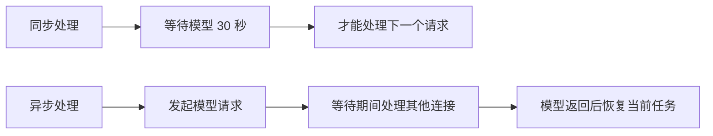

#### 事件循环是什么

事件循环是一个不断检查“哪些任务已经可以继续”的调度器：

```text
while True:
    找到已经完成 IO 的任务
    恢复这些任务执行
    找到新的 await 等待点
    把控制权交给其他任务
```

#### 什么是阻塞 IO

下面这些操作可能阻塞当前线程：

- `requests.get()`。
- 同步数据库查询。
- 大目录扫描。
- 同步读取大文件。
- 同步 Kubernetes client。
- PDFium/DocReader 解析。
- `subprocess.run()` 等待长命令。

如果它们在 Gateway 的事件循环里运行，其他用户的请求也可能一起卡住。

#### DeerFlow 中的处理方式

- 优先使用异步 HTTP/数据库客户端。
- 不能异步化的同步操作用 `asyncio.to_thread()` 移出事件循环。
- 解析器通过协调器串行化，而不是盲目增加线程。
- Provisioner 的同步 Kubernetes API 使用同步 FastAPI handler，让框架放入 worker thread。
- Blockbuster 测试门禁会捕获业务代码中的阻塞 IO。

#### 常见误解

`async def` 并不会自动让函数变快。函数内部如果直接调用阻塞库，它仍然会阻塞事件循环。`await` 只有在等待一个真正可让出控制权的异步操作时才有意义。

### 0.4 进程、线程、任务和并发

这四个词经常混淆：

| 概念 | 简单解释 | DeerFlow 中的例子 |
| --- | --- | --- |
| 进程 | 有独立内存空间的程序实例 | Gateway 进程、Frontend 进程、Provisioner 进程 |
| 线程 | 进程内部的执行单元 | `to_thread`、同步 K8s client、解析器 worker |
| asyncio Task | 事件循环管理的协作任务 | 一个 `run_agent` 后台任务 |
| 并发 | 多件事情交错进行 | 多个用户 Run、子 Agent、SSE 连接 |

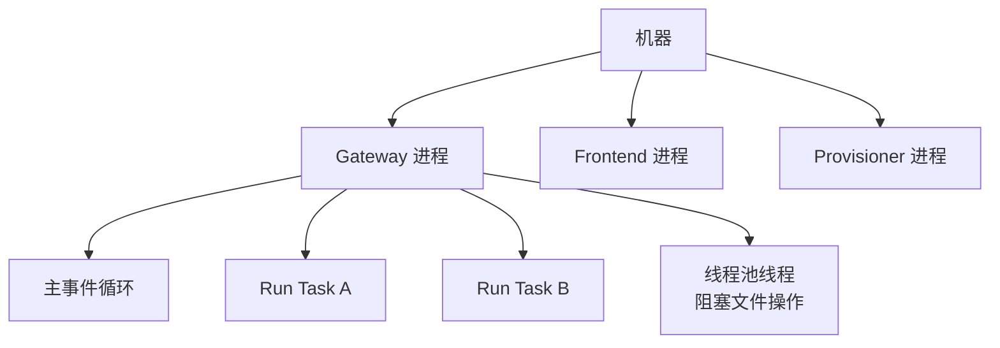

DeerFlow 中“多个 Run 同时存在”不等于“一个 Run 内所有工具都无条件并行”。并发会受到 Thread 冲突、子 Agent 限制、解析器线程安全、数据库连接池和 Sandbox 容量的约束。

### 0.5 HTTP：浏览器和 Gateway 如何沟通

#### 通俗理解

HTTP 是一种请求/响应协议。浏览器提出请求，服务器返回响应。请求通常包含：

```text
方法：GET / POST / PUT / DELETE
路径：/api/threads/123/runs/stream
Headers：认证、内容类型、CSRF、追踪 ID
Body：JSON、表单或文件
```

响应通常包含：

```text
状态码：200 / 400 / 401 / 403 / 404 / 409 / 500
Headers：内容类型、缓存、CSP、Set-Cookie
Body：JSON、文件、HTML 或事件流
```

#### DeerFlow 中的 HTTP 分层

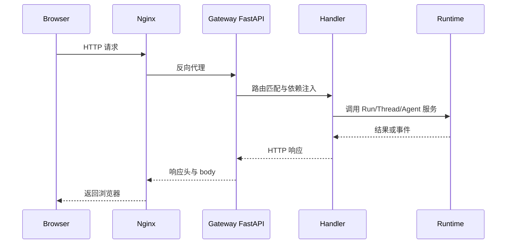

#### 状态码的系统含义

- `401`：没有完成认证。
- `403`：已经知道是谁，但没有权限或 CSRF 不通过。
- `404`：资源不存在，或为了避免信息泄露而隐藏不存在性。
- `409`：状态冲突，例如同一 Thread 已经有运行中的 Run。
- `422`：输入结构或字段校验失败。
- `500`：服务端没有正确处理异常。

### 0.6 ASGI、FastAPI 和依赖注入

#### ASGI 是什么

WSGI 适合传统同步 Web 应用；ASGI 支持异步、长连接、SSE 和 WebSocket。Gateway 需要在一个服务中同时处理普通 JSON API、文件上传、流式运行和后台任务，因此使用 ASGI/FastAPI。

#### FastAPI 路由的底层逻辑

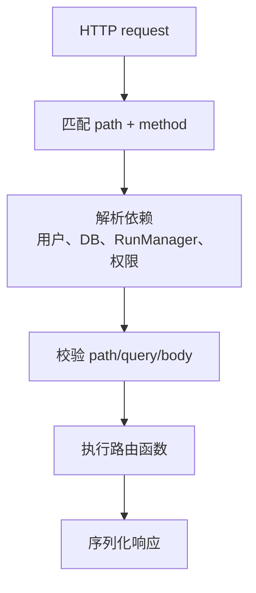

依赖注入的价值是：路由函数不需要自己寻找数据库连接、当前用户或运行管理器。测试时也可以替换依赖，降低耦合。

#### Gateway 启动生命周期

应用启动时通常需要：

- 加载配置。
- 初始化数据库和迁移。
- 创建 checkpointer/store。
- 创建 StreamBridge。
- 创建 RunManager。
- 初始化 MCP 工具缓存。
- 启动必要的后台服务。

应用关闭时需要：

- 停止接受新 Run。
- 等待或取消正在运行的任务。
- 关闭数据库连接。
- 关闭 Redis/HTTP 客户端。
- 回收 Sandbox 或释放资源。

### 0.7 JSON、序列化和反序列化

#### 通俗理解

Python 对象存在内存中，浏览器和数据库不认识 Python 对象，因此必须转换成 JSON 或其他可持久化格式。

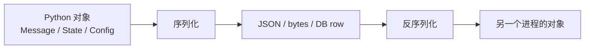

#### Agent 系统中的困难

消息可能包含：

- 字符串。
- 图片或文件引用。
- tool_calls。
- `artifact` 元数据。
- interrupt 信息。
- 模型供应商特定字段。

不能把 Python 对象的 `repr()` 当成稳定协议。DeerFlow 通过事件序列化、消息转换和 State schema 建立跨组件契约。

### 0.8 HTTP Streaming 与 SSE

#### 为什么普通 HTTP 响应不够

模型可能运行几十秒。如果等完整结果才返回，用户会看到长时间空白；如果每个 token 单独发一个普通响应，又不符合 HTTP 一次请求一次响应的模型。

HTTP streaming 允许服务器保持连接并持续发送数据。SSE 是其中一种约定：服务器发送带有事件格式的文本，浏览器持续接收。

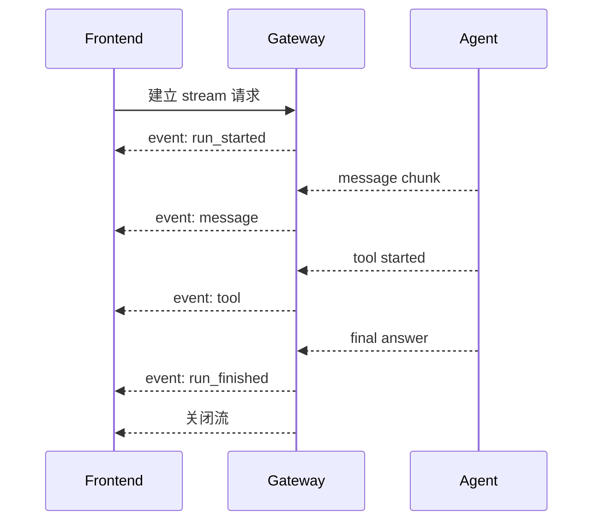

SSE 只负责传输，不负责永久保存。断线后必须依靠事件日志、checkpoint 和历史 API 重建状态。

### 0.9 React、Next.js 和前端状态

#### React 的基本思想

React 把页面拆成组件。组件根据 props 和 state 计算 UI：

```text
UI = render(props, state)
```

当 state 更新时，React 重新计算相关组件，而不是手动修改整个页面。

#### Hook 是什么

Hook 是把状态、生命周期和副作用封装起来的函数。DeerFlow 的 Thread hooks 将复杂的流式订阅、发送消息、缓存失效和当前 Thread 切换封装起来。

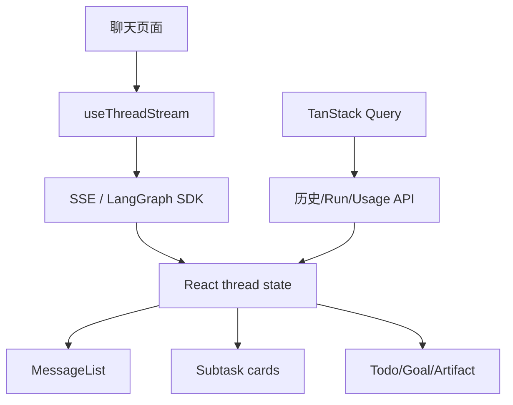

#### Next.js 的作用

Next.js 提供：

- App Router。
- Server Components 和 Client Components。
- 服务端 API route。
- 构建和部署。
- 静态资源和页面布局。

在当前分支中，浏览器交互使用 client hooks；敏感 token 相关的同源 server route 放在服务端，防止浏览器 JavaScript 直接读取平台 secret。

### 0.10 TypeScript：前端的结构化约束

TypeScript 通过类型描述前端能收到什么：

```ts
type RunStatus = "pending" | "running" | "success" | "error" | "cancelled";

type Artifact = {
  path: string;
  name: string;
  mimeType?: string;
};
```

这类类型并不等于运行时安全。服务器传来的 JSON 仍可能不符合预期，因此重要边界仍要在后端校验。前端类型主要帮助开发阶段减少错误和提高组件之间的契约清晰度。

### 0.11 LangChain：模型、消息和工具抽象

#### 通俗理解

不同模型供应商的 API 不同：OpenAI、Anthropic、Ollama、Volcengine 等参数和返回结构并不完全一样。LangChain 用统一抽象把它们包装成可调用的 chat model。

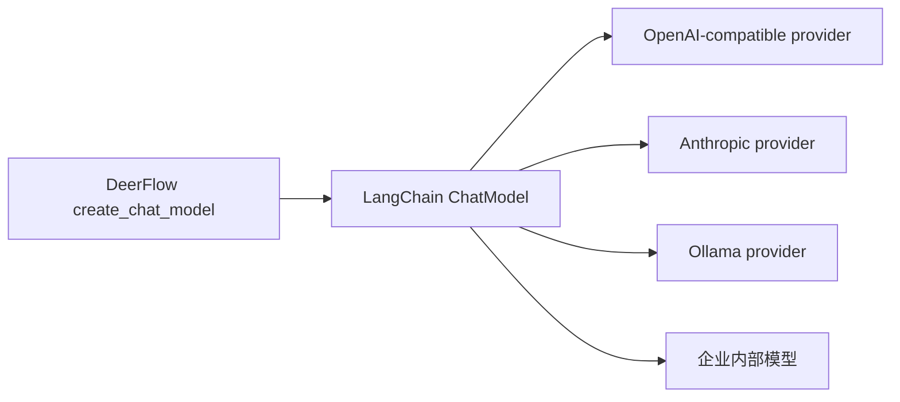

#### 主要抽象

- `HumanMessage`：用户消息。
- `AIMessage`：模型消息，可能含文本和 tool_calls。
- `ToolMessage`：工具返回给模型的结果。
- `BaseTool`：工具名称、参数 schema、同步/异步执行。
- `Runnable`：可组合、可调用的处理单元。
- `RunnableConfig`：调用时的配置、metadata、callbacks 和 configurable 数据。

### 0.12 LLM 的基本机制：Token、Prompt 和 Context Window

#### Token

模型并不是按汉字或单词直接计费，而是按 token 处理文本。中文、代码、JSON 和英文的 token 密度不同。输入历史越长，input token 越多；模型生成越长，output token 越多。

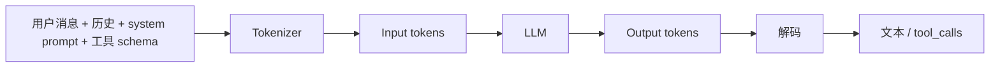

#### Context window

Context window 是一次模型调用能看到的最大 token 范围。它包括：

- system prompt。
- 历史 messages。
- 工具 schema。
- Skill 说明。
- 上传文件摘要或内容片段。
- 当前 ToolMessage。

摘要 Middleware、延迟工具发现和文件引用，都是为了控制 context window。

#### Temperature 和 reasoning

Temperature 影响采样随机性；thinking/reasoning 是供应商模型提供的额外推理能力。DeerFlow 的思考开关不是“让任何模型自动会思考”，而是根据模型配置把正确的参数传给支持该能力的 provider。

### 0.13 Tool Calling：模型如何请求程序执行动作

模型本身不能直接读取服务器文件，也不能直接执行命令。工具调用是一个协议：

```json
{
  "name": "bash",
  "arguments": {
    "command": "python analyze.py sales.xlsx"
  }
}
```

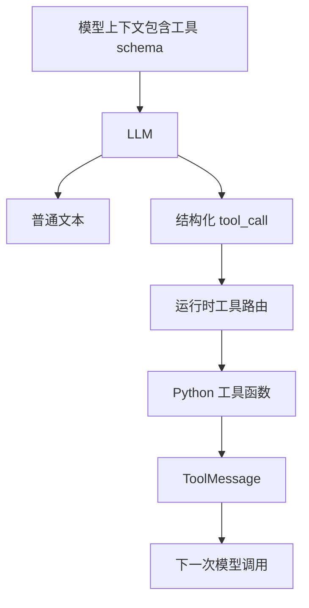

这里的关键是“模型提出请求，运行时决定是否执行”。模型的 tool_call 不是服务器已经执行的事实；只有经过工具路由、权限、参数和 Sandbox 检查后，才会产生真实副作用。

### 0.14 LangGraph：把 Agent 变成有状态的图

#### 为什么普通 while 循环不够

最简单的 Agent 可以写成：

```python
while True:
    response = model.invoke(messages)
    if not response.tool_calls:
        return response
    result = run_tools(response.tool_calls)
    messages.extend([response, result])
```

但真实系统还需要：

- 保存中间状态。
- 断点恢复。
- 人工中断和恢复。
- 并行分支。
- 子图和子 Agent。
- 事件流。
- 节点级 Middleware。
- 超步数保护。

LangGraph 将这些过程建模为图和状态：

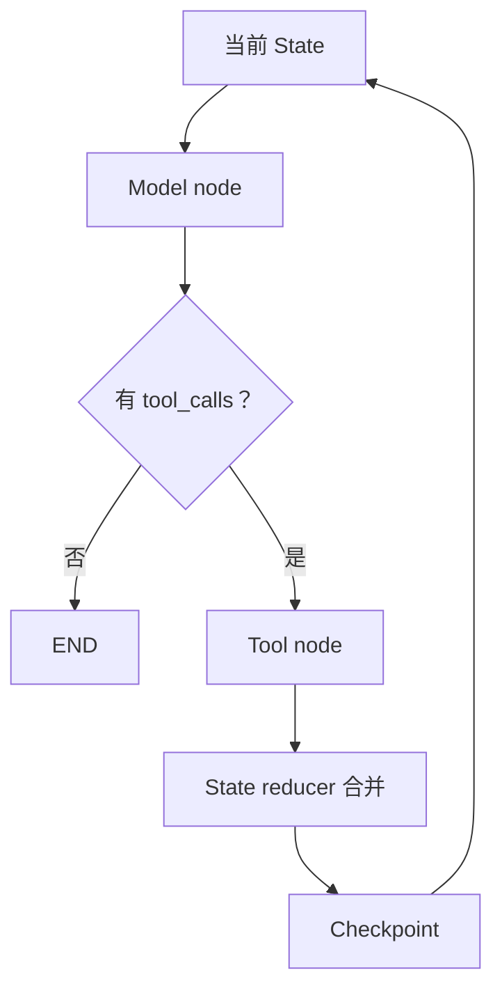

#### super-step 与 recursion limit

图每推进一轮，就可能产生新的节点执行和 State 更新。`recursion_limit` 用来阻止图无限推进；它不是 token 上限，也不是并发数上限。

### 0.15 AgentState、ThreadState 和 reducer

AgentState 是 Agent 框架需要的基础状态；ThreadState 是 DeerFlow 在其上扩展的业务状态。

```text
AgentState
├── messages
└── Agent 基础字段

ThreadState
├── AgentState 的字段
├── sandbox
├── thread_data
├── artifacts
├── todos
├── goal
├── delegations
└── skill_context
```

Reducer 就像“这个字段的合并规则”：

- 普通数字可以相加。
- 列表可以追加。
- 字典可以合并。
- Todo 可能需要整体替换。
- Sandbox ID 冲突必须报错。

### 0.16 数据库基础：表、主键、外键和索引

#### 通俗理解

数据库是一个能可靠保存结构化数据的系统。表像电子表格，但它能提供约束、查询、并发和事务。

DeerFlow 典型数据关系可以抽象成：

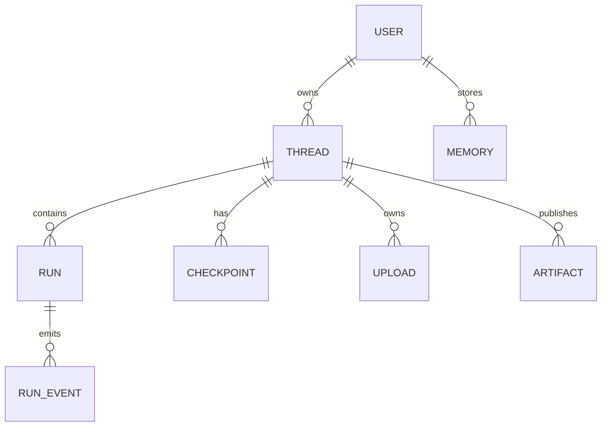

#### 主键和外键

- 主键：唯一标识一行，例如 `thread_id`、`run_id`。
- 外键：表达关联，例如 Run 属于哪个 Thread。
- 索引：让查询更快，例如按 user_id、thread_id、created_at 查找。

#### 事务

事务把多次数据库操作组成一个整体：要么全部成功，要么全部回滚。Run 创建时，Thread 元数据、Run 记录和关联信息之间需要保持一致，否则会出现“有 Run 没有 Thread”或“页面看不到已创建 Run”的问题。

### 0.17 数据库基础：SQLite、PostgreSQL、迁移

| 项目 | SQLite | PostgreSQL |
| --- | --- | --- |
| 部署 | 单文件，简单 | 独立数据库服务 |
| 并发写入 | 较弱 | 更强 |
| 适合 | 本地开发、轻量部署 | 多用户、生产、多副本 |
| 扩展能力 | 有限 | 丰富 |
| DeerFlow 用途 | 本地 checkpoint/store/元数据 | 企业生产持久化 |

数据库 schema 不能只靠“手动改表”。迁移工具记录从旧结构到新结构的演进，这样不同环境可以按相同顺序升级。

### 0.18 Redis：为什么它适合事件和队列

Redis 是内存优先的键值数据库，也提供 list、stream、pub/sub、sorted set 等结构。它擅长低延迟的临时状态、队列和事件分发，但不能在所有场景替代关系数据库。

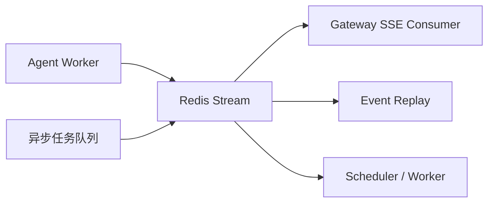

Redis Stream 的消息通常需要 ID 和消费位置；这和 DeerFlow 的 `seq`、事件重放和断线恢复思路相吻合。

### 0.19 事件驱动系统：生产者、消费者和最终一致性

事件驱动系统不是“某个函数直接调用另一个函数”，而是：

```text
生产者发布事件
  → 事件通道保存/转发
  → 一个或多个消费者读取
  → 消费者更新自己的状态
```

DeerFlow 的 Agent 事件消费者可能有：

- 浏览器 SSE。
- Run event store。
- 子任务步骤聚合器。
- 使用量统计器。
- 审计和监控系统。

因此事件处理要考虑重复、乱序、断线、消费失败和幂等。

### 0.20 Docker：镜像、容器、网络和卷

#### 通俗理解

镜像是应用及其依赖的打包模板；容器是镜像的运行实例；卷是容器之外的持久文件；网络让多个容器互相找到对方。

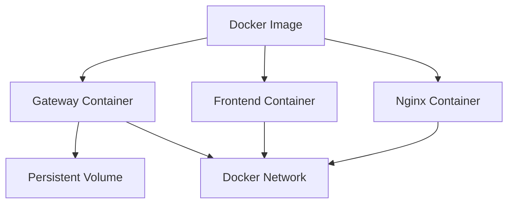

容器删除后，容器内部文件可能消失；数据库、配置和用户生成 Artifact 若需要保留，就必须使用卷或外部存储。

### 0.21 Kubernetes：Pod、Deployment、Service、Secret

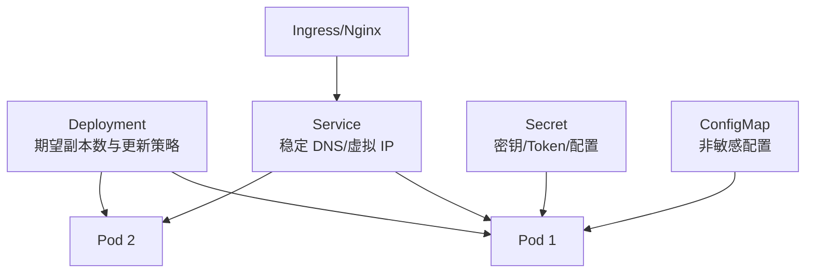

- Pod：一组共同调度的容器。
- Deployment：声明希望有多少 Pod，以及如何滚动更新。
- Service：给变化中的 Pod 提供稳定服务名。
- Secret：保存敏感配置。
- ConfigMap：保存非敏感配置。
- PVC：申请持久化存储。

DeerFlow 的 Provisioner 会动态创建 Sandbox Pod，因此必须理解 Pod 生命周期、健康检查、Secret 注入、Service DNS、资源限制和回收。

### 0.22 Kubernetes 网络和服务发现

Pod IP 会变化，不能把它当永久地址。Service 提供稳定的 DNS 名称，例如某个 Gateway、WeKnora 或 adapter Service。企业部署中尤其不能把 ClusterIP 硬编码进配置，因为重建集群后 ClusterIP 可能改变。

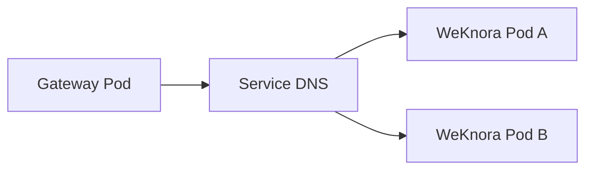

### 0.23 TLS、CA、代理与证书验证

#### TLS 解决什么问题

TLS 同时提供：

- 加密：别人看不到传输内容。
- 身份验证：客户端确认访问的确实是目标服务。
- 完整性：内容在传输中没有被修改。

证书验证依赖信任链：服务端证书由 CA 签发，客户端必须信任这个 CA。

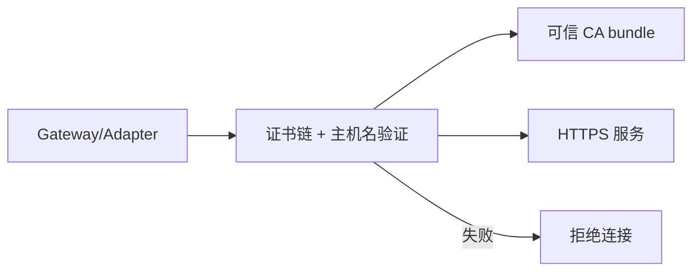

`verify=false` 不是正确修复，它关闭了身份验证。正确做法是把受信任 CA 以 Secret/挂载方式提供，并在必要时仅对特定客户端设置兼容 TLS 参数。

代理还会改变请求路径：有些外部 HTTPS 请求必须经过代理，有些内部 Service、模型主机或 SSO 端点必须进入 `NO_PROXY`。错误的代理配置常表现为 302、502、超时或连接重置。

### 0.24 SSRF、路径穿越和命令注入

这是 Agent 系统必须掌握的三类风险。

#### SSRF

服务器被诱导访问攻击者指定的内部地址，例如云 metadata、数据库、Kubernetes API。解决办法是严格 allowlist 精确主机，而不是允许整个私网。

#### 路径穿越

用户输入 `../../secret`，试图跳出允许目录。正确流程是：

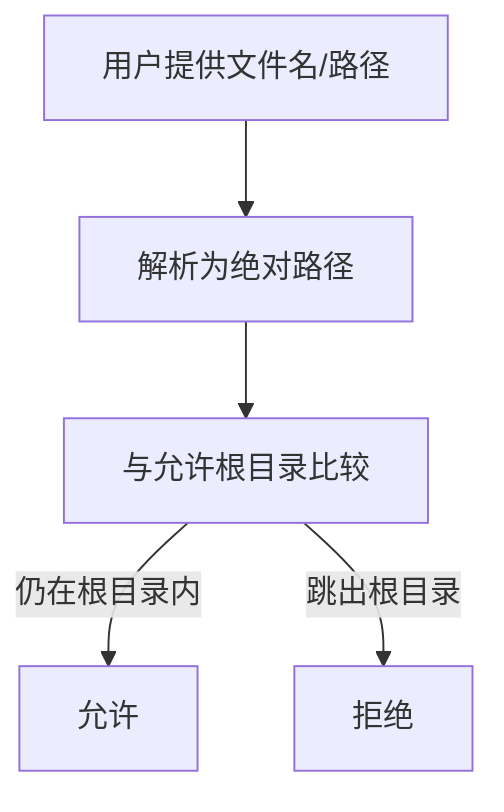

#### 命令注入

把用户字符串直接拼进 shell 命令可能让用户执行额外命令。应使用参数化调用、受控命令集合、Shell 审计和 Sandbox 隔离。

### 0.25 认证、授权、Cookie、CSRF

#### 认证与授权

认证回答“你是谁”；授权回答“你能做什么”。

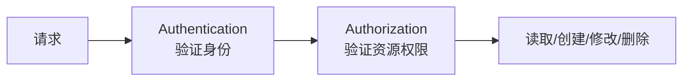

#### Cookie 与 HttpOnly

HttpOnly cookie 可以让浏览器自动携带身份，但禁止普通 JavaScript 读取。适合保存平台 Token 或登录会话；服务端 route 可以读取它并执行受控动作。

#### CSRF

如果攻击者诱导浏览器自动向你的站点发送带 cookie 的修改请求，就可能发生 CSRF。CSRF token、SameSite cookie、Origin/Referer 检查和服务端授权共同降低风险。

### 0.26 文件格式与文档解析

不同文件不是“换一个扩展名就一样”：

| 格式 | 主要结构 | 常见处理难点 |
| --- | --- | --- |
| CSV | 文本表格 | 编码、分隔符、引号、超大文件 |
| XLSX | ZIP + XML | 公式、图表、隐藏 sheet、图片 |
| PDF | 页面、文本、对象、图片 | 扫描、字体、矢量图、阅读顺序 |
| DOCX | ZIP + XML | 文本、表格、图片、样式 |
| PPTX | ZIP + XML | 幻灯片、布局、图表、媒体 |

解析通常分为：

```mermaid
flowchart LR
    File["原始文件"] --> Detect["文件类型与内容检测"]
    Detect --> Native["原生解析器"]
    Detect --> Visual["渲染为图片/PDF"]
    Native --> Merge["文本、表格、图片、布局合并"]
    Visual --> Merge
    Merge --> Markdown["Markdown / 结构化内容"]
    Markdown --> Agent["Agent / WeKnora"]
```

“能被浏览器打开”不代表“解析器可以安全完整地读取”。PDFium、Office converter、OCR 和 MinerU 可能有不同的失败模式，因此适配器需要独立回退路径和资源限制。

### 0.27 Embedding、向量检索与 RAG

#### Embedding 是什么

Embedding 把文本转换成向量，让语义相近的文本在向量空间里更接近：

```text
“退款如何办理” → [0.12, -0.83, ...]
“退货流程是什么” → [0.10, -0.79, ...]
```

#### RAG 的基本流程

```mermaid
flowchart TD
    Doc["文档"] --> Split["切块"]
    Split --> Embed["Embedding 模型"]
    Embed --> Index["向量索引"]
    Query["用户问题"] --> QEmbed["问题向量"]
    QEmbed --> Search["相似度检索"]
    Index --> Search
    Search --> Context["相关片段"]
    Context --> Prompt["拼入模型上下文"]
    Query --> Prompt
    Prompt --> LLM["生成答案"]
```

#### RAG 的难点

- 文档切块太大，检索不精确。
- 切块太小，语义不完整。
- 向量维度和索引模型不匹配。
- 用户没有权限的文档被检索出来。
- 只给模型片段，没有来源引用。
- 文档更新后索引没有重建。

在 DeerFlow/WeKnora 中，知识库 scope 是安全条件，不只是搜索过滤条件。检索工具必须让 Gateway/WeKnora 同时验证用户权限和知识库范围。

### 0.28 MCP：外部工具的标准化连接

MCP 可以理解成“外部工具服务器的通用插座”。DeerFlow 负责：

- 连接 MCP server。
- 获取工具定义。
- 缓存工具。
- 将工具转换成 LangChain `BaseTool`。
- 应用名称去重、权限和 Skill policy。
- 处理连接失败和超时。

```mermaid
flowchart LR
    MCPServer["MCP Server"] --> Protocol["MCP Protocol"]
    Protocol --> DeerMCP["DeerFlow MCP Client"]
    DeerMCP --> Cache["工具缓存"]
    Cache --> Agent["Agent tool catalog"]
```

MCP 标准化的是连接和工具描述，不会自动解决权限、数据泄露、超时和远程服务可信度问题。

### 0.29 Cron 与调度系统

定时任务的基础概念是：

- 任务定义：做什么。
- 调度表达式：什么时候做。
- 执行记录：实际何时开始、结果怎样。
- 幂等性：重复触发是否会造成错误副作用。
- 重试策略：失败后是否再执行。

```mermaid
flowchart LR
    Task["Task row\nprompt + schedule + run_context"] --> Scheduler["Scheduler"]
    Scheduler --> Due{"到执行时间？"}
    Due -->|否| Wait["等待"]
    Due -->|是| Launch["内部认证启动 Run"]
    Launch --> Agent["正常 Agent 生命周期"]
    Agent --> Result["Run outcome"]
    Result --> Audit["任务运行记录"]
    Wait --> Scheduler
```

调度任务不能假设用户在线，也不能调用需要即时澄清的工具；因此非交互模式必须是服务端可信上下文，而不是客户端提交一个布尔值就能开启。

### 0.30 可观测性：日志、指标、Trace 和事件

#### 四种东西的区别

| 类型 | 回答的问题 |
| --- | --- |
| 日志 | 发生了什么？ |
| 指标 | 发生了多少次、耗时多少？ |
| Trace | 一次请求跨过哪些服务和节点？ |
| 事件 | 运行过程有哪些可消费变化？ |

```mermaid
flowchart TD
    Request["一次 Run"] --> Log["结构化日志"]
    Request --> Metric["耗时、tokens、错误率"]
    Request --> Trace["Gateway → Agent → Tool → Model"]
    Request --> Events["前端/任务/审计事件"]
```

追踪 ID 可以把浏览器请求、Gateway 日志、Agent 运行和模型调用关联起来。日志必须脱敏，不能为了方便排查把完整 API key、cookie 或用户文件内容打出来。

### 0.31 测试基础：从纯函数到完整系统

```mermaid
flowchart TB
    Pure["纯逻辑单元测试\nreducer、路径、配置"] --> Harness["Harness 测试\nAgent、工具、Middleware"]
    Harness --> GatewayTest["Gateway 测试\n路由、认证、上传、Run"]
    GatewayTest --> RuntimeTest["Runtime 测试\nstream、cancel、resume"]
    RuntimeTest --> E2E["端到端测试\n浏览器到后端"]
    E2E --> Deploy["部署回归\nDocker/K8s/企业服务"]
```

测试的原则是：越靠近底层，越快、越确定；越靠近完整系统，越能发现集成问题但越慢、越脆弱。DeerFlow 这类系统需要各层都测，不能只测最终页面。

### 0.32 这些基础知识如何组合成 DeerFlow

最后把基础知识收束成一次运行：

```mermaid
sequenceDiagram
    participant U as 用户
    participant FE as Next.js/React
    participant HTTP as HTTP/SSE
    participant API as FastAPI Gateway
    participant RT as Async Runtime
    participant LG as LangGraph
    participant LC as LangChain Model/Tool
    participant DB as DB/Redis
    participant SB as Sandbox

    U->>FE: 输入任务并上传文件
    FE->>HTTP: JSON + stream 请求
    HTTP->>API: 认证、CSRF、路由
    API->>DB: 创建 RunRecord
    API->>RT: 创建 asyncio Task
    RT->>DB: 读取 checkpoint/store
    RT->>LG: 执行 State graph
    LG->>LC: 调用 chat model
    LC-->>LG: AIMessage/tool_call
    LG->>SB: 受控执行工具
    SB-->>LG: ToolMessage/State update
    LG->>DB: checkpoint/event
    LG-->>RT: stream event
    RT-->>HTTP: SSE
    HTTP-->>FE: 实时更新
    FE-->>U: 消息、任务、Artifact
```

掌握这张图，就可以把后续任何新模块放回正确的位置：它是协议、状态、执行、持久化、展示还是安全边界的一部分？

### 0.33 理论层总图：从模型到超级 Agent 平台

在进入具体理论之前，先看这些概念的上下级关系：

```mermaid
flowchart TB
    LLM["LLM\n概率性的语言/多模态预测器"] --> Agent["Agent\n根据目标和状态选择下一步"]
    Tool["Tool\n可执行的外部能力"] --> Agent
    Skill["Skill\n任务知识、流程和约束"] --> Agent
    Memory["Memory\n跨步骤/跨会话信息"] --> Agent
    Agent --> Harness["Harness\n把模型、工具、状态、安全、运行时组织起来"]
    Harness --> SuperAgent["Super Agent\n可委派、可恢复、可扩展的 Agent 系统"]
    Middleware["Middleware\n横切策略与生命周期控制"] --> Harness
    Sandbox["Sandbox\n外部副作用隔离"] --> Harness
    Persistence["Checkpoint/Store/Event\n状态、长期数据、过程记录"] --> Harness
    Gateway["Gateway/UI/Channels\n应用入口和用户界面"] --> SuperAgent
```

一个简单的理解顺序是：

```text
LLM 负责“生成可能的下一步”
Agent 负责“根据目标选择并执行下一步”
Tool 负责“把下一步变成真实动作”
Skill 负责“告诉 Agent 某类任务应该怎么做”
Memory 负责“让 Agent 记住相关背景”
Harness 负责“把所有东西装配成可靠运行系统”
```

### 0.34 Harness 理论：为什么需要一个 Harness

#### 0.34.1 Harness 是什么

Harness 这个词原意是“马具”或“安全带”。在软件系统中，它表示一层负责把能力接起来、约束起来、观察起来的运行框架。

先看一张极简图：

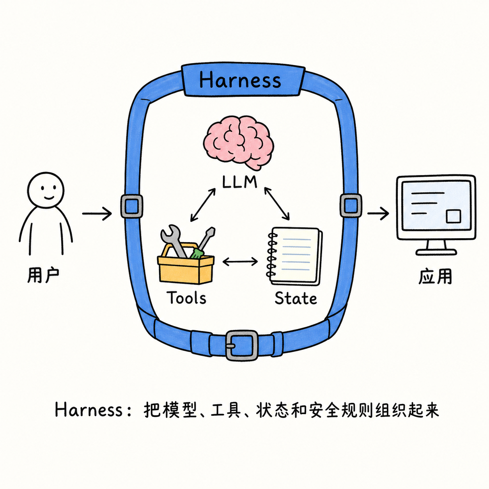

图中只保留四个关系：LLM 负责产生思路，Tools 负责执行动作，State 负责记录过程，Harness 把它们组织在安全边界内，并把用户请求连接到应用。Harness 自己不是“大脑”，也不是某一个工具；它是让这些能力能够一起可靠运行的框架。

对大模型系统而言，Harness 通常负责：

- 创建和配置模型。
- 组织消息和上下文。
- 注册工具。
- 维护 Agent State。
- 执行模型—工具循环。
- 管理 Middleware。
- 保存 checkpoint 和长期数据。
- 发布事件。
- 处理取消、恢复、重试和错误。
- 施加权限、预算和安全策略。

因此 Harness 不等于“调用模型的 SDK”：

```mermaid
flowchart LR
    SDK["Model SDK\n只解决如何调用某个模型"] --> Model["LLM API"]
    Harness["Harness\n解决如何让模型可靠地完成任务"] --> Model
    Harness --> Tools["Tools"]
    Harness --> State["State"]
    Harness --> Policy["Policy"]
    Harness --> Runtime["Runtime"]
    Harness --> Persistence["Persistence"]
```

#### 0.34.2 SDK、Framework、Harness、Application 的区别

| 层 | 主要问题 | DeerFlow 中的对应物 |
| --- | --- | --- |
| SDK | 如何调用一个服务 | 模型 provider SDK、数据库 client |
| Framework | 如何按统一方式组织某类程序 | LangChain、LangGraph |
| Harness | 如何把多个能力组成可控的运行系统 | `deerflow-harness` |
| Application | 具体产品怎样给用户使用 | Gateway、Frontend、Channels、WeKnora 页面 |

LangGraph 可以提供图执行机制，但它不知道 DeerFlow 的上传目录、平台用户、企业审计、Skill policy、外部 Agent launch 或具体前端消息协议。Harness 正是把通用框架和具体可靠运行要求连接起来的地方。

#### 0.34.3 Harness 的核心设计：控制反转

普通程序通常是业务函数主动调用库：

```python
result = my_function()
```

Harness 则更像一个运行平台：业务能力注册进去，Harness 在正确的生命周期调用它：

```mermaid
flowchart TD
    Register["注册模型、工具、Middleware、State"] --> Harness["Harness Runtime"]
    Harness --> Before["before hook"]
    Harness --> Model["模型调用"]
    Harness --> Tool["工具调用"]
    Harness --> After["after hook"]
    Harness --> Persist["保存状态/事件"]
```

这叫控制反转：不是每个工具都自己处理日志、用户、取消、checkpoint 和错误，而是由 Harness 提供统一生命周期，工具只实现自己的业务能力。

#### 0.34.4 Harness 的四个边界

一个成熟 Harness 通常有四条边界：

1. **能力边界**：模型能调用哪些工具。
2. **状态边界**：哪些数据属于当前 Thread，哪些属于长期 Store。
3. **执行边界**：代码和文件在哪个 Sandbox 中运行。
4. **信任边界**：哪些字段来自可信服务器，哪些只是客户端请求。

DeerFlow 的 Harness/App 分层，就是把“可复用 Agent 执行能力”和“某个产品的 HTTP、用户、企业集成”分开。

#### 0.34.5 为什么 Harness 不能依赖 App

如果 Harness 反向导入 `app.*`，它就只能在 DeerFlow Gateway 中运行，不能被：

- Python Client 使用。
- LangGraph Studio 使用。
- 其他宿主应用嵌入。
- 单元测试独立运行。
- 未来的不同 Gateway 或 Channel 复用。

因此依赖方向是：

```text
Application → Harness → LangGraph/LangChain → Provider/OS
```

而不是：

```text
Harness ↔ Application 互相调用
```

### 0.35 大模型理论：LLM 到底在做什么

#### 0.35.1 LLM 的最简定义

大语言模型可以先理解为一个概率预测器：

> 给定已经看到的 token，预测下一个 token 的概率分布。

```text
输入：请分析这个文件
模型预测下一个 token：我 / 首先 / 可以 / 需要 ...
选择一个 token 后，把它加入上下文
继续预测下一个 token
```

从数学上看，它近似计算：

```text
P(token_n | token_1, token_2, ..., token_{n-1})
```

模型没有天然的“数据库事实意识”或“真实世界执行能力”。它通过训练学到语言和模式，再根据当前上下文生成最可能的延续。

#### 0.35.2 Transformer 的直觉

现代 LLM 大多建立在 Transformer 结构之上。无需先掌握全部矩阵运算，可以先理解三件事：

- Tokenizer：把文本切成模型能处理的 token。
- Embedding：把 token 映射成向量。
- Attention：让当前位置关注上下文中与它相关的其他位置。

```mermaid
flowchart LR
    Text["文本"] --> Tokenizer["Tokenizer"]
    Tokenizer --> Vectors["Token vectors"]
    Vectors --> Attention["Self-attention\n决定关注哪些上下文"]
    Attention --> Layers["多层 Transformer"]
    Layers --> Logits["下一个 token 的分数"]
    Logits --> Sample["采样/选择"]
    Sample --> Output["输出 token"]
```

Attention 让模型能够把“这个文件”与更早的 `sales.xlsx` 联系起来，把“它”与前文的地区汇总联系起来。但这仍然是上下文内的模式计算，不是传统数据库查询。

#### 0.35.3 Logits、采样和 temperature

模型最后会给每个候选 token 一个分数，称为 logits。运行时可以：

- 直接选概率最高的 token。
- 按概率随机采样。
- 使用 temperature 调整概率分布的尖锐程度。
- 使用 top-k/top-p 限制候选范围。

temperature 较低通常更稳定，较高通常更多样，但不会让模型自动获得事实或工具权限。

#### 0.35.4 Prompt 是输入程序，不是普通字符串

在 Agent 系统中，模型输入通常包含多个角色：

```mermaid
flowchart TD
    System["System prompt\n最高层行为约束"] --> Context["模型上下文"]
    Developer["Developer/Agent policy"] --> Context
    User["Human message"] --> Context
    ToolSchema["Tool schemas"] --> Context
    ToolHistory["AI/Tool messages"] --> Context
    Skill["Skill instructions"] --> Context
    Context --> LLM["模型输出"]
```

DeerFlow 的 `apply_prompt_template` 不是简单拼接一段欢迎词，而是在模型调用前构造当前 Agent 的工作环境：语言、工具规则、Skill、子 Agent、知识范围、非交互模式和安全要求都可能进入上下文。

#### 0.35.5 LLM 不等于 Agent

LLM 的核心动作是生成输出；Agent 还需要：

- 目标。
- 当前状态。
- 可用动作。
- 执行循环。
- 观察工具结果。
- 终止条件。
- 错误和安全策略。

```mermaid
flowchart LR
    LLM["LLM\n产生文本/结构化意图"] --> AgentLoop["Agent Loop\n解释、执行、观察、再调用"]
    AgentLoop --> State["State"]
    AgentLoop --> Tools["Tools"]
    AgentLoop --> Stop["终止条件"]
```

### 0.36 Agent 理论：一个会行动的有状态决策系统

#### 0.36.1 Agent 的定义

可以把 Agent 抽象成：

```text
Agent = Goal + State + Policy + Actions + Observation + Loop + Termination
```

其中：

- Goal：要完成什么任务。
- State：目前知道什么、做到了哪一步。
- Policy：下一步如何选择。
- Actions：可以执行哪些工具或动作。
- Observation：工具执行后看到了什么。
- Loop：是否继续思考和行动。
- Termination：什么时候结束。

#### 0.36.2 Agent 的基本闭环

```mermaid
flowchart TD
    Goal["目标 Goal"] --> Perceive["读取 State/上下文"]
    Perceive --> Decide["模型/策略决定下一步"]
    Decide --> Action["执行 Action/Tool"]
    Action --> Observe["获得 Observation/ToolMessage"]
    Observe --> Update["更新 State"]
    Update --> Stop{"达到终止条件？"}
    Stop -->|否| Perceive
    Stop -->|是| Answer["最终答案/终态"]
```

DeerFlow 的模型调用—工具调用循环就是这个闭环的工程化实现。

#### 0.36.3 ReAct、计划型 Agent 和委派型 Agent

常见 Agent 方式包括：

| 类型 | 核心思路 | DeerFlow 里的对应机制 |
| --- | --- | --- |
| ReAct | 思考/行动/观察循环 | 模型与工具循环 |
| Plan-and-Execute | 先规划，再逐项执行 | Todo/plan mode |
| Hierarchical Agent | 主 Agent 委派子 Agent | `task` 与 subagent registry |
| Tool-using Agent | 重点是调用外部能力 | 工具集合、MCP、Sandbox |
| RAG Agent | 先检索，再回答 | WeKnora/知识库工具 |

真实 DeerFlow 通常是混合型：Lead Agent 负责规划和综合，Middleware 负责保护，Subagent 负责拆分，Tool 负责执行，Memory 和 RAG 负责提供背景。

#### 0.36.4 Agent 与传统工作流的区别

传统工作流通常是：

```text
A → B → C → D
```

Agent 工作流允许根据中间观察动态选择：

```mermaid
flowchart TD
    Start["开始"] --> A["分析任务"]
    A --> B{"根据结果选择"}
    B --> C["调用文件工具"]
    B --> D["调用搜索工具"]
    B --> E["请求用户澄清"]
    C --> F["再次判断"]
    D --> F
    E --> F
    F --> G{"完成？"}
    G -->|否| A
    G -->|是| End["结束"]
```

灵活性更高，也意味着更难预测、更需要预算、循环检测、权限和可观察性。

### 0.37 Tool 理论：工具不是函数，而是有副作用的能力契约

#### 0.37.1 Tool 的定义

一个完整 Tool 可以抽象为：

```text
Tool = Name + Description + Input Schema + Executor + Runtime Context + Result Contract + Error Contract + Policy
```

一个普通函数只关心参数和返回值；Agent 工具还要说明：

- 模型什么时候应该使用它。
- 参数必须符合什么 schema。
- 它会读什么、写什么、调用什么外部系统。
- 是否需要用户确认。
- 是否可以重试。
- 错误如何返回。
- 是否需要当前用户和 Thread。

#### 0.37.2 Tool 的三层结构

```mermaid
flowchart TB
    Schema["模型可见层\n名称、描述、参数 schema"] --> Router["运行时路由层\n查找、校验、授权、注入上下文"]
    Router --> Executor["执行层\nPython、HTTP、Sandbox、MCP"]
    Executor --> Result["结果层\nToolMessage、State update、Event"]
```

模型看到的是 schema，不是 Python 实现。它只能提出结构化请求；Router 决定是否允许执行；Executor 才产生真实副作用。

#### 0.37.3 Tool 的前置条件与后置条件

好的 Tool 需要明确：

```text
前置条件：用户有权限、文件存在、Sandbox 可用
执行动作：读取/写入/调用外部服务
后置条件：生成文件、写入 State、返回可理解结果
失败条件：权限拒绝、超时、参数错误、外部服务错误
```

这使 Tool 能被 Middleware 和测试验证，而不是成为一个“黑盒函数”。

#### 0.37.4 幂等性和副作用

如果模型因网络重试再次调用工具，结果会怎样？

- 查询工具通常天然幂等。
- 创建订单、发送邮件、删除文件不是天然幂等。
- 生成报告可以使用固定 Artifact 名称或 Run ID 去重。
- 状态更新可以使用事件 ID 去重。

```mermaid
flowchart LR
    Retry["同一个 tool_call 重试"] --> Query["只读查询\n结果基本不变"]
    Retry --> Create["创建副作用\n可能重复创建"]
    Create --> Idempotency["幂等键/去重/确认"]
```

### 0.38 Skill 理论：可发现、可加载的任务知识包

#### 0.38.1 Skill 是什么

Skill 不是单纯的提示词，也不是一个普通 Tool。它更像一个可加载的任务知识包：

```text
Skill = 触发条件 + 领域知识 + 操作流程 + 工具建议 + 验证步骤 + 安全限制 + 资源/脚本
```

例如“创建演示文稿”的 Skill 可能规定：

- 先确认主题和受众。
- 先列大纲再生成页面。
- 每页保持一个核心结论。
- 用 LibreOffice 生成 preview PDF。
- 生成后检查每页布局。

#### 0.38.2 Skill、Tool、Prompt 的边界

| 概念 | 解决的问题 | 是否直接产生副作用 |
| --- | --- | --- |
| Prompt | 当前一次调用如何表达要求 | 通常不直接产生 |
| Skill | 某类任务长期可复用的知识和流程 | 通过工具间接产生 |
| Tool | 执行一个明确动作 | 经常会产生 |
| Agent | 根据目标动态选择动作 | 通过 Tool 产生 |

```mermaid
flowchart TD
    Skill["Skill\n告诉 Agent 怎么做"] --> Prompt["当前上下文中的操作规则"]
    Prompt --> Agent["Agent 决定步骤"]
    Agent --> Tool["Tool 执行动作"]
    Tool --> Result["结果与反馈"]
    Result --> Agent
```

#### 0.38.3 Skill 为什么需要发现和激活两个阶段

如果每次都把所有 Skill 全文放进 system prompt：

- 上下文会变大。
- 不相关知识会干扰模型。
- 工具权限可能被误扩大。
- 更新 Skill 后旧上下文难以管理。

因此更合理的是：

```mermaid
flowchart LR
    Catalog["Skill catalog\n名称/描述/路径"] --> Discover["发现相关 Skill"]
    Discover --> Policy["检查允许范围"]
    Policy --> Activate["读取 Skill.md"]
    Activate --> Context["放入当前 Agent context"]
```

`skill_context` 只保存轻量引用，完整 Skill 内容按需要读取；这也是延迟加载和可审计的基础。

#### 0.38.4 Skill 的风险

Skill 的文字会影响模型行为，因此可能包含：

- 过度授予工具权限的建议。
- 诱导泄露 secret 的指令。
- 与系统策略冲突的“忽略前面规则”。
- 不安全的命令。
- 过时的文件路径或部署假设。

Skill review、allowed-tools、沙箱和平台保密 Middleware 共同构成防线。

### 0.39 Agent、Tool、Skill、Harness 的组合关系

```mermaid
flowchart TB
    UserGoal["用户目标"] --> Harness["Harness 提供运行环境"]
    Harness --> Agent["Agent 负责动态决策"]
    Skill["Skill 提供方法论/流程"] --> Agent
    Memory["Memory 提供历史背景"] --> Agent
    Agent --> Tool["Tool 提供动作能力"]
    Tool --> Sandbox["Sandbox 隔离外部副作用"]
    Tool --> External["MCP/外部服务"]
    Tool --> State["更新 State"]
    State --> Agent
    Harness --> Policy["权限、预算、事件、恢复"]
    Policy --> Agent
```

用一个具体问题区分它们：

> “请分析 Excel 并生成 PPT”

- LLM：生成“我需要先读取文件”的语言或 tool_call。
- Agent：决定先读 Excel，再分析，再生成 PPT。
- Skill：告诉它怎样设计报告、怎样验证 PPT。
- Tool：真正读取 Excel、运行 Python、生成 PPT。
- Sandbox：隔离这些命令和文件操作。
- Harness：控制整个过程的状态、事件、恢复、权限和预算。

### 0.40 Middleware 理论：横切关注点的统一插槽

#### 0.40.1 什么是横切关注点

日志、权限、错误处理、重试、计时、预算和 tracing 会影响很多业务动作，却不应该被复制到每个 Tool 和每个 Agent 节点里。这类功能叫横切关注点。

```mermaid
flowchart LR
    Business["模型/工具业务逻辑"] --> Cross["横切关注点"]
    Cross --> Logging["日志"]
    Cross --> Auth["权限"]
    Cross --> Errors["错误"]
    Cross --> Budget["预算"]
    Cross --> Trace["Trace"]
```

#### 0.40.2 Middleware 和装饰器的区别

装饰器通常包住一个函数；Agent Middleware 可以感知更丰富的生命周期：

- 一次 Agent 开始前。
- 模型调用前后。
- 某个工具调用前后。
- 每个 State 更新后。
- 整个 Run 结束时。

```mermaid
flowchart TD
    RunStart["Run start"] --> BeforeAgent["before_agent"]
    BeforeAgent --> BeforeModel["before_model"]
    BeforeModel --> Model["LLM"]
    Model --> BeforeTool{"是否有 tool_call？"}
    BeforeTool -->|是| BeforeToolHook["before_tool"]
    BeforeToolHook --> Tool["Tool"]
    Tool --> AfterTool["after_tool"]
    AfterTool --> BeforeModel
    BeforeTool -->|否| AfterModel["after_model"]
    AfterModel --> AfterAgent["after_agent"]
    AfterAgent --> RunEnd["Run end"]
```

#### 0.40.3 为什么 Middleware 顺序会改变语义

如果先做摘要再做 token 计算，token 统计可能只统计压缩后的上下文；如果先做权限过滤再做工具 schema，模型看不到被禁止工具；如果先执行工具再做错误转换，异常可能直接打穿图。

Middleware 的顺序本质上是一个策略管线：

```text
准备资源 → 过滤能力 → 压缩上下文 → 调用模型 → 执行工具 → 清洗结果 → 统计/持久化
```

### 0.41 Memory 理论：工作记忆、情节记忆、语义记忆和程序记忆

人类记忆的分类可以帮助理解 Agent Memory：

| 类型 | 含义 | DeerFlow 对应思路 |
| --- | --- | --- |
| 工作记忆 | 当前正在处理的内容 | 当前 messages/ThreadState |
| 情节记忆 | 过去发生过什么 | 运行历史、事件、会话记录 |
| 语义记忆 | 稳定事实和偏好 | Store/长期 Memory |
| 程序记忆 | 怎样做一类任务 | Skill、Agent 配置 |

```mermaid
flowchart TD
    Current["当前任务"] --> Working["工作记忆\nmessages + state"]
    History["过去运行"] --> Episodic["情节记忆"]
    Facts["稳定偏好/事实"] --> Semantic["语义记忆"]
    Procedures["工作流程/方法"] --> Procedural["程序记忆\nSkill"]
    Working --> Answer["当前决策"]
    Episodic --> Working
    Semantic --> Working
    Procedural --> Working
```

长期记忆不能成为无条件的最高优先级指令；它应该作为背景，仍然受到当前用户请求、系统策略和权限约束。

### 0.42 规划理论：计划、执行、反思和终止

复杂 Agent 通常包含四种认知动作：

1. 规划：把目标拆成步骤。
2. 执行：调用工具完成步骤。
3. 观察：读取工具结果。
4. 反思：判断是否需要修正方案。

```mermaid
flowchart TD
    Goal["目标"] --> Plan["计划/分解"]
    Plan --> Execute["执行工具"]
    Execute --> Observe["观察结果"]
    Observe --> Evaluate["评估是否达到目标"]
    Evaluate -->|未达到| Replan["调整计划"]
    Replan --> Execute
    Evaluate -->|达到| Finish["结束"]
```

Todo Middleware 不是“好看的清单”，它可以让计划显式存在于 State 中，帮助模型和前端共享进度；但 Todo 本身不是事实证明，最终仍需工具结果和验证步骤。

### 0.43 Agent 可靠性理论：概率能力外面必须有确定性边界

LLM 输出具有概率性，不能把它当作普通业务函数。因此可靠 Agent 必须形成“概率内核 + 确定外壳”：

```mermaid
flowchart TB
    LLM["概率性 LLM"] --> Intent["生成意图/计划/tool_call"]
    Intent --> Schema["确定性 schema 校验"]
    Schema --> Auth["确定性权限检查"]
    Auth --> Budget["确定性预算/递归检查"]
    Budget --> Sandbox["确定性执行边界"]
    Sandbox --> Result["确定性结果与事件契约"]
    Result --> LLM
```

确定性外壳包括：

- 参数 schema。
- 工具 allowlist。
- 用户和 Thread 授权。
- 路径和命令检查。
- token budget。
- recursion limit。
- loop detection。
- checkpoint 和 event seq。
- 终态规则。

### 0.44 Super Agent 理论：为什么 DeerFlow 不只是一个 Agent

Super Agent 通常意味着：一个 Lead Agent 可以协调多个专用 Agent、工具、知识库和执行环境。

```mermaid
flowchart TD
    Lead["Lead Agent\n理解目标、规划、综合"] --> Research["研究 Subagent"]
    Lead --> Code["代码/Bash Subagent"]
    Lead --> Data["数据分析 Subagent"]
    Lead --> Knowledge["知识库检索 Agent"]
    Research --> Summary["结果摘要"]
    Code --> Summary
    Data --> Summary
    Knowledge --> Summary
    Summary --> Lead
    Lead --> Final["统一答案/Artifact"]
```

Super Agent 的难点不是“多调用几个模型”，而是：

- 怎样分配任务。
- 怎样限制并发和递归。
- 怎样传递上下文而不爆炸。
- 怎样合并子任务结果。
- 怎样处理一个子任务失败而其他任务成功。
- 怎样让前端显示每个子任务。
- 怎样避免子 Agent 无限创建孙 Agent。

### 0.45 文件和工具的理论：Agent 是如何接触真实世界的

LLM 本身只能处理上下文；文件和外部系统属于模型之外的世界。Tool 和 Sandbox 是“上下文世界”和“外部世界”之间的适配层：

```mermaid
flowchart LR
    Context["模型上下文"] --> Intent["意图"]
    Intent --> Tool["Tool adapter"]
    Tool --> World["文件系统/数据库/网络/模型服务"]
    World --> Observation["结果/观察"]
    Observation --> Tool
    Tool --> Context
```

这条边界解释了为什么工具结果必须：

- 可序列化。
- 可审计。
- 可限制大小。
- 可脱敏。
- 可区分成功和失败。
- 可与对应的 tool_call 关联。

### 0.46 理论对照表：遇到新功能应该放在哪一层

| 新需求 | 首先考虑的理论对象 | 典型实现位置 |
| --- | --- | --- |
| 增加一个外部动作 | Tool / capability | `tools/`、MCP |
| 增加一种任务流程 | Skill / procedural memory | `skills/` |
| 改变所有模型调用前的行为 | Middleware | `agents/middlewares/` |
| 支持新的模型供应商 | Model adapter | `models/`、配置 |
| 支持新的执行环境 | Sandbox provider | `sandbox/`、Provisioner |
| 让多个 Agent 协作 | Super Agent / delegation | `subagents/` |
| 保存跨会话事实 | Memory / Store | `memory/`、`runtime/store/` |
| 让浏览器实时看到状态 | Event / Stream | `runtime/stream_bridge/`、前端 hooks |
| 增加企业用户入口 | Application / Gateway | `app/gateway/`、Frontend |
| 限制危险行为 | Policy / security boundary | Gateway、Middleware、Sandbox |

### 0.47 一张图总结所有理论关系

```mermaid
flowchart TB
    Goal["用户目标"] --> Harness["Harness\n生命周期、状态、策略、事件、恢复"]
    Harness --> Agent["Agent\n目标驱动的决策闭环"]
    LLM["LLM\n概率性 token 预测"] --> Agent
    Skill["Skill\n流程/知识/方法"] --> Agent
    Memory["Memory\n背景/历史/偏好"] --> Agent
    Agent --> Tool["Tool\n结构化外部能力"]
    Tool --> Sandbox["Sandbox\n副作用隔离"]
    Tool --> MCP["MCP\n远程工具协议"]
    Tool --> Observation["ToolMessage/Observation"]
    Observation --> Agent
    Agent --> State["State reducer"]
    State --> Checkpoint["Checkpoint\n可恢复工作状态"]
    State --> Store["Store\n跨 Thread 长期数据"]
    Agent --> Events["StreamEvent\n实时过程"]
    Events --> UI["Frontend/Channels"]
    Policy["确定性安全外壳\n权限、预算、递归、审计"] --> Harness
```

如果以后看到一个陌生模块，可以先问：它是在帮助模型“理解”、帮助 Agent“决策”、帮助 Tool“行动”、帮助 Harness“控制”，还是帮助应用“展示”？这个问题通常能迅速找到它应该所在的层。

### 0.48 论文与行业思想地图：不要只学“怎么写”，还要知道“为什么这样写”

理论学习的正确方式不是把论文当作 DeerFlow 的实现说明，而是建立三层关系：

```mermaid
flowchart LR
    Paper["论文/行业观点\n提出问题与原理"] --> Pattern["架构模式\nReAct、RAG、Memory、Multi-Agent"]
    Pattern --> Deer["DeerFlow 实现\nGraph、Middleware、Tool、Store、Sandbox"]
    Deer --> Eval["实验/测试/运行数据\n验证是否真的有效"]
    Eval --> Improve["改进提示、工具、状态或策略"]
    Improve --> Deer
```

下面的书目按“它解释什么”和“在 DeerFlow 中哪里能看到”组织。

#### 0.48.1 Transformer：大模型为什么能理解上下文

**论文**：Vaswani 等，《Attention Is All You Need》，2017。

核心观点是 Transformer 用 self-attention 处理序列中不同位置之间的关系，并且比传统循环结构更容易并行训练。[原始论文](https://arxiv.org/abs/1706.03762)

通俗地说，模型阅读一句话时，不是只盯着相邻的字，而是在每个位置判断“上下文里哪些部分与我最相关”。这为长文本建模、代码理解、工具 schema 理解和多轮消息关联提供了基础。

DeerFlow 的映射：

- `create_chat_model` 连接的是已经训练好的 Transformer 类模型。
- system prompt、历史消息、Skill 和工具 schema 都会进入模型上下文。
- 摘要、延迟工具和文件引用是在上下文窗口有限时做的工程管理。

重要边界：Transformer 的注意力能处理上下文关系，不等于它自动拥有外部数据库、实时事实或文件执行能力。那些能力需要 RAG、Tool 和 Sandbox。

#### 0.48.2 Scaling 与 Few-shot：为什么同一个模型可以完成很多任务

**论文**：Brown 等，《Language Models are Few-Shot Learners》，2020。

该工作展示了扩大自回归语言模型规模后，模型可以通过自然语言指令和少量示例完成多种任务，而不一定需要为每个任务单独训练模型。[原始论文](https://arxiv.org/abs/2005.14165)

它对 Agent 系统的启发是：

- 一个模型可以承担多个任务。
- 任务差异可以通过 system prompt、examples、Skill 和 Tool schema 表达。
- 模型本身仍然有边界，不能把 few-shot 能力误解成可靠的业务逻辑。

DeerFlow 的动态模型配置、Agent prompt、Skill 发现和工具绑定，都是“一个通用模型在不同上下文中承担不同角色”的工程化延伸。

#### 0.48.3 InstructGPT：能力不等于服从和对齐

**论文**：Ouyang 等，《Training language models to follow instructions with human feedback》，2022。

核心观点是，模型规模变大并不自动意味着更好地遵循用户意图；通过示范数据和人类反馈训练，可以提升有用性、真实性和安全性。[原始论文](https://arxiv.org/abs/2203.02155)

这为 DeerFlow 的很多“模型之外的约束”提供了理论背景：

- system prompt 约束行为。
- Tool schema 约束动作格式。
- Middleware 约束安全和错误。
- Gateway 约束身份和权限。
- Sandbox 约束外部副作用。

一个重要结论是：不要期待模型自己解决所有安全问题。对齐训练有帮助，但生产系统仍需要确定性的权限、审计、预算和执行边界。

#### 0.48.4 Chain-of-Thought：中间推理为什么可能有帮助

**论文**：Wei 等，《Chain-of-Thought Prompting Elicits Reasoning in Large Language Models》，2022。[原始论文](https://arxiv.org/abs/2201.11903)

论文展示了在提示中提供中间推理示例，能够改善某些复杂推理任务。对 DeerFlow 的正确理解不是“把所有隐藏思维都显示给用户”，而是：

- 复杂任务可能需要中间状态。
- 计划、Todo、工具结果和验证步骤可以成为显式工作轨迹。
- 可审计的外部步骤比不可验证的内部文字更重要。

因此 DeerFlow 的 Todo、子任务步骤、ToolMessage 和运行事件，是“让任务过程可观察”的工程机制，但它们不等同于模型内部真实推理过程。

#### 0.48.5 ReAct：Agent 为什么要交替思考和行动

**论文**：Yao 等，《ReAct: Synergizing Reasoning and Acting in Language Models》，2022/2023。[原始论文](https://arxiv.org/abs/2210.03629)

ReAct 的核心思想是让语言模型在推理和行动之间交替：推理帮助规划和处理异常，行动帮助模型从外部环境获得信息。

```mermaid
flowchart LR
    Thought["根据目标和上下文形成下一步判断"] --> Action["调用搜索/文件/计算工具"]
    Action --> Observation["获得外部观察结果"]
    Observation --> Thought
    Thought --> Finish["判断是否结束"]
```

DeerFlow 的直接对应关系是：

```text
AIMessage + tool_calls → Tool 执行 → ToolMessage → 下一次模型调用
```

ReAct 也解释了为什么工具结果必须回到模型上下文：没有 Observation，模型只能凭空继续猜。

#### 0.48.6 Toolformer：模型如何学会什么时候调用工具

**论文**：Schick 等，《Toolformer: Language Models Can Teach Themselves to Use Tools》，2023。[原始论文](https://arxiv.org/abs/2302.04761)

论文研究模型如何学习选择工具、决定调用时机、组织参数以及将工具结果纳入后续预测。DeerFlow 当前主要是运行时工具使用，而不是训练 Toolformer 模型，但该论文帮助理解三个设计点：

- 工具描述要让模型知道“什么时候值得调用”。
- 参数 schema 影响模型能否正确提出调用。
- 工具结果必须以清晰的结构回到上下文。

这也是工具名称、工具描述、schema、错误消息和 ToolMessage 设计不能随意写的原因。

#### 0.48.7 RAG：为什么模型需要显式的非参数记忆

**论文**：Lewis 等，《Retrieval-Augmented Generation for Knowledge-Intensive NLP Tasks》，2020。[原始论文](https://arxiv.org/abs/2005.11401)

RAG 将模型参数中的知识与外部可检索的非参数记忆结合，改善知识密集任务中的事实性、可更新性和来源追踪。

```mermaid
flowchart TD
    Documents["企业文档"] --> RetrieverIndex["切块 + Embedding + 索引"]
    Question["用户问题"] --> Retriever["检索器"]
    RetrieverIndex --> Retriever
    Retriever --> Evidence["相关证据"]
    Evidence --> Prompt["受限上下文"]
    Question --> Prompt
    Prompt --> LLM["LLM 生成回答"]
```

DeerFlow/WeKnora 的知识库能力应理解为 RAG 系统：文档解析和切块决定可检索单元，Embedding 决定语义空间，知识库 scope 决定用户能检索哪些内容，引用 Middleware 帮助回答保留来源。权限过滤必须在检索服务端执行，不能只依赖 prompt 告诉模型“不要看别人的数据”。

#### 0.48.8 Reflexion：反馈不一定要立即更新模型参数

**论文**：Shinn 等，《Reflexion: Language Agents with Verbal Reinforcement Learning》，2023。[原始论文](https://arxiv.org/abs/2303.11366)

Reflexion 提出通过语言形式的反馈和反思记忆改进后续决策，而不必每次都重新训练模型。

```mermaid
flowchart TD
    Try["尝试完成任务"] --> Feedback["测试/用户/环境反馈"]
    Feedback --> Reflection["生成反思记录"]
    Reflection --> Episodic["短期情节记忆"]
    Episodic --> NextTry["下一次尝试读取"]
    NextTry --> Try
```

DeerFlow 中可以把类似思想映射到：工具失败结果反馈给模型、LoopDetection 识别重复轨迹、Memory Middleware 保存适合长期使用的经验、子任务结果记录失败原因和 `stop_reason`。错误日志、反思文本和长期用户记忆不是一回事，能否进入 Memory 必须经过筛选和权限控制。

#### 0.48.9 Generative Agents：观察、规划、反思和记忆如何组合

**论文**：Park 等，《Generative Agents: Interactive Simulacra of Human Behavior》，2023。[原始论文](https://arxiv.org/abs/2304.03442)

该工作提出了由观察、记忆检索、规划和反思组成的 Agent 架构，并展示了记忆和反思对长期行为的重要作用。

```mermaid
flowchart LR
    Observe["观察事件/环境"] --> Memory["记忆存储与检索"]
    Memory --> Plan["规划下一步"]
    Plan --> Act["行动"]
    Act --> Observe
    Observe --> Reflect["周期性反思"]
    Reflect --> Memory
```

DeerFlow 不等于论文中的社会模拟系统，但它提供了理解长期 Agent 的通用框架：当前 messages 是工作记忆，事件和历史是情节材料，Store 是长期记忆，Goal/Todo 是规划状态，Tool 是行动接口。

#### 0.48.10 MemGPT：上下文窗口可以像分层内存一样管理

**论文**：Packer 等，《MemGPT: Towards LLMs as Operating Systems》，2023。[原始论文](https://arxiv.org/abs/2310.08560)

MemGPT 借鉴操作系统的分层内存思想，把有限的快速上下文和更大的慢速外部记忆结合，并用中断管理模型与用户之间的控制流。

```mermaid
flowchart TB
    L1["快速层\n当前模型上下文"] <--> L2["中速层\n摘要/近期历史"]
    L2 <--> L3["慢速层\nStore/文档/长期记忆"]
    Interrupt["用户输入/工具结果/中断"] --> L1
```

DeerFlow 中的 summary_text、history API、Store/Memory、interrupt/resume、文件和知识库引用，都可以用“分层内存”来理解。这也解释了为什么把所有历史消息全部拼进 prompt 不是可靠的长期方案。

#### 0.48.11 Self-Refine：先生成再验证和改进

**论文**：Madaan 等，《Self-Refine: Iterative Refinement with Self-Feedback》，2023。[原始论文](https://arxiv.org/abs/2303.17651)

Self-Refine 研究让同一个模型生成初稿、提供反馈、再迭代改写，不需要额外训练。

DeerFlow 中的工程映射可以是：

```text
生成文件/答案
  → 工具或渲染器检查
  → 错误/质量反馈
  → Agent 修正
  → 再次检查
```

例如 PPT 生成后用 LibreOffice 转 PDF，再通过页面检查发现布局错误，Agent 才有机会修正。反馈最好来自确定性工具或用户，而不是让模型无依据地自我宣布“看起来很好”。

#### 0.48.12 Anthropic 的 Agent 工程观点：简单、可组合、工具优先

Anthropic 的工程文章《Building effective agents》强调，很多成功的 Agent 系统使用简单、可组合的模式，而不是不必要的复杂框架，并讨论了单 Agent、工作流、多 Agent、上下文管理和工具设计。[行业工程材料](https://www.anthropic.com/engineering/building-effective-agents)

它对 DeerFlow 的启发包括：

- 先判断任务是否真的需要 Agent，而不是所有问题都使用长循环。
- 工具设计往往比单纯增加 prompt 更重要。
- 上下文工程决定模型能否有效工作。
- 多 Agent 要有明确分工和结果契约。
- 并行需要考虑协调成本，不是越多越好。

Anthropic 关于多 Agent Research 系统的工程分享也强调并行探索、协调、工具设计和评测的重要性。[多 Agent 工程材料](https://www.anthropic.com/engineering/multi-agent-research-system)

DeerFlow 的 Lead Agent、Subagent Registry、delegations ledger、StreamBridge 和子任务事件，正好可以用这些观点来理解：多 Agent 的难点在协调和可观测性，而不是简单地创建更多模型实例。

#### 0.48.13 行业观点如何转成 DeerFlow 的设计检查表

```mermaid
flowchart TD
    Principle["论文/行业原则"] --> Question["对 DeerFlow 提出设计问题"]
    Question --> Code["找到代码实现"]
    Code --> Test["找到测试/事件/指标"]
    Test --> Gap{"是否有缺口？"}
    Gap -->|有| Improve["补充边界、测试或文档"]
    Gap -->|无| Document["记录实现与原理的对应关系"]
```

| 理论观点 | 设计问题 | DeerFlow 检查位置 |
| --- | --- | --- |
| ReAct | 工具结果是否回到模型上下文？ | ToolMessage、Runtime Worker |
| RAG | 检索是否带权限和来源？ | WeKnora scope/citation |
| MemGPT | 长上下文是否分层管理？ | summary、Store、history |
| Reflexion | 失败是否产生可用反馈？ | ToolError、loop detection、Memory |
| Toolformer | 工具 schema 是否清晰？ | `get_available_tools`、tool policy |
| Self-Refine | 结果是否有验证和迭代？ | Artifact preview、解析器、测试 |
| 多 Agent 研究 | 并行任务是否可协调和回放？ | Subagent executor、delegations、events |
| InstructGPT | 模型是否只是一个能力组件？ | Gateway auth、Middleware、Sandbox |
| Transformer | 上下文为何会影响输出？ | prompt、history、summary、token budget |

#### 0.48.14 论文结论与 DeerFlow 实现不能直接画等号

阅读论文时必须保留三种距离：

1. **研究问题距离**：论文可能只验证一个受控 benchmark，DeerFlow 面向真实用户和企业安全。
2. **实现距离**：论文中的 Agent 可能是 prompt + API，而 DeerFlow 还有 Gateway、数据库、前端和 Sandbox。
3. **证据距离**：论文结果说明一种方法在实验中有效，不等于当前配置在所有业务上都可靠。

因此每一篇论文都应该在书里写成：

```text
论文提出了什么问题？
论文的核心机制是什么？
论文在哪些条件下有效？
DeerFlow 借鉴了哪部分？
DeerFlow 没有直接采用哪部分？
我们用什么测试或事件验证实现？
```

---

## 1. 如何阅读本书

DeerFlow 同时拥有产品层、应用层、Agent 框架层、运行时层、基础设施层和企业集成层。如果从文件树的第一个文件开始读，容易在实现细节中迷失。更有效的方式是同时使用三种视角。

### 1.1 用户视角

用户只看到：输入框、消息、工具进度、子任务卡片、文件、Artifact、停止按钮和历史记录。

### 1.2 运行时视角

运行时关心：一次 Run 如何启动、如何流式输出、如何取消、如何保存 checkpoint、如何恢复、如何记录 token 和错误。

### 1.3 Agent 视角

Agent 关心：当前有哪些消息、能使用哪些工具、系统提示词是什么、是否允许委派子 Agent、是否需要摘要、是否遇到循环或预算上限。

三个视角对应三类代码：

| 视角 | 主要代码区域 | 关注点 |
| --- | --- | --- |
| 产品/HTTP | `backend/app/gateway/`、`frontend/src/` | 请求、权限、展示、API |
| Runtime | `backend/packages/harness/deerflow/runtime/` | Run、事件、流、恢复、持久化 |
| Agent | `backend/packages/harness/deerflow/agents/`、`tools/`、`sandbox/` | 模型、状态、工具、Middleware |

### 1.4 第一条阅读原则：先区分“持久数据”和“流式数据”

消息正在生成时，前端看到的是流式事件；运行结束后，数据库和 checkpoint 才是权威来源。流式事件是“过程”，checkpoint 和持久化记录是“结果及恢复依据”。

### 1.5 第二条阅读原则：先区分“配置”和“状态”

模型名称、是否思考、是否启用子 Agent 属于运行配置；消息、Todo、Artifact、sandbox_id 属于 ThreadState；Run 状态、耗时和错误属于运行记录。它们不能混为一谈。

### 1.6 本书贯穿案例：分析一份销售 Excel 并生成报告

为了让后面的概念前后连起来，本书反复使用一个具体任务：

> 用户上传 `sales.xlsx`，要求 DeerFlow 计算各地区销售额、画一张图，并生成 `sales-report.pptx`。

这句话看起来只是一个聊天问题，但系统实际要完成很多次转换：

```mermaid
flowchart TD
    U["用户语言\n分析 sales.xlsx 并生成报告"] --> HTTP["HTTP 请求\nthread_id + input + uploads + context"]
    HTTP --> Run["RunRecord\n一次执行的身份"]
    Run --> GraphInput["LangGraph 输入\nHumanMessage + 配置"]
    GraphInput --> State1["ThreadState\nmessages + uploaded_files"]
    State1 --> Model1["模型判断\n需要读取文件"]
    Model1 --> Tool1["Sandbox 工具\n读取/运行 Python"]
    Tool1 --> State2["ThreadState 更新\n工具消息 + artifacts/todos"]
    State2 --> Model2["模型判断\n需要生成 PPT"]
    Model2 --> Tool2["脚本/演示文稿工具"]
    Tool2 --> Artifact["Artifact\nsales-report.pptx + preview.pdf"]
    Artifact --> Events["StreamEvent"]
    Events --> UI["前端消息、任务卡、文件预览"]
```

后文每次讲一个对象，都回答它在这个案例里做什么：

- Thread：保存这段销售分析对话的长期身份。
- Run：记录“这一次生成报告”的执行过程。
- ThreadState：保存当前消息、上传文件、Todo、sandbox 和 Artifact。
- Checkpoint：保存 Agent 执行到某一步时的状态快照。
- Store：保存可能跨会话使用的用户偏好，例如“报告默认使用中文”。
- StreamEvent：让用户实时看到“正在读取 Excel”“正在生成 PPT”。
- Sandbox：实际运行 Python、读取 Excel 和生成文件。
- Middleware：负责上传文件注入、错误处理、标题、预算、循环检测和结果整理。

这个案例的价值在于：它同时经过消息、模型、工具、状态、文件和前端，能够把 DeerFlow 的各层串成一条因果链。

---

## 2. DeerFlow 的总体架构

### 2.1 服务拓扑

先看一张极简框架图：

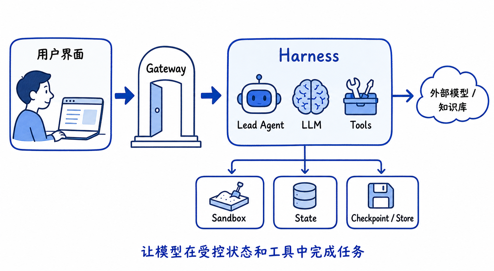

这张图只保留四层：用户界面、Gateway、Harness，以及底部的执行与持久化。阅读它时先抓住主路径：用户界面把请求交给 Gateway，Gateway 进入 Harness，Harness 组织 Lead Agent、LLM 和 Tools，再使用 Sandbox、State、Checkpoint/Store 完成任务并保存过程。外部模型和知识库是 Harness 可以连接的外部能力，不属于 Harness 自身。

典型本地开发栈包含四个服务：

```mermaid
flowchart TB
    Browser["浏览器"] --> Nginx["Nginx :2026\n统一入口"]
    Nginx --> Frontend["Next.js Frontend :3000"]
    Nginx --> Gateway["Gateway FastAPI :8001"]
    Gateway -."仅在 Kubernetes / Provisioner 模式".-> Provisioner["Provisioner :8002"]
    Provisioner --> SandboxPods["Sandbox Pods / AIO Sandbox"]
    Gateway --> DB["SQLite 或 PostgreSQL"]
    Gateway --> Redis["可选 Redis\nStreamBridge / 队列"]
    Gateway --> Models["外部或内部模型服务"]
    Gateway --> WeKnora["可选 WeKnora"]
```

Nginx 是浏览器的统一入口。标准流程中，前端不需要直接面对 Gateway 的内部端口；`/api/langgraph/*` 被转发并改写到 Gateway 的原生 API，其他 API 路由进入 Gateway。当前分支还包含 WeKnora 同源嵌入、外部 Agent 启动路由和多个安全相关的反向代理约束。

### 2.2 Harness 与 App 的边界

后端最重要的架构约束是：

```mermaid
flowchart LR
    App["app.*\n应用层\nFastAPI、Gateway、IM Channel"] --> Harness["deerflow.*\n可复用 Harness\nAgent、工具、沙箱、模型、Skill、MCP、Runtime"]
    Harness -."禁止反向依赖".-> App
```

`packages/harness/deerflow/` 是可发布的 Agent 框架层；`backend/app/` 是 DeerFlow 应用本身。应用层可以调用 Harness，Harness 不能导入应用层。这个边界让 DeerFlow 能够被嵌入其他宿主，也防止 Agent 核心代码被 Gateway 细节污染。

### 2.3 仓库结构地图

```text
deer-flow/
├── backend/
│   ├── packages/harness/deerflow/
│   │   ├── agents/          Agent、状态、Middleware、Memory、Subagent
│   │   ├── runtime/         Run、StreamBridge、Store、持久化
│   │   ├── models/          模型工厂与能力声明
│   │   ├── tools/           工具装配与内置工具
│   │   ├── sandbox/         Sandbox 抽象、本地实现、工具
│   │   ├── subagents/       子 Agent 注册、执行器和内置子 Agent
│   │   ├── skills/          Skill 发现、读取和解析
│   │   ├── mcp/             MCP 客户端、缓存和工具转换
│   │   └── config/          配置模型、加载和校验
│   └── app/gateway/         HTTP API、认证、上传、Thread、Run、WeKnora
├── frontend/src/            Next.js 页面、Thread hooks、消息和 Artifact
├── skills/public/           平台内置 Skill
├── skills/custom/           本地自定义 Skill，通常不提交
├── contracts/               跨组件 JSON 契约
├── docker/                  Compose、Nginx、Provisioner
├── k8s/                     Kubernetes 部署和企业覆盖层
└── docs/                    文档、设计说明和本文
```

### 2.4 两种执行入口

DeerFlow 的运行入口不只有浏览器聊天：

- 浏览器 Chat：前端调用 Gateway 的 LangGraph 兼容 API。
- IM Channel：飞书、Slack、Telegram、钉钉等渠道把消息转入同一套运行生命周期。
- Scheduled Task：调度器决定何时执行，但仍然复用正常 Gateway Run 路径。
- GitHub Webhook：外部事件经过触发策略后创建 LangGraph Run。
- 内嵌 Python Client：`deerflow.client` 可在 Python 进程内运行 Agent。

设计重点是“多入口、同生命周期”。入口可以不同，Thread、Run、Agent、工具、状态和事件机制尽量统一。

---

## 3. 八个核心对象：Thread、Run、State、Checkpoint、Store、Event、Sandbox、Middleware

### 3.1 Thread：对话容器

Thread 是一段持久化对话的身份。它通常拥有：

- `thread_id`
- 所属用户
- 标题和展示名称
- assistant/agent 身份
- 创建时间和更新时间
- 元数据，例如 sidecar、来源渠道、外部平台标记
- 与 checkpoint、消息、Run、上传文件和 Artifact 的关联

Thread 不是“一次模型调用”，而是多次 Run 的容器。

```mermaid
graph LR
    T["Thread\n一个会话"] --> R1["Run 1\n用户问题 A"]
    T --> R2["Run 2\n用户问题 B"]
    T --> R3["Run 3\n继续追问"]
    R1 --> CP1["Checkpoint 序列"]
    R2 --> CP2["Checkpoint 序列"]
    R3 --> CP3["Checkpoint 序列"]
```

### 3.2 Run：一次执行

Run 是 Thread 上的一次 Agent 执行。它通常包含：

- 输入消息或 `Command(resume=...)`
- 使用的 assistant/agent
- 有效模型名
- 运行配置
- `RunStatus`，例如 pending、running、success、error、cancelled
- 开始时间、结束时间、耗时
- 错误信息
- token usage
- 运行策略，例如递归上限、断开连接策略、多任务策略

同一个 Thread 可以连续产生多个 Run；每个 Run 可能推进同一个 ThreadState。

### 3.3 ThreadState：Agent 的工作记忆

ThreadState 是 LangGraph 图看到的状态对象。当前分支在 LangChain `AgentState` 的基础上增加了 DeerFlow 字段，例如：

```text
messages          对话消息和工具消息
sandbox           当前 Thread 的 sandbox 标识
thread_data       workspace/uploads/outputs 路径
title             对话标题
artifacts         已发布 Artifact 路径
todos             Todo 列表
uploaded_files    当前对话上传文件
viewed_images     已查看图片的轻量元数据
goal              当前活动目标
promoted         延迟工具已提升的名称及 catalog hash
delegations       子 Agent 委派账本
skill_context     当前激活 Skill 的轻量引用
summary_text      压缩后的上下文摘要
```

State 不是普通字典的简单覆盖。LangGraph 使用 reducer 合并多个节点的更新。比如多个工具都初始化同一个 sandbox 时，可以写入相同的 `sandbox_id`；如果出现不同 ID，则认为是隔离生命周期错误并失败关闭。

### 3.4 Checkpoint：状态快照

Checkpoint 是 LangGraph 在执行过程中保存的状态快照。它支持：

- 下一轮 Run 继续读取历史状态。
- LangGraph interrupt 后恢复。
- 调试某个 super-step 的状态。
- 在运行中断后恢复或审计状态。
- 对不同 checkpoint 做历史版本定位。

Checkpoint 关注“图状态”；Run 记录关注“执行审计”；Thread 消息 API 关注“用户看到的历史”。三者有重叠，但不是一张表的三个名字。

### 3.5 Store：跨 Thread 的数据空间

Store 更适合放跨 Thread 的持久数据，例如：

- 用户长期记忆。
- Agent 的长期配置。
- 跨会话索引。
- 需要按 namespace 和 key 查询的数据。

可以把 checkpoint 理解为“这个 Thread 的图快照”，把 store 理解为“应用或用户范围的长期数据库”。

### 3.6 StreamEvent：运行过程中的事件

StreamEvent 是一次 Run 过程中的实时消息，例如：

- 新的 AI 消息 token 或消息块。
- 工具开始、工具结束和工具错误。
- 子任务开始、运行和完成。
- Todo 更新。
- Artifact 更新。
- ThreadState values 更新。
- 运行完成、失败、取消。

事件适合驱动 UI，但不一定适合永久作为唯一事实来源。断线重连后，前端通常需要从历史 API、Run 事件 API和当前 checkpoint 补齐状态。

### 3.7 Sandbox：Agent 的执行边界

Sandbox 为 Agent 提供文件、命令和代码执行能力。它可以是：

- Local Sandbox：直接使用受控本地目录。
- AIO Sandbox：通过 HTTP API 访问独立执行服务。
- Provisioner/Kubernetes Sandbox：由 Provisioner 创建和回收 Pod。

Sandbox 的关键不是“能不能执行 bash”，而是：路径边界、命令边界、环境变量注入、凭据保护、生命周期、空闲回收和审计。

### 3.8 Middleware：Agent 运行时的控制层

Middleware 不是简单的 Python 装饰器。它可以在：

- Agent 执行前准备状态。
- 模型调用前修改消息、提示词或工具集。
- 工具调用前检查参数或权限。
- 工具调用后清洗结果、记录元数据或转成 ToolMessage。
- Agent 执行后生成标题、更新记忆或清理资源。

```mermaid
flowchart LR
    Input["输入消息"] --> Before["Middleware before"]
    Before --> Model["模型调用"]
    Model --> ToolDecision{"是否需要工具？"}
    ToolDecision -->|否| After["Middleware after"]
    ToolDecision -->|是| Tool["工具执行"]
    Tool --> ToolAfter["工具结果 Middleware"]
    ToolAfter --> Model
    After --> Output["最终输出"]
```

---

## 4. 一条用户消息的完整生命周期

### 4.1 总体时序

```mermaid
sequenceDiagram
    participant U as 用户
    participant F as Frontend
    participant N as Nginx
    participant G as Gateway
    participant M as RunManager
    participant W as run_agent
    participant A as Lead Agent
    participant L as LLM
    participant T as Tool/Sandbox
    participant P as Checkpoint/Store
    participant S as StreamBridge

    U->>F: 输入消息并提交
    F->>N: LangGraph 兼容 stream 请求
    N->>G: 改写并转发
    G->>M: 创建 RunRecord
    G->>G: 构造 graph_input 与运行配置
    G->>W: 创建后台任务
    W->>A: 创建/编译 Lead Agent
    W->>P: 读取 Thread checkpoint
    A->>L: 模型调用
    L-->>A: 文本或 tool_calls
    A->>T: 调用工具
    T-->>A: ToolMessage / 状态更新
    A->>L: 带工具结果再次调用
    A->>P: 保存 checkpoint
    A-->>S: 发布运行事件
    S-->>F: SSE / 流式事件
    W->>M: 更新 Run 状态
    W->>P: 更新标题、运行记录、持久数据
    F-->>U: 渲染消息与执行过程
```

### 4.2 前端提交阶段

前端通常先处理：

- 输入框中的文本。
- 上传文件状态。
- `/goal`、`/compact` 等内置命令。
- 可选的输入润色或语音转写。
- 当前模型、思考模式、Agent、知识库范围等运行上下文。

确认提交后，Thread hooks 将请求交给 LangGraph SDK 客户端。前端不应自行拼接一套与后端不同的 Agent 生命周期；它负责发起 Run、消费流和展示状态。

### 4.3 Gateway 创建 Run

Gateway 的核心工作包括：

1. 校验用户是否拥有 Thread。
2. 防止同一 Thread 出现冲突运行。
3. 创建 `RunRecord`。
4. 对运行配置做脱敏持久化。
5. 根据 `assistant_id` 解析 Agent 工厂。
6. 将用户输入标准化为消息或恢复命令。
7. 注入可信的用户、Thread、WeKnora 和运行上下文。
8. 规范化 stream modes、递归上限和内部调用标记。
9. 创建 `asyncio` 后台任务执行 `run_agent`。

特别要注意：传给实际执行的 config 和写进 Run 记录的 config 不是同一份。运行时可能需要 secret，但 Run 记录、API 回显和审计数据必须使用脱敏副本。

### 4.4 Agent 循环

模型通常不会只调用一次。典型循环是：

```mermaid
flowchart TD
    Start["读取当前 ThreadState"] --> Prepare["Middleware 准备上下文"]
    Prepare --> Call["调用模型"]
    Call --> Choice{"模型输出类型"}
    Choice -->|文本答案| Finish["结束本轮 Run"]
    Choice -->|tool_calls| Validate["校验工具与参数"]
    Validate --> Execute["执行工具"]
    Execute --> Merge["合并 ToolMessage 与 State 更新"]
    Merge --> Guard{"预算、循环、递归、错误检查"}
    Guard -->|继续| Prepare
    Guard -->|强制结束| Finish
```

每次工具调用可能改变 ThreadState。例如 `present_file` 更新 artifacts，sandbox 工具更新 thread_data，Todo 工具更新 todos，子 Agent 工具更新 delegations。

### 4.5 事件回流

后台 Agent 通过 StreamBridge 发布事件；SSE 路由从 StreamBridge 消费事件。这样执行者和 HTTP 连接不必直接绑定：

- 浏览器断开时，Run 可以继续或按策略取消。
- 多进程模式可用 Redis 作为桥接。
- 事件可以保存到事件日志供恢复和子任务历史读取。
- 前端可以用事件流快速显示，也可以用历史 API 重建。

---

## 5. Gateway、RunManager、run_agent 与 StreamBridge

### 5.1 Gateway 的职责边界

Gateway 不是 Agent 本身。它负责应用级问题：

- HTTP 路由。
- 身份认证与权限。
- CSRF 和安全响应头。
- Thread 和 Run API。
- 文件上传和 Artifact 下载。
- 配置、模型、MCP、Skill、Memory 管理。
- 数据库访问和审计。
- 将请求转换成 Harness 能理解的运行配置。

Agent 核心位于 Harness，Gateway 只应把可信上下文传入 Agent。

### 5.2 RunManager 的职责

RunManager 可以理解为运行生命周期的“控制平面”：

- 创建 Run。
- 检查冲突。
- 记录 Run 状态。
- 查找运行中的任务。
- 取消运行。
- 处理断开连接策略。
- 保存运行摘要、错误和 token usage。
- 管理恢复和历史查询。

它不应该承载模型调用细节；模型调用由 `run_agent` 和编译出的 Agent 图完成。

### 5.3 run_agent 的职责

`run_agent` 是“执行平面”。它负责：

1. 组装 LangGraph runtime context。
2. 绑定 Thread、Run、Store、Checkpointer 和事件桥。
3. 调用 Agent factory。
4. 启动图流式执行。
5. 将图事件序列化成 DeerFlow 事件。
6. 处理 interrupt、cancel、error 和最终状态。
7. 在 finally 阶段完成标题、运行记录和资源清理。

控制平面回答“这次 Run 是否存在、是否能取消”；执行平面回答“Agent 当前执行到哪里、状态怎样变化”。

### 5.4 StreamBridge 的设计

```mermaid
flowchart LR
    Worker["Agent Worker\n事件生产者"] --> Bridge["StreamBridge"]
    Bridge --> SSE["SSE Consumer\n浏览器连接"]
    Bridge --> Replay["事件读取/恢复"]
    Bridge --> TaskUI["子任务历史读取"]
    Bridge -."单进程".-> Memory["Memory Bridge"]
    Bridge -."多进程/分布式".-> Redis["Redis Bridge"]
```

MemoryStreamBridge 适合本地单进程；RedisStreamBridge 适合 Gateway 多副本或 Worker 与 HTTP 进程分离。桥接层隐藏了事件传输介质，业务代码只依赖 `StreamBridge` 接口。

### 5.5 取消不是简单的断开 HTTP

停止按钮通常需要：

- 取消或标记 Run。
- 通知 Agent 执行路径。
- 终止工具或子任务的后续执行。
- 更新 Thread 与 Run 缓存。
- 等待后台任务完成清理。
- 在必要时补写终态事件。

因此“浏览器连接关闭”和“Run 已经停止”不是严格同义词。当前分支对 stop 后的缓存失效和后续 refetch 有专门处理。

---

## 6. LangGraph 图、AgentState、ThreadState 与 Checkpoint

### 6.1 LangGraph 的基本执行模型

LangGraph 可以看成一个带状态的有向图。每个节点读取当前状态，返回状态更新；图运行器按照边和条件继续执行。

DeerFlow 使用 LangChain Agent 构造能力生成 Lead Agent 图，但最终仍然受 LangGraph 的状态、super-step、checkpoint 和 interrupt 机制约束。

### 6.2 State 更新不是覆盖，而是 reducer 合并

如果两个节点都返回：

```python
{"todos": [...]}
```

最终如何合并，取决于字段的 reducer。当前 ThreadState 的重要 reducer 包括：

| 字段 | 合并策略 |
| --- | --- |
| `sandbox` | 相同 ID 可幂等合并，不同 ID 直接报错 |
| `artifacts` | 追加并去重，保留顺序 |
| `viewed_images` | 合并字典，空字典表示清空 |
| `todos` | 新值覆盖旧值，`None` 表示未触碰 |
| `goal` | 没有新值时保留当前 Goal |
| `promoted` | 按 catalog hash 隔离，避免工具目录变化后误用旧名称 |
| `delegations` | 按委派 ID 合并，终态不能被非终态降级，最多保留最近记录 |
| `skill_context` | 按路径去重，保留最近引用 |

这种设计解决了 Agent 中多工具、多 Middleware、并行子任务同时写状态时的冲突问题。

### 6.3 State、messages 和 UI history 不完全相同

`messages` 是模型上下文和 LangGraph 状态的一部分，但用户看到的历史可能经过：

- 工具调用分组。
- 隐藏消息过滤。
- 摘要 checkpoint 与完整历史拼接。
- 乐观消息合并。
- 子任务专用显示模型。
- ToolMessage artifact 中的 human input 解析。

所以前端不能简单地把所有 checkpoint 中的 messages 原样显示。

### 6.4 Checkpoint 与摘要

长对话会遇到上下文窗口限制。摘要 Middleware 可以将旧消息压缩为 `summary_text`，同时保留必要的最近尾部和用户关键输入。摘要是模型上下文优化，不等于删除用户可见历史；前端仍可以显示完整的历史分页。

```mermaid
flowchart LR
    Old["旧消息"] --> Summarize["摘要模型"]
    Summarize --> Summary["summary_text"]
    Recent["最近消息尾部"] --> Context["下一次模型上下文"]
    Summary --> Context
    FullHistory["完整历史分页"] -."仍供 UI 查看".-> UI["前端历史"]
```

### 6.5 Interrupt 与恢复

人机交互请求、确认、澄清或其他中断可以让图暂停。恢复时不是重新发送普通用户文本，而是使用 `Command(resume=...)` 继续图执行。这样工具调用身份、当前节点和状态不会丢失。

---

## 7. Lead Agent 的创建过程

### 7.1 工厂入口

LangGraph 需要一个符合约定的工厂函数。当前主入口是：

```text
backend/packages/harness/deerflow/agents/lead_agent/agent.py
    make_lead_agent(config)
        └── _make_lead_agent(config, app_config=...)
```

### 7.2 模型选择优先级

Lead Agent 会综合读取：

```text
本次请求 context.model_name / model
        ↓
自定义 Agent 配置中的 model
        ↓
全局配置中的默认模型
        ↓
配置中的回退模型
```

模型配置不仅包含模型名，还包含：

- Provider 类路径。
- API base 和 secret。
- 是否支持思考。
- 是否支持视觉。
- 是否支持 reasoning effort。
- 超时和重试。
- thinking 开关对应的 extra body。
- 价格和 token 计算信息。

如果用户打开思考模式，但当前模型不支持思考，工厂会记录警告并降级为非思考模式，而不是让模型请求带上无效参数。

### 7.3 Lead Agent 的装配顺序

```mermaid
flowchart TD
    Config["RunnableConfig + AppConfig"] --> Resolve["解析用户、Agent、模型、模式"]
    Resolve --> SkillPolicy["读取 Skill 与 tool policy"]
    Resolve --> ToolLoad["加载配置工具、内置工具、MCP、子 Agent"]
    ToolLoad --> Deferred["延迟工具目录与自动提升"]
    Resolve --> Prompt["生成系统提示词"]
    Resolve --> MW["构造 Middleware 链"]
    SkillPolicy --> ToolLoad
    Deferred --> Agent["create_agent"]
    Prompt --> Agent
    MW --> Agent
    Resolve --> Model["create_chat_model"]
    Model --> Agent
    State["ThreadState"] --> Agent
    Agent --> Graph["Compiled LangGraph Agent"]
```

### 7.4 用户作用域和 Agent 作用域

当前分支会把用户 ID传入 Skill、Memory、知识库范围和权限相关逻辑。自定义 Agent 还可能拥有：

- 自己的模型。
- 自己的工具组。
- 自己的 `SOUL.md` 或提示词。
- 可用 Skill 白名单。
- 可更新 Agent 配置的 `update_agent` 工具。

Webhook 渠道会被限制使用自修改 Agent 的工具，避免外部评论者通过 Prompt 触发持久化配置变化。

### 7.5 系统提示词不是一个固定字符串

系统提示词通常由以下部分组合：

- 基础语言和行为规则。
- 工具说明和使用约束。
- Skill 说明或延迟发现提示。
- 子 Agent 使用说明。
- 当前运行模式。
- 知识库范围和引用要求。
- 非交互模式说明。
- Agent 自己的灵魂文件或自定义描述。

因此调试“模型为什么这样回答”时，不能只看 UI 上的用户问题；需要同时看最终模型配置、最终工具清单和最终 system prompt。

---

## 8. Middleware 链及执行顺序

### 8.1 通用链的设计顺序

`factory.py` 中的特性驱动装配大致遵循以下顺序：

```text
0  ThreadDataMiddleware
1  UploadsMiddleware
2  SandboxMiddleware
3  DanglingToolCallMiddleware
4  Guardrail（可选）
5  ToolErrorHandlingMiddleware
6  SummarizationMiddleware（可选）
7  TodoMiddleware（计划模式）
8  TitleMiddleware
9  MemoryMiddleware
10 ViewImageMiddleware
11 SubagentLimitMiddleware
12 LoopDetectionMiddleware
13 TokenBudget / TokenUsage 等预算和统计能力
14 ClarificationMiddleware
```

Lead Agent 还会按当前企业配置加入 Artifact、终态响应、图片、WeKnora scope/citation、safety finish reason 等专用 Middleware。实际顺序要以 `build_middlewares()` 和当前配置为准。

### 8.2 为什么顺序重要

- ThreadData 必须先于 Sandbox，Sandbox 才知道 Thread 目录。
- Uploads 必须能访问 Thread ID 和上传目录。
- 摘要应该尽早执行，避免后续 Middleware 在过长上下文上工作。
- ToolErrorHandling 要在 Clarification 前，工具异常才能变成模型可理解的 ToolMessage。
- ViewImage 要在模型调用前注入图片信息。
- Todo 要在 Clarification 前，避免计划更新被中断截断。
- Clarification 通常放在末端，负责把工具层的澄清请求转换为人机交互协议。

### 8.3 Middleware 的三种作用

#### 上下文准备

例如初始化 sandbox、扫描上传文件、加载 memory、注入 Skill 引用。

#### 执行保护

例如工具错误处理、循环检测、子 Agent 数量限制、token budget、非交互模式禁用澄清。

#### 结果整理

例如生成标题、记录 token、发布 Artifact、生成 WeKnora 引用、更新子任务账本。

### 8.4 一个工具错误的路径

```mermaid
sequenceDiagram
    participant M as 模型
    participant TE as ToolErrorHandlingMiddleware
    participant T as 工具
    participant S as State/Event
    M->>TE: tool_call
    TE->>T: 执行
    T-->>TE: 抛出异常
    TE->>TE: 分类、脱敏、限制堆栈
    TE->>S: 写入 ToolMessage / 错误元数据
    S-->>M: 模型可读的工具失败结果
    M->>M: 决定重试、换工具或给出最终回答
```

这比让 Python 异常直接穿出图更可靠，因为模型需要知道“工具失败了”，而用户不应该看到未经处理的内部路径、凭据或完整堆栈。

### 8.5 自定义 Middleware

自定义 Middleware 应：

- 明确它修改的是消息、工具、状态还是运行上下文。
- 说明它必须位于哪个 Middleware 前后。
- 不把不可序列化的大对象写入 ThreadState。
- 异步路径避免同步阻塞 IO。
- 对工具错误和取消保持幂等。
- 添加单元测试和至少一个运行时测试。

---

## 9. Tool 注册、工具调用和工具结果

### 9.1 工具来源

当前可用工具通常来自：

```mermaid
flowchart TD
    Config["config.yaml tools"] --> Load["get_available_tools"]
    Builtin["内置工具\npresent_file / ask_clarification / view_image"] --> Load
    Subagent["子 Agent 工具\ntask"] --> Load
    MCP["缓存的 MCP 工具"] --> Load
    ACP["ACP Agent 工具"] --> Load
    Load --> Policy["Skill/tool policy 过滤"]
    Policy --> Deferred["延迟工具目录"]
    Deferred --> Final["最终绑定给模型的工具"]
```

### 9.2 配置工具

配置中的工具通常通过 `use` 字符串动态加载，例如：

```yaml
tools:
  - name: my_tool
    group: analysis
    use: my_package.tools:my_tool
```

加载器会解析类或变量，检查工具名称，补齐同步调用包装，并进行名称去重。配置中的 `name` 与工具对象自己的 `.name` 不一致会造成模型 schema 和运行时路由不一致，因此系统会警告并以工具对象名称为最终绑定依据。

### 9.3 工具分组与安全过滤

工具组允许自定义 Agent 只看到部分工具。除此之外还可能受以下条件影响：

- 当前模型是否支持视觉。
- 是否启用子 Agent。
- 是否处于非交互调度模式。
- Skill 的 allowed-tools policy。
- 当前知识库范围。
- 当前渠道是否是 Webhook。
- Local Sandbox 是否禁止宿主机 bash。

“配置里存在”不等于“本次模型真的能调用”。调试工具问题时，必须检查最终 `final_tools`。

### 9.4 延迟工具发现

当 MCP 或工具数量很大时，不应该把所有 schema 永久塞进每次模型上下文。DeerFlow 可以先暴露工具目录和搜索/提升机制，模型在需要时将某些工具提升到当前可调用集合。

```mermaid
flowchart LR
    Catalog["工具目录\n名称、描述、来源"] --> Search["tool_search"]
    Search --> Promote["按 catalog hash 提升工具"]
    Promote --> Bind["加入当前模型工具集合"]
    Bind --> Call["实际调用"]
```

`catalog_hash` 很重要：工具目录变化后，旧的“已提升工具名称”不能盲目复用，否则可能把同名但不同定义的工具暴露给模型。

### 9.5 工具调用协议

模型输出 `tool_calls` 后，运行时通常会：

1. 找到工具名称。
2. 校验参数 schema。
3. 注入运行时上下文。
4. 执行同步或异步函数。
5. 记录开始/结束/错误事件。
6. 将结果包装成 `ToolMessage`。
7. 合并工具带来的 State 更新。
8. 把工具结果送回模型。

工具可以通过返回值回答，也可以用 LangGraph `Command(update=...)` 同时更新状态、跳转或触发事件。

### 9.6 Human Input

澄清不是普通文本消息。`ask_clarification` 生成结构化请求，后端把请求信息写入 `ToolMessage.artifact.human_input`。前端根据稳定的 `clarification:<tool_call_id>` 身份渲染卡片。用户回答后，前端发送一条普通消息，但将回答元数据放在额外参数中，后端以 `Command(resume=...)` 或相应协议恢复执行。

这保证了：

- 同一个请求不会渲染两次。
- 隐藏的回答消息不会污染普通聊天展示。
- 恢复时仍能找到原来的工具调用。

---

## 10. Sandbox、本地执行与 Kubernetes Provisioner

### 10.1 Sandbox 抽象

Sandbox 是 Agent 与执行环境之间的抽象接口。上层工具只应依赖 Sandbox 能力，例如：

- `bash`。
- `ls`。
- 读文件。
- 写文件。
- 字符串替换。
- 文件上传和输出。

它不应该直接假定“文件一定在宿主机”或“命令一定在当前 Python 进程执行”。

### 10.2 Local Sandbox

本地模式使用受控的本地目录。关键安全点：

- 工作目录、上传目录和输出目录分离。
- 路径解析后必须仍位于允许根目录。
- 限制活动/服务器可执行上传扩展名。
- 不依赖浏览器 MIME 类型做安全判断。
- 宿主机 bash 默认不应因为配置工具存在就自动暴露。

### 10.3 AIO / Remote Sandbox

远程执行通常通过 HTTP API 调用 `/v1/bash/exec` 等能力。环境变量通过结构化命令环境传递，而不是随意写进 Pod manifest。请求作用域的 secret 应只进入真正使用它的命令。

### 10.4 Provisioner/Kubernetes 模式

```mermaid
sequenceDiagram
    participant G as Gateway
    participant P as Provisioner
    participant K as Kubernetes
    participant S as Sandbox Pod
    G->>P: 请求创建/获取 Sandbox
    P->>K: 创建 Pod
    K-->>P: Pod Running
    P-->>G: sandbox_id 与访问信息
    G->>S: bash/read/write 请求
    S-->>G: 执行结果
    G->>P: 空闲回收或删除
    P->>K: 删除 Pod
```

当前分支特别强调：

- 动态 Sandbox Pod 不应自动挂载 ServiceAccount Token。
- Sandbox API Key 通过 Secret 注入，不嵌入命令或 Pod 明文。
- Provisioner 管理的 warm sandbox 会在 Gateway 启动时重新接管并裁剪到配置数量。
- 活跃 Sandbox 可以暂时超过软容量上限，但最终由 idle timeout 回收。
- 企业代理、CA 和 TLS 兼容配置应只注入 Sandbox Pod，不应做全主机降级。

### 10.5 Sandbox 生命周期

```mermaid
stateDiagram-v2
    [*] --> Uninitialized
    Uninitialized --> Creating: 第一次需要工具
    Creating --> Ready: 健康检查通过
    Ready --> Active: 执行命令/读写文件
    Active --> Ready: 命令结束
    Ready --> Idle: 一段时间无请求
    Idle --> Active: 再次使用
    Idle --> Reclaimed: idle timeout
    Active --> Failed: Pod/服务异常
    Failed --> Creating: 允许重建
    Reclaimed --> [*]
```

---

## 11. Subagent 委派与并行任务

### 11.1 为什么需要 Subagent

Lead Agent 负责总体规划和最终回答；复杂任务可以委派给更专门的子 Agent，例如：

- 通用研究。
- Bash/代码执行。
- 文档或数据处理。
- 并行分析多个来源。

子 Agent 不只是“再调用一次模型”，它通常有自己的图、工具、状态、Run 标识和事件。

### 11.2 委派结构

```mermaid
flowchart TD
    Lead["Lead Agent"] --> TaskTool["task 工具"]
    TaskTool --> Registry["Subagent Registry"]
    Registry --> A1["Subagent A\n研究"]
    Registry --> A2["Subagent B\n代码"]
    Registry --> A3["Subagent C\n数据"]
    A1 --> Ledger["delegations ledger"]
    A2 --> Ledger
    A3 --> Ledger
    Ledger --> Lead
```

### 11.3 并发限制与递归限制

当前运行上下文通常包含：

- `subagent_enabled`。
- `max_concurrent_subagents`。
- `max_total_subagents`。
- LangGraph `recursion_limit`。

前两个限制控制子任务数量，递归上限控制图的 super-step 数量。递归上限不是“允许无限模型调用”；Gateway 会对客户端值做服务器侧上限裁剪。

### 11.4 delegation ledger

`delegations` 是 ThreadState 中的可见账本，记录：

- 委派 ID。
- 子 Agent 类型。
- Run ID。
- 描述。
- 状态。
- 结果摘要和引用。
- 终止原因。

相同 ID 的新状态会更新原条目；终态不会被后来的运行中状态覆盖；条目数量会限制在最近窗口内。这样可以避免事件重放或并发更新把 UI 状态倒退。

### 11.5 前端子任务显示

前端不仅显示最后结果，还可以显示子任务步骤：

- `task_started`。
- `task_running`。
- 子 Agent 的 AI 步骤。
- 子 Agent 执行的工具步骤。
- 最终结果。

历史展开时，前端可以按 `run_id` 和 `task_id` 分页读取专属事件，避免被整个 Run 的事件数量上限截断。

---

## 12. Skill 系统与 MCP 系统

### 12.1 Skill 是“可加载知识和工作流”，不是普通工具

Skill 通常以目录形式存在，核心文件是 `SKILL.md`，还可以包含：

- 参考资料。
- 脚本。
- 模板。
- 资源文件。

Skill 的作用是改变 Agent 的工作方式：告诉模型何时使用某个流程、怎样操作文件、如何检查结果、哪些限制必须遵守。

### 12.2 Skill 的加载层次

```mermaid
flowchart TD
    Scan["Skill Storage 扫描"] --> Meta["读取名称、描述、路径"]
    Meta --> Policy["用户/Agent allowed-tools 与权限"]
    Policy --> Index["Skill 索引/描述"]
    Index --> Search["describe_skill / 延迟发现"]
    Search --> Read["读取 SKILL.md"]
    Read --> Context["skill_context 轻量引用"]
    Context --> Prompt["注入当前 Agent 上下文"]
```

为了避免 checkpoint 变得巨大，`skill_context` 存的是 Skill 的 name/path/description 引用，而不是整个 `SKILL.md` 正文。

### 12.3 Skill 安全边界

Skill 是模型可读的指令来源，因此需要：

- 隔离系统指令和 Skill 内容的优先级。
- 过滤或审查不安全工具声明。
- 防止 Skill 诱导模型泄露 secret。
- 对可下载 Skill 包检查 ZIP 结构和 `SKILL.md`。
- 避免把平台内部凭据写入 Skill。

### 12.4 MCP 是外部工具协议

MCP 服务器提供外部工具，DeerFlow 在应用启动时初始化并缓存工具定义。运行时 `get_available_tools` 从缓存读取 MCP 工具，再进行名称去重、策略过滤和延迟工具装配。

```mermaid
flowchart LR
    Server["MCP Server"] --> Client["MCP Client"]
    Client --> Cache["MCP Tool Cache"]
    Cache --> Loader["get_available_tools"]
    Loader --> Policy["权限/Skill/Agent 工具策略"]
    Policy --> Agent["Lead Agent"]
```

MCP 配置可以通过 Gateway API 修改；工具装配需要读取最新 extensions 配置，否则独立进程之间会出现“管理端已改、Agent 仍使用旧配置”的问题。

### 12.5 Skill 与 MCP 的区别

| 项目 | Skill | MCP |
| --- | --- | --- |
| 核心内容 | 指令、流程、参考资料、脚本 | 可调用的外部工具协议 |
| 主要影响 | 模型如何完成任务 | 模型能调用什么外部能力 |
| 载体 | `SKILL.md` 目录包 | MCP Server |
| 是否有工具 | 可以声明/使用工具 | 本身就是工具来源 |
| 典型问题 | 指令冲突、恶意 Skill | 工具权限、远程连接、数据泄露 |

---

## 13. Memory、摘要、标题、Goal 与 Token Budget

### 13.1 Memory 的两层含义

DeerFlow 中的 Memory 可能同时包含：

- 当前 Thread 内的上下文记忆：messages、summary_text、goal。
- 跨 Thread 的长期记忆：写入 Store 或专用 Memory backend。

长期记忆不是本次用户请求的最高优先级指令。它只能作为背景参考，不能覆盖当前用户明确的操作要求。

### 13.2 Memory Middleware

Memory Middleware 可以在运行后将适合长期保存的信息排入队列，异步做抽取和持久化。这样主对话不必等待完整记忆处理，也避免把昂贵的记忆提取模型调用塞进每一次前台响应的关键路径。

### 13.3 摘要

摘要的目标是减少模型上下文长度，而不是删除历史。它需要考虑：

- 保留用户最初任务。
- 保留最近消息。
- 保留未完成工具链的必要上下文。
- 不破坏 ToolMessage 和 AIMessage 的配对。
- 不将敏感信息扩散到摘要。

### 13.4 Title Middleware

标题生成通常发生在首次交换或运行完成阶段。它读取 checkpoint 中的标题信息，再更新 Thread display name。标题生成失败不应让主要任务失败，因此常作为非核心副作用处理。

### 13.5 Goal

Goal 是 Thread 级别的活动目标，可通过 `/goal` 设置、查询和清除。Goal reducer 的语义是：普通状态更新没有触碰 Goal 时，不能把现有目标意外清掉。

`/goal <condition>` 既会保存目标，也会将条件作为下一次任务提交；`/goal clear` 和查询不启动新的 Agent Run。

### 13.6 Token Usage 与 Token Budget

Token Usage 是统计能力，Token Budget 是限制能力。

```mermaid
flowchart LR
    Call["模型调用"] --> Usage["记录 input/output/total tokens"]
    Usage --> Threshold{"预算阈值"}
    Threshold -->|低于 warning| Continue["继续"]
    Threshold -->|达到 warn| Warn["向上下文注入警告"]
    Threshold -->|达到 hard stop| Strip["移除 tool_calls"]
    Strip --> Final["强制模型输出最终答案"]
```

Token budget 和 `recursion_limit` 解决不同问题：前者限制 token 成本，后者限制图步骤和循环深度。

### 13.7 Loop Detection

循环检测关注反复出现的工具调用和相似轨迹。诊断循环时应看完整的 tool-call trace：

- 是否同一个参数不断重试。
- 工具是否每次都返回相同错误。
- 模型是否看不到工具结果。
- 工具结果是否被 Middleware 清洗为空。
- 子 Agent 是否反复创建。

单纯把递归上限调大通常只是延迟失败。

---

## 14. 文件上传、Artifact、图片与文档处理

### 14.1 文件安全边界

浏览器文件校验不够。Gateway 必须在服务端：

- 拒绝可执行或服务器可执行扩展名。
- 处理文件名、路径和大小限制。
- 对 staged PDF 做验证后再原子替换。
- 对原始上传和可疑生成 PDF 使用强化下载响应。
- 对预览 PDF 使用 CSP、无脚本、opaque-origin iframe sandbox。
- 不依赖 filename MIME 猜测作为唯一安全判断。

### 14.2 上传文件到 Agent

```mermaid
flowchart TD
    Browser["浏览器选择文件"] --> UploadAPI["Gateway Upload API"]
    UploadAPI --> Validate["扩展名、大小、路径、PDF 校验"]
    Validate --> Stage["临时 staged 文件"]
    Stage --> Atomic["原子替换到 Thread uploads"]
    Atomic --> Middleware["UploadsMiddleware 扫描"]
    Middleware --> State["uploaded_files / thread_data"]
    State --> Prompt["注入 Agent 上下文"]
```

### 14.3 Artifact

Artifact 是 Agent 生成并呈现给用户的文件或结果。`present_file` 负责将输出文件纳入 Artifact 状态；前端根据文件类型选择下载、预览或右侧详情面板。

PowerPoint 使用配对预览契约：

```text
/mnt/user-data/outputs/report.pptx          下载/选中的主 Artifact
/mnt/user-data/outputs/report.preview.pdf   优先用于右侧预览
/mnt/user-data/outputs/report.pdf           旧版本兼容回退
```

### 14.4 图片

`view_image` 不把大块 base64 图片直接永久塞入 checkpoint。ThreadState 只保存轻量元数据和路径，模型需要时再读取。视觉 Middleware 在模型调用前将图片信息注入上下文，并根据模型是否支持 vision 决定是否暴露工具。

### 14.5 PDF、Word 与演示文稿

当前企业分支的文档路径包含：

- 可搜索 PDF：优先使用内置解析器。
- 扫描或混合 PDF：根据文本长度和图片覆盖率路由到 MinerU。
- PDFium 检查失败：尝试独立内置解析，再回退到 MinerU。
- Word：原生文本/图片与临时 PDF 视觉处理结果合并。
- PPT/PPTX：转换为 PDF，并保留可检索文本和视觉证据。
- 解析器不可用时优雅降级，不应破坏已经恢复的文本。

底层 PDFium/DocReader 不保证线程安全，因此适配器使用 `ParseCoordinator` 串行化进程内解析；HTTP server 可以保持 health 响应，但不能擅自放开解析并发。

### 14.6 知识库 Markdown companion

对话上传的 PDF/DOC/DOCX/PPT/PPTX 可以通过配置的 WeKnora/MinerU adapter 生成同 stem 的 Markdown companion，但不应因为一次对话上传就自动创建知识库记录。

---

## 15. 前端 Thread Hooks、SSE、消息渲染与缓存

### 15.1 前端不是简单的聊天窗口

前端同时处理：

- Thread 创建、切换和历史分页。
- 当前 Run 的 SSE 流。
- optimistic user message。
- AI 消息块合并。
- 工具调用分组。
- 子任务步骤和结果。
- Todo、Goal、Artifact、Human Input。
- stop、cancel、branch、regenerate。
- TanStack Query cache invalidation。

### 15.2 前端状态流

```mermaid
flowchart LR
    Hook["useThreadStream / useSubmitThread"] --> SDK["LangGraph SDK"]
    SDK --> SSE["SSE 事件"]
    SSE --> Reducer["线程状态更新"]
    Reducer --> Messages["messages"]
    Reducer --> Tasks["tasks / subtask steps"]
    Reducer --> Values["values: todos/goal/artifacts"]
    Messages --> Group["message grouping"]
    Group --> Render["MessageList / MessageResponse"]
    Values --> UI["Goal、Todo、Artifact 面板"]
    Query["TanStack Query"] --> History["历史、Run、Usage API"]
    History --> Reducer
```

### 15.3 消息不是一维列表

前端会根据消息类型和 tool call 关系分组：

- 普通用户消息。
- Assistant processing group。
- AI 文本与 tool_calls 同时存在的消息。
- ToolMessage。
- Human Input card。
- Subtask card。
- 最终结果。

尤其要注意：AI 消息可能同时有用户可见文本和 tool_calls。不能因为存在 tool_calls 就把文本丢掉；当前分支将其作为 processing step 展示。

### 15.4 历史与实时事件的合并

历史分页、checkpoint、当前 SSE 和 optimistic message 可能同时包含同一消息的不同版本。前端需要使用稳定身份、序号和 canonical position 合并，而不能简单按 timestamp 重新排序，否则会把消息插入错误位置。

### 15.5 Stop 与缓存

停止 Run 后，前端通常需要立即失效：

- 当前 Thread。
- Thread history。
- Token usage。
- Sidebar/search cache。

然后再进行一次后续 refetch，因为 SDK stop 可能通过 abort 加后台取消完成，后端标题或终态记录可能稍后才提交。

### 15.6 Artifact 预览安全

PDF 预览 iframe 必须：

- 不使用 `allow-scripts`。
- 不使用 `allow-same-origin`。
- 使用 `no-referrer`。
- 配合 Gateway 的 CSP 和 active-PDF attachment fallback。

Markdown 中的 Artifact 链接如果有面板回调，应先使用惰性 `#artifacts` href，避免 hydration 前点击直接导航到原始文件响应。

---

## 16. 数据库、Redis、运行记录与恢复机制

### 16.1 持久化分层

```mermaid
flowchart TB
    ThreadMeta["Thread metadata\n标题、用户、状态"]
    RunDB["Run records\n状态、模型、耗时、错误、usage"]
    Checkpoint["LangGraph checkpoint\n图状态快照"]
    Store["LangGraph store\n跨 Thread 数据/Memory"]
    EventLog["Run event log\n顺序事件、子任务步骤"]
    Files["uploads / outputs\n文件系统或 Sandbox"]
    ThreadMeta --- RunDB
    RunDB --- Checkpoint
    RunDB --- EventLog
    Checkpoint --- Store
    RunDB --- Files
```

### 16.2 SQLite 与 PostgreSQL

本地环境可以使用 SQLite；生产/Kubernetes 通常使用 PostgreSQL。切换数据库不应改变 Agent 逻辑，但会改变：

- 并发能力。
- 连接池。
- 事务行为。
- 迁移流程。
- checkpoint/store 的后端实现。
- 多副本 Gateway 的可用性。

### 16.3 Redis 的位置

Redis 可以承载：

- StreamBridge 的跨进程事件。
- 运行或任务队列。
- WeKnora/调度相关的异步协作。

Redis 不是 ThreadState 的唯一权威存储；长期状态仍应落在 checkpoint、数据库或 Store 中。

### 16.4 事件顺序与 seq

当前分支对 Run 事件使用顺序序号，前端历史和子任务回放可以按 `after_seq` 查询。序号比客户端时间戳可靠，因为：

- 不同机器时钟可能不一致。
- 并行子任务完成顺序不是创建顺序。
- SSE 重连可能重复收到事件。

### 16.5 运行恢复

恢复时需要判断：

- Thread 是否存在。
- 目标 checkpoint 是否有效。
- 是否有未完成 Run。
- 是否需要 `Command(resume=...)`。
- 原 Sandbox 是否仍然存在。
- 上传和输出文件是否可访问。
- 旧工具目录的 catalog hash 是否还能匹配。

恢复不是“重新执行最后一条消息”，而是“从可验证的状态和运行上下文继续图”。

---

## 17. 认证、权限、CSRF、平台保密与安全边界

### 17.1 认证和授权的分工

- 认证：你是谁。
- Thread 授权：你能否访问这个 Thread。
- Artifact/Upload 授权：你能否读取这个文件。
- Agent/Skill/tool policy：本次 Agent 能否使用某工具。
- Admin review：管理员是否拥有跨用户只读观察权限。

管理员的跨用户读取权限不应自动扩展为对他人 Thread 的创建、继续、取消、修改或删除权限。

### 17.2 CSRF

浏览器携带 cookie 时，状态改变请求需要 CSRF 防护。外部 Agent telemetry、上传、配置变更和管理操作不能仅依赖“前端按钮隐藏”。Gateway 必须在服务端验证。

### 17.3 平台保密 Middleware

当前分支包含平台保密边界，用于在模型或工具执行前拒绝涉及以下内容的请求：

- 服务端环境变量和凭据。
- 平台数据库和账户表。
- Kubernetes/容器集群状态。
- 内部网络和内部 API。
- 系统提示词和源码路径。
- 平台日志和运行时秘密。

这条边界不应误伤公共产品使用帮助、WeKnora 检索或用户主动上传到 `/mnt/user-data` 的文件分析。

### 17.4 Secret 处理原则

```mermaid
flowchart LR
    Browser["浏览器"] -."不应看到".-> Secret["API Key / Token / Cookie"]
    Request["请求上下文"] --> Gateway["Gateway 服务端校验"]
    Gateway --> Runtime["仅注入本次 Run / 工具调用"]
    Runtime --> Upstream["模型 / WeKnora / Sandbox"]
    Gateway --> Audit["脱敏 Run 记录"]
```

关键原则：

- HttpOnly cookie 不交给前端 JavaScript。
- Token 不硬编码在卡片或 URL 生成逻辑中。
- Run 记录保存脱敏 config。
- Skill 不携带平台凭据。
- Kubernetes Secret 只在部署时注入。
- 不能用 `verify=false` 或 `--insecure` 代替正确 CA 配置。

### 17.5 外部 Agent 启动

五个内置外部 Agent 通过同源 server route 启动：

1. 服务端读取 HttpOnly 平台 cookie。
2. 校验目标 agent 是否在严格 allowlist。
3. 构造固定的 canonical HTTPS 地址。
4. 在重定向时加入当前 Token。
5. 设置 `no-store` 和 `no-referrer`。

前端只能触发 route，不能读取 Token。

---

## 18. WeKnora、调度任务与外部 Agent 等企业扩展

### 18.1 WeKnora 集成

当前企业分支将 DeerFlow 与同源 WeKnora 工作区连接起来。核心边界包括：

- 通过 SSO session 将 DeerFlow 身份交换给 WeKnora。
- 普通用户和系统管理员使用不同的 UI policy。
- 原生 WeKnora RBAC 仍是授权边界，前端 DOM 隐藏只是展示策略。
- 知识库、文件和资源句柄通过 Gateway 代理访问。
- 浏览器不直接接触 WeKnora bearer token 或存储路径。
- WeKnora 搜索/问答工具只使用允许的知识库范围。
- WeKnora usage analytics 与 DeerFlow 工具调用统计分开。

### 18.2 内部模型 Relay

企业环境可能需要 Gateway 作为内部模型中继，统一负责：

- 上游凭据。
- 企业代理。
- CA 和 TLS 兼容。
- 超时与重试。
- 审计安全的错误映射。

embedding 维度、模型名和解析规则属于部署契约，修改后可能要求重新解析知识库。

### 18.3 Scheduled Tasks

调度任务的职责是“决定何时运行”，不是创建另一套 Agent 引擎。

```mermaid
flowchart LR
    UI["Scheduled Task UI"] --> DB["Task row\ncron + allowlisted run_context"]
    Scheduler["Scheduler service"] --> DB
    Scheduler --> Launch["内部认证 Gateway launch"]
    Launch --> Normal["正常 Run lifecycle"]
    Normal --> Agent["Lead Agent"]
```

调度任务保存的 run context 只包含允许的字段，例如模型、模式、思考、子 Agent 和 WeKnora scope；不应保存 caller identity、runtime secret、内部执行标记或任意客户端 context。

由于调度任务是非交互的，Agent toolset 会排除 `ask_clarification`。递归上限使用 scheduler 配置，但仍受全局 `max_recursion_limit` 限制。

### 18.4 外部点击统计

外部平台通过 `POST /api/agent_click` 上报点击事件。服务端要求 Bearer token 或 `X-External-Agent-Click-Key`，规范化旧名称并存入 PostgreSQL 审计日志。仪表盘按 Asia/Shanghai 自然日统计，且保持 Haineng 与 collaboration 两类来源独立。

---

## 19. 测试、调试、故障定位与源码阅读方法

### 19.1 读一条链，而不是读一个目录

建议从以下路径开始：

```text
Frontend hooks
  → Gateway thread_runs / services.py
  → runtime/runs/worker.py
  → lead_agent/agent.py
  → agents/factory.py
  → tools/tools.py
  → 具体工具或 Middleware
  → checkpoint/store/event
```

一旦能走通一条消息，再横向看 Skill、MCP、Sandbox、Subagent 和前端展示。

### 19.2 关键调试问题

#### 页面没有输出

依次检查：

1. 浏览器请求是否发送。
2. Nginx 是否正确改写。
3. Gateway 是否创建 RunRecord。
4. `run_agent` 是否启动。
5. Agent factory 是否抛出配置错误。
6. StreamBridge 是否有事件。
7. SSE consumer 是否断开。
8. 前端 grouping 是否丢弃消息。

#### 工具不在模型工具列表中

检查：

- config tool group。
- 模型是否支持 vision。
- `subagent_enabled`。
- Skill allowed-tools。
- non-interactive 过滤。
- MCP cache 是否刷新。
- deferred tool 是否需要提升。
- 工具名称是否重复或与对象 `.name` 不一致。

#### 工具执行成功但 UI 没更新

检查：

- 工具是否返回了正确的 State update。
- ThreadState reducer 是否正确。
- 是否发布对应的事件。
- 前端是否订阅该 stream mode。
- TanStack Query 是否覆盖了实时状态。
- 是否发生 checkpoint/live copy 合并错误。

#### 子任务显示失败但其实成功

检查：

- 是否存在 terminal ToolMessage。
- `delegations` 是否被旧事件覆盖。
- `task_running` 是累计 usage 还是增量 usage。
- Run 结束时是否缺少 terminal task message。
- 前端是否把后续 parallel task 的 processing group 误判为前一个任务失败。

### 19.3 阻塞 IO

Agent 执行路径大量使用 async。文件扫描、SQLite、同步 Kubernetes client 和解析器如果在事件循环中直接执行，可能造成整个 Gateway 卡顿。当前仓库有 Blockbuster 运行时门禁和 `asyncio.to_thread` 相关测试。新增代码应优先：

- 使用异步 SDK。
- 将明确的阻塞调用移到线程。
- 不在 async Middleware hook 中直接扫描大目录。
- 不用“本地文件很小”作为长期设计依据。

### 19.4 测试分层

| 层级 | 测试内容 |
| --- | --- |
| 纯逻辑 | reducer、路径检查、配置解析、状态合并 |
| Harness | Agent factory、Middleware、工具和 sandbox contract |
| Gateway | 路由、权限、上传、Run API、CSRF |
| Runtime | stream、cancel、resume、checkpoint、事件顺序 |
| Frontend unit | hooks、消息分组、Artifact pairing、分页 |
| 集成/E2E | 浏览器到模型/工具的完整链路 |
| 部署回归 | Docker、K8s、CA、Proxy、WeKnora、MinerU |

### 19.5 推荐的源码断点

- Gateway：请求进入、Run 创建、配置合并、内部用户注入。
- `run_agent`：图启动、事件循环、异常和 finally。
- Lead Agent factory：模型解析、工具解析、Middleware 列表。
- `get_available_tools`：工具来源和去重。
- Sandbox middleware：sandbox 初始化和上下文注入。
- Tool error middleware：工具异常如何转换。
- StreamBridge：事件入队和出队。
- 前端 Thread hook：SSE 事件如何更新本地状态。

---

## 20. 扩展 DeerFlow 的正确方式

### 20.1 新增工具

建议步骤：

1. 在 Harness 内实现工具，不直接依赖 `app.*`。
2. 明确输入 schema、返回值和 State update。
3. 添加超时、错误、取消和 secret 处理。
4. 放入配置工具组或内置工具集合。
5. 检查工具名称、同步/异步调用和重复注册。
6. 增加单元测试和一次 Agent 运行测试。

### 20.2 新增 Middleware

先回答三个问题：

- 它需要在模型前、工具前、工具后还是运行后执行？
- 它要修改 messages、tools、state 还是 runtime context？
- 它如何在重试、恢复、取消和并行场景保持幂等？

### 20.3 新增 Skill

Skill 应提供：

- 清晰的触发条件。
- 可执行的步骤。
- 失败处理和验证方法。
- 需要的工具清单。
- 安全限制。
- 示例输入输出。

不要在 Skill 中写平台 secret、数据库密码、Kubernetes credential 或“忽略系统规则”的指令。

### 20.4 新增 Gateway 路由

Gateway 路由需要同时考虑：

- 认证。
- Thread/用户授权。
- CSRF。
- 输入校验。
- 响应脱敏。
- 异步阻塞 IO。
- 管理员跨用户读取边界。
- 与 Nginx 路由优先级的关系。

### 20.5 新增企业集成

建议把外部系统放在 Gateway adapter 或明确的 Harness provider 后面，避免把外部 API 细节散落到 Agent、前端和 Skill 中。凭据、代理、CA、重试、审计和错误映射应集中管理。

### 20.6 文档与测试同步

当前仓库明确要求代码变更同步更新 README 和相关 AGENTS.md。功能变更至少应更新：

- 用户如何使用。
- 开发者应该从哪里进入源码。
- 配置字段和部署影响。
- 安全边界。
- 测试命令和回归用例。

---

## 21. 学习路线、练习题与源码索引

### 21.1 分阶段学习路线

#### 阶段一：能画出全链路

目标：能够解释 Browser → Nginx → Gateway → RunManager → run_agent → Agent → LLM/Tool → StreamBridge → Browser。

练习：画出一次“普通回答”和一次“工具调用”的两张时序图。

#### 阶段二：能解释状态

目标：知道 messages、ThreadState、checkpoint、Run record、Store 的差别。

练习：找出一次 Todo 更新从工具返回到前端显示的路径。

#### 阶段三：能解释 Agent 装配

目标：知道模型、工具、Skill、MCP 和 Middleware 如何被选择。

练习：配置一个只拥有指定工具组的自定义 Agent，并确认最终工具列表。

#### 阶段四：能调试运行失败

目标：从一条 Run ID 追到日志、事件、checkpoint、工具和前端。

练习：制造一个工具参数错误，解释它为什么变成 ToolMessage 而不是整个 Run 崩溃。

#### 阶段五：能做安全扩展

目标：新增工具、Middleware 或路由时不破坏 Harness/App、凭据和权限边界。

练习：实现一个只读工具，并分别测试普通用户、非交互调度和管理员审计场景。

### 21.2 核心源码索引

| 主题 | 入口 |
| --- | --- |
| Gateway 应用 | `backend/app/gateway/app.py` |
| Gateway 运行依赖 | `backend/app/gateway/deps.py` |
| Run 创建与启动 | `backend/app/gateway/services.py` |
| Run API | `backend/app/gateway/routers/thread_runs.py`、`runs.py` |
| Runtime Worker | `backend/packages/harness/deerflow/runtime/runs/worker.py` |
| RunManager | `backend/packages/harness/deerflow/runtime/runs/manager.py` |
| StreamBridge | `backend/packages/harness/deerflow/runtime/stream_bridge/` |
| Store | `backend/packages/harness/deerflow/runtime/store/` |
| Lead Agent | `backend/packages/harness/deerflow/agents/lead_agent/agent.py` |
| ThreadState | `backend/packages/harness/deerflow/agents/thread_state.py` |
| Middleware 工厂 | `backend/packages/harness/deerflow/agents/factory.py` |
| Middleware 实现 | `backend/packages/harness/deerflow/agents/middlewares/` |
| 工具装配 | `backend/packages/harness/deerflow/tools/tools.py` |
| Sandbox 抽象 | `backend/packages/harness/deerflow/sandbox/` |
| 子 Agent | `backend/packages/harness/deerflow/subagents/` |
| Skill | `backend/packages/harness/deerflow/skills/`、`skills/public/` |
| MCP | `backend/packages/harness/deerflow/mcp/` |
| 前端 Thread | `frontend/src/core/threads/` |
| 前端消息 | `frontend/src/core/messages/`、`frontend/src/components/workspace/messages/` |
| 前端任务 | `frontend/src/core/tasks/` |
| Artifact | `frontend/src/core/artifacts/`、`backend/app/gateway/routers/artifacts.py` |
| 上传与文件安全 | `backend/app/gateway/routers/uploads.py`、`file_security.py` |
| 调度任务 | `backend/app/gateway/routers/scheduled_tasks.py`、`frontend/src/core/scheduled-tasks/` |
| WeKnora | `backend/app/gateway/routers/weknora.py`、`frontend/src/core/weknora/` |

### 21.3 最后形成的心智模型

DeerFlow 不是“一个带很多工具的聊天机器人”。更准确的描述是：

> DeerFlow 是一个以 Thread 为隔离单元、以 LangGraph 为 Agent 执行引擎、以 Middleware 为策略层、以 Sandbox 为执行边界、以 StreamBridge 为事件通道、以 Checkpoint/Store/数据库为持久化基础、以 Gateway 和前端为应用界面的可扩展超级 Agent 平台。

理解了这句话，就可以把任何新功能放回正确的位置：

- 要改变模型行为：看 Lead Agent、prompt 和 Middleware。
- 要增加能力：看 Tool、MCP 或 Skill。
- 要执行代码和文件操作：看 Sandbox。
- 要并行拆解任务：看 Subagent。
- 要跨会话记住信息：看 Store/Memory。
- 要让浏览器实时看到过程：看 StreamBridge 和前端 Thread hooks。
- 要保证恢复和审计：看 Checkpoint、RunRecord 和 EventLog。
- 要接企业平台：看 Gateway adapter、认证和安全边界。

---

## 22. 第二版：用一条真实任务揭露底层运行逻辑

前面的章节给出了组件地图。本章把地图连成一条“可以在脑中执行”的线路。你可以把它当成 DeerFlow 的底层通关章节：不记文件名也没关系，但要理解每个阶段为什么存在，以及数据如何从一个阶段流到下一个阶段。

### 22.1 先用一句人话理解 DeerFlow

DeerFlow 的本质可以先用一句话表示：

> DeerFlow 接收一个带有身份和上下文的任务，把任务放进一个可恢复的有状态 Agent 图中；图不断调用模型和工具，工具不断更新状态，运行时不断保存状态并把过程广播给前端，直到得到最终答案或触发安全终止条件。

这句话中每个动词都对应一个真实机制：

| 人话 | 底层机制 |
| --- | --- |
| 接收任务 | Gateway 解析 HTTP 请求 |
| 带有身份 | user、thread、assistant、run context |
| 放进 Agent 图 | Lead Agent factory + LangGraph |
| 调用模型 | LangChain chat model |
| 调用工具 | ToolNode/Agent middleware/tool router |
| 更新状态 | State reducer + `Command(update=...)` |
| 保存状态 | Checkpoint、Run record、Store、event log |
| 广播过程 | StreamBridge + SSE |
| 可恢复 | checkpoint + resume command |
| 安全终止 | 权限、循环、token、递归、取消和错误 Middleware |

### 22.2 真实任务的第一步：浏览器发出的不是“一个字符串”

用户以为自己发送的是：

```text
请分析我上传的 sales.xlsx，并生成一份 PPT 报告。
```

前端真正发送的请求更接近：

```json
{
  "thread_id": "thread-123",
  "assistant_id": "default",
  "input": {
    "messages": [
      {"role": "user", "content": "请分析我上传的 sales.xlsx，并生成一份 PPT 报告。"}
    ]
  },
  "context": {
    "model_name": "configured-model",
    "thinking_enabled": true,
    "subagent_enabled": true
  },
  "stream_mode": ["messages", "updates", "custom"],
  "metadata": {
    "source": "web"
  }
}
```

文件本身通常已经先通过上传 API 放入 Thread 对应的 uploads 目录；运行请求里携带的是文件身份、路径或上传引用，而不是让模型直接接收整个二进制文件。

这里的第一个重要底层原则是：

> 前端发送的是“运行意图”，Gateway 负责把它变成“受信任的运行上下文”；Agent 不应该直接相信浏览器传来的每一个字段。

例如浏览器可以请求某个模型，但 Gateway 仍然需要检查模型是否存在、用户是否有权使用它、请求的递归上限是否超过服务器上限、非交互字段是否被外部调用者伪造。

### 22.3 Gateway 做的第一件事：把请求变成一个 Run

Gateway 收到请求后，先不要想“模型要回答什么”，而要先完成运行管理：

```mermaid
flowchart TD
    Request["HTTP 请求"] --> Auth["认证与用户解析"]
    Auth --> Ownership["检查 Thread 所属关系"]
    Ownership --> Conflict["检查是否已有冲突 Run"]
    Conflict --> Record["创建 RunRecord"]
    Record --> Redact["保存脱敏后的 kwargs"]
    Redact --> ThreadMeta["创建或更新 Thread metadata"]
    ThreadMeta --> Input["标准化 graph input"]
    Input --> Config["构造 trusted run config"]
    Config --> Task["asyncio.create_task(run_agent(...))"]
```

#### 为什么先创建 RunRecord？

因为运行可能立刻失败，也可能浏览器马上断开。如果等模型成功后才创建记录，系统就无法回答：

- 这次请求是否真的启动过？
- 谁发起的？
- 使用了哪个模型？
- 为什么没有结果？
- 是否曾经处于 running？

RunRecord 是一次执行的“出生证明”。它不等于最终答案，也不等于 checkpoint。

#### 为什么要保存脱敏配置？

实际运行可能需要 API key、平台 Token 或内部服务凭据，但运行记录会被列表 API、管理员面板、错误报告和调试工具读取。于是 DeerFlow 使用两份概念上的 config：

```text
live_config       给实际 Agent 使用，允许包含运行所需的可信 secret
persisted_config  写入 Run 记录，必须脱敏
```

如果这两者混用，就会出现“为了让模型能调用 API，把密钥写进数据库和前端响应”的严重问题。

### 22.4 Gateway 如何把“用户输入”变成 LangGraph 输入

普通消息和恢复命令是两种不同的入口：

```python
if command and command.get("resume") is not None:
    graph_input = Command(resume=command["resume"])
else:
    graph_input = normalize_input(body.input)
```

普通消息表示：从当前 ThreadState 继续处理一条新的用户输入。

`Command(resume=...)` 表示：图此前已经停在某个 interrupt 或人机交互点，现在把用户的结构化回答交给原来的图继续运行。

这两个入口不能混淆。若把人机交互回答重新包装成普通用户消息，模型可能把它理解成一个新问题，而不是原工具调用的恢复数据。

### 22.5 trusted config 的形成过程

运行配置并不是一个地方一次性生成的，而是逐层合并：

```mermaid
flowchart LR
    Client["客户端可提交字段"] --> Filter["允许字段过滤"]
    Filter --> Server["服务器默认值与限制"]
    Server --> Identity["认证用户/Thread/渠道"]
    Identity --> Scope["知识库与权限范围"]
    Scope --> Runtime["trusted runtime config"]
    Runtime --> Agent["Lead Agent factory"]
```

可信配置通常包含：

- `thread_id`：当前 Thread。
- `user_id`：服务端确认的用户身份。
- `model_name`：最终解析后的模型。
- `thinking_enabled`：最终有效思考模式。
- `agent_name`：当前自定义 Agent。
- `subagent_enabled`：是否开放子 Agent。
- `non_interactive`：是否来自受信任的调度路径。
- `channel_name`：web、GitHub、IM 或 scheduler。
- `weknora_knowledge_base_ids`：知识库范围。
- `recursion_limit`：经过服务端裁剪的图预算。

关键点是：客户端传入的字段是“请求”，服务端合成后的字段才是“事实”。

### 22.6 `run_agent` 是如何把多个系统接到一起的

`run_agent` 可以看成一座桥。它一端连接 HTTP/Run 管理，一端连接 LangGraph Agent，中间接入持久化和事件：

```mermaid
flowchart TB
    RunRecord["RunRecord"] --> Worker["run_agent"]
    Config["trusted config"] --> Worker
    Input["graph_input"] --> Worker
    Worker --> Factory["agent_factory"]
    Factory --> Graph["Compiled Agent Graph"]
    Worker --> Checkpointer["Checkpointer"]
    Worker --> Store["Store"]
    Worker --> Bridge["StreamBridge"]
    Worker --> EventStore["Run Event Store"]
    Graph --> Bridge
    Graph --> Checkpointer
    Graph --> Store
```

它至少要同时解决五件事：

1. Agent 运行时能拿到正确的 Thread 和用户上下文。
2. Agent 的状态能从正确的 checkpoint 恢复。
3. 图事件能被序列化为前端理解的事件。
4. 后台执行和浏览器 HTTP 连接可以解耦。
5. 无论成功、失败、取消还是异常，都执行必要的 finally 清理。

因此 `run_agent` 往往比“调用 graph.ainvoke”复杂得多。它承担的是 DeerFlow 运行时语义，而不是 LangGraph 最小示例里的单次函数调用。

### 22.7 Lead Agent factory 不是每次都“从零思考”，而是组装运行时

Lead Agent factory 主要做配置决策，不负责替模型思考：

```mermaid
flowchart TD
    RuntimeConfig["运行配置"] --> ResolveAgent["解析 agent_name"]
    RuntimeConfig --> ResolveModel["解析最终模型"]
    RuntimeConfig --> ResolveMode["解析 plan/thinking/subagent/non-interactive"]
    ResolveAgent --> Policy["读取 Agent tool groups 与 Skill policy"]
    ResolveModel --> Vision["判断是否支持 vision"]
    ResolveMode --> Middleware["决定 Middleware"]
    Policy --> Tools["加载并过滤 tools"]
    Vision --> Tools
    Middleware --> Create["create_agent"]
    Tools --> Create
    ResolveModel --> Create
    Prompt["system prompt"] --> Create
    StateSchema["ThreadState"] --> Create
    Create --> Graph["Agent Graph"]
```

模型最终看到的工具集合可能经过以下缩减：

```text
配置中声明的工具
  → 工具组过滤
  → 宿主 bash 安全过滤
  → Skill allowed-tools 过滤
  → 非交互模式过滤
  → 知识库 scope 恢复/过滤
  → 重复名称去重
  → 延迟工具目录装配
  → 最终绑定到模型
```

所以出现“我明明配置了工具，为什么模型看不到”的时候，原因通常不在模型，而在这条过滤链中的某一步。

### 22.8 LangGraph 的一次 super-step 到底是什么

可以把一个 super-step 理解成：图在当前状态上完成一轮可调度节点推进，并产生新的状态更新。对于 Agent，常见的一轮是：

```text
读取当前 state
  → Middleware before
  → 模型调用
  → 产生 AIMessage 或 tool_calls
  → 如果有工具，执行工具节点
  → 合并 ToolMessage 和 state update
  → checkpoint
  → 产生 stream events
```

不同版本的 LangGraph 内部节点细节可能不同，但对 DeerFlow 来说最重要的语义是：

- 每一轮不是孤立的 HTTP 请求。
- 每一轮都以某个 ThreadState 版本为输入。
- 每一轮都可能产生 checkpoint 和事件。
- 递归上限限制的是这种图推进次数，而不是简单的 Python `for` 循环次数。

### 22.9 模型为什么会“再次回答”

以销售 Excel 为例，模型第一次调用可能输出：

```json
{
  "content": "我先读取并分析文件。",
  "tool_calls": [
    {"name": "bash", "args": {"command": "python analyze.py sales.xlsx"}}
  ]
}
```

这不是最终回答。运行时执行 bash 后形成：

```text
HumanMessage：请分析文件
AIMessage：我要读取文件 + tool_call(bash)
ToolMessage：命令输出了地区汇总和图表路径
```

然后再次调用模型时，模型上下文中多了 ToolMessage，于是它可以继续推理：

```text
AIMessage：数据分析完成，我现在生成 PPT + tool_call(present_file 或脚本)
ToolMessage：sales-report.pptx 已生成
AIMessage：最终回答 + Artifact 链接
```

底层逻辑是：

> 工具不是模型之外的旁路动作；工具结果会变成下一次模型调用上下文的一部分。

这也是 ToolMessage 必须稳定、可序列化、可追踪的原因。

### 22.10 一个工具调用的完整内部链

```mermaid
sequenceDiagram
    participant L as LLM
    participant R as Tool Router
    participant MW as Tool Middleware
    participant T as Tool
    participant SB as Sandbox
    participant ST as ThreadState
    participant CP as Checkpoint

    L->>R: tool_call(name, args)
    R->>R: 查找工具并校验 schema
    R->>MW: before_tool_call
    MW->>T: 注入 runtime 与执行
    T->>SB: bash/read/write 或外部 API
    SB-->>T: 原始结果
    T-->>MW: 返回值 / Command(update)
    MW->>MW: 脱敏、错误转换、元数据整理
    MW->>ST: 合并状态更新
    MW->>R: 生成 ToolMessage
    R->>CP: 保存本轮 checkpoint
    R-->>L: 下一次模型输入包含 ToolMessage
```

其中至少有三类结果：

1. 给模型看的文字结果。
2. 给前端看的事件或 artifact 元数据。
3. 给 LangGraph 保存的状态更新。

三者可能来自同一个工具调用，但不应把它们混成一个巨大字符串。

### 22.11 为什么工具错误要被转成 ToolMessage

如果工具直接抛出异常并结束整个 Run，模型没有机会：

- 修改参数重试。
- 换另一个工具。
- 解释为什么不能完成。
- 请求用户补充信息。

工具错误 Middleware 通常会做这些工作：

```text
捕获异常
  → 判断是否可恢复
  → 删除敏感路径/凭据/内部堆栈
  → 生成模型可理解的错误摘要
  → 记录内部可审计错误
  → 生成 ToolMessage
  → 让模型决定下一步
```

但不是所有错误都应该交给模型。例如权限越界、平台保密违规、Sandbox 隔离冲突和硬预算超限，可能必须直接终止。

### 22.12 ThreadState 的“状态账本”思维

不要把 ThreadState 理解为“当前页面的 JSON”。它更像 Agent 的账本：每个字段有自己的所有者、写入时机和合并规则。

| 字段 | 主要写入者 | 主要消费者 | 为什么需要 reducer |
| --- | --- | --- | --- |
| `messages` | 模型、工具、用户输入 | 模型和前端 | 对齐消息序列与追加语义 |
| `sandbox` | Sandbox Middleware/工具 | Sandbox 工具 | 防止同一 Thread 出现两个隔离环境 |
| `thread_data` | ThreadData Middleware | 文件工具 | 建立 workspace/uploads/outputs 关系 |
| `artifacts` | present_file/结果 Middleware | 前端 Artifact 面板 | 追加且去重 |
| `todos` | Todo 工具/Middleware | 前端 Todo | 新列表覆盖旧列表 |
| `goal` | Goal API/运行时 | prompt 和前端 | 普通更新不能意外清除 |
| `delegations` | Subagent executor | Lead Agent 和前端 | 并行事件合并不能倒退 |
| `viewed_images` | ViewImage Middleware | 视觉模型 | 保存引用而不是大块二进制 |

一个很实用的调试问题是：

> 这个字段是谁写的？写入是完整替换、追加、合并、清空还是幂等更新？

### 22.13 Checkpoint、Store 和 RunRecord 的三本账

用会计账本比喻：

```text
ThreadState / Checkpoint：Agent 工作账
  记录“我现在进行到哪一步，下一步从哪里继续”

RunRecord：执行审计账
  记录“谁在什么时候启动了哪次执行，结果如何”

Store：长期资料账
  记录“未来其他 Thread 也可能需要的资料”
```

如果用户刷新页面：前端从 history API 和 checkpoint 恢复消息。

如果用户继续同一个 Thread：Agent 读取 Thread checkpoint。

如果系统要显示管理员统计：读取 RunRecord。

如果模型需要用户以前偏好的语言：读取 Store/Memory。

### 22.14 三种时间：实时流、图状态、数据库提交

DeerFlow 同时存在三种“时间”：

```mermaid
flowchart LR
    A["模型产生事件"] --> T1["实时事件时间\n前端马上看到"]
    A --> T2["图状态时间\ncheckpoint 保存"]
    A --> T3["应用持久化时间\nRun/Thread/usage 提交"]
```

它们不一定完全同时发生。比如前端可能已经看到“正在生成标题”，但标题更新要等 Run finally 才写入 Thread metadata；停止按钮可能已经让前端显示 idle，但数据库中的终态提交稍晚完成。

这就是前端需要“立即失效缓存 + 后续 refetch”的根本原因：实时体验和最终一致性是两条不同的时间线。

### 22.15 StreamBridge 的底层价值：把生产者和消费者拆开

如果 Agent 直接写浏览器连接，会产生几个问题：

- 浏览器关闭会不会杀死模型调用？
- Gateway 多副本时，SSE 请求和 Worker 是否落在同一进程？
- 子任务事件如何被历史回放？
- 运行完成后，如何让另一个管理员页面读取事件？

StreamBridge 将问题拆成：

```text
Agent worker：只负责发布事件
StreamBridge：负责排队、顺序和可选持久化
SSE consumer：负责把事件发给某个浏览器
History reader：负责按 run_id/seq/task_id 回放事件
```

单进程使用内存实现是部署选择；跨进程使用 Redis 是传输实现。业务语义不应绑定在某一个具体实现上。

### 22.16 Sandbox 的深层逻辑：不是“执行命令”，而是“受控副作用”

模型的文本推理没有直接修改外部世界；工具执行才会产生副作用。文件写入、命令、网络请求、模型外部 API 都可能改变系统或泄露数据。因此 Sandbox 需要控制：

```mermaid
flowchart TD
    ToolCall["模型请求执行命令"] --> Identity["确认 Thread/Sandbox 身份"]
    Identity --> Path["确认路径在允许根目录"]
    Path --> Env["准备允许的环境变量"]
    Env --> Policy["命令/扩展/网络策略"]
    Policy --> Execute["执行"]
    Execute --> Output["限制输出并脱敏"]
    Output --> Audit["事件/审计/State"]
```

因此，Sandbox 工具的正确设计不是把 `subprocess.run(command)` 包一层，而是把执行看成一个有身份、有目录、有环境、有超时、有审计的受控操作。

### 22.17 Local Sandbox 与 Kubernetes Sandbox 的共同抽象

两者的执行介质不同，但上层需要的契约相同：

| 契约 | Local | Kubernetes/AIO |
| --- | --- | --- |
| Thread 隔离 | 本地根目录 | Pod/远程 workspace |
| 命令执行 | 本地进程 | HTTP exec API |
| 文件读写 | 本地文件系统 | sandbox 文件 API/挂载卷 |
| 环境变量 | 进程环境/结构化注入 | 请求级环境/Secret |
| 回收 | 本地目录清理 | Pod idle timeout/delete |
| 安全边界 | 路径与命令检查 | 网络、Pod、Token、Secret、路径 |

这就是 Sandbox 抽象的价值：Agent 不必知道它运行在哪一台机器上。

### 22.18 Subagent 的底层逻辑：嵌套 Run，而不是普通函数调用

当 Lead Agent 调用 `task` 工具时，可以把它理解成：

```text
Lead Run
  → 创建子任务身份
  → 选择 subagent 类型
  → 创建子 Agent 图
  → 启动子执行
  → 产生子 Run/事件
  → 折叠结果摘要
  → 更新 delegations ledger
  → 将结果交回 Lead Agent
```

子 Agent 的结果通常要经过压缩，因为直接把全部子任务历史塞回 Lead Agent 会快速增加上下文。于是系统同时保留：

- 供 Lead Agent 推理的结果摘要。
- 供 UI 展开的步骤事件。
- 供审计和恢复使用的 Run ID。
- 供 ThreadState 展示的委派账本。

### 22.19 Skill 与 MCP 的底层组合关系

用“说明书”和“遥控器”来理解：

- Skill 是说明书：告诉模型某类任务应该怎么做。
- MCP 是遥控器：给模型一个连接外部系统的按钮。

一个 Skill 可以建议使用一个 MCP 工具，但两者生命周期不同：Skill 是模型上下文内容，MCP 是工具运行时能力。工具策略必须在两者交汇处生效：不能因为 Skill 写了“请调用某工具”，就绕过工具权限。

### 22.20 Memory 与 summary 的底层区别

摘要回答：

> 为了让当前 Thread 继续运行，旧上下文怎样压缩？

长期记忆回答：

> 未来其他 Thread 是否需要保留这条关于用户或任务的事实？

摘要是当前执行优化，通常进入 ThreadState；长期记忆是跨 Thread 数据，通常进入 Store 或 Memory backend。把二者混为一谈会导致：

- 每次摘要都污染长期记忆。
- 长期记忆无法按用户/namespace 管理。
- 用户删除一个会话时误删全部长期偏好。

### 22.21 上传文件为什么要经过两个阶段

上传先落盘，再进入 Agent，是为了把安全和推理分开：

```text
HTTP 上传阶段：验证文件能否被安全接收
Agent 运行阶段：决定如何理解和使用文件
```

如果直接让 Agent 读取 HTTP multipart：

- Agent 需要理解上传协议。
- 文件可能尚未完成原子写入。
- 安全检查和模型推理耦合。
- 重试和恢复困难。

因此 UploadsMiddleware 只负责把已经安全落盘的文件信息注入 Thread 上下文；具体读取、解析和生成报告由工具或文档适配器完成。

### 22.22 Artifact 为什么不是普通 Markdown 链接

生成文件涉及：路径授权、下载响应、预览安全、文件类型、主文件与预览文件配对、历史记录和删除策略。把 Artifact 当普通 URL 会绕开这些问题。

正确的思路是：

```text
工具生成文件
  → 服务端确认文件属于当前允许输出目录
  → present_file 更新 artifacts state
  → StreamEvent 通知前端
  → 前端根据 Artifact 类型选择面板/下载/预览
  → Gateway 再次做权限和响应安全检查
```

前端展示成功不能替代 Gateway 的文件授权；文件下载接口仍然是安全边界。

### 22.23 前端为什么要做消息分组，而不是直接渲染 messages

模型消息协议适合 Agent，不一定适合人类阅读。一次完整工具循环可能是：

```text
AI：我先检查文件
AI：tool_call(bash)
Tool：命令输出
AI：我发现数据缺失，准备换一种方法
AI：tool_call(python)
Tool：分析结果
AI：最终答案
```

如果直接逐条显示，用户会看到很多内部协议碎片；如果只显示最终文本，又看不到执行过程。前端因此建立展示层模型，把消息分成 processing、tool、subtask、result 等组，同时保留重要的用户可见文本。

### 22.24 前端为什么不能只相信 SSE

SSE 适合实时，但它有天然缺点：

- 浏览器可能断线。
- 事件可能重复或漏掉。
- 页面切换会卸载订阅。
- 多个数据源可能同时更新同一对象。
- 运行终态和标题可能稍后提交。

所以前端必须组合：

```text
实时 SSE：低延迟体验
历史 API：断线后重建
checkpoint values：恢复 ThreadState
TanStack Query：缓存与失效
稳定 identity/seq：去重与排序
```

### 22.25 恢复一次运行时，底层真正检查什么

恢复不是“点击继续”这么简单，至少要检查：

1. Thread 是否仍存在且属于当前用户。
2. checkpoint 是否属于这个 Thread。
3. 目标 Run 是否仍可恢复。
4. interrupt 的身份是否匹配。
5. resume payload 是否符合 schema。
6. 原 Sandbox 是否仍然可用。
7. 旧的上传文件和输出文件是否仍存在。
8. 当前工具目录是否与 checkpoint 的 catalog hash 相容。
9. 当前模型和 Agent 配置是否允许继续。
10. 恢复是否会与另一个正在执行的 Run 冲突。

任何一项失败都可能需要“安全地重新开始”或提示用户，而不是盲目重放。

### 22.26 取消、失败和正常结束的差异

```mermaid
stateDiagram-v2
    [*] --> Pending
    Pending --> Running
    Running --> Success: 得到最终答案
    Running --> Error: 不可恢复异常
    Running --> Cancelled: 用户/系统取消
    Running --> Interrupted: 等待用户输入
    Interrupted --> Running: Command(resume)
    Interrupted --> Cancelled: 用户停止
    Error --> [*]
    Success --> [*]
    Cancelled --> [*]
```

四种终态对前端和审计的意义不同：

- Success：任务完成。
- Error：任务失败，需要看错误原因。
- Cancelled：任务被主动终止，不应伪装成普通错误。
- Interrupted：任务还没有终态，它正在等待恢复。

### 22.27 一个“读懂源码”的具体追踪练习

以“生成 PPT”为例，按以下顺序找代码：

```text
1. frontend/src/core/threads/hooks.ts
   看用户输入和 Run stream 如何提交

2. backend/app/gateway/routers/thread_runs.py
   看 HTTP 层如何接收 run 请求

3. backend/app/gateway/services.py
   看 RunRecord、graph_input、trusted config 和 run_agent 启动

4. backend/packages/harness/deerflow/runtime/runs/worker.py
   看 Agent 图如何被执行和事件如何发布

5. backend/packages/harness/deerflow/agents/lead_agent/agent.py
   看模型、工具、Skill、Middleware 如何装配

6. backend/packages/harness/deerflow/tools/tools.py
   看工具来源、去重和过滤

7. 具体 PPT/文件工具
   看文件如何生成、如何写入 outputs

8. present_file_tool.py
   看 Artifact 如何进入 ThreadState

9. frontend/src/core/artifacts/
   看前端如何配对 preview.pdf 并展示
```

每跳到一个文件，先不要读全部内容，只找：输入、输出、状态读写、异常处理和下一跳。

### 22.28 最终的底层心智模型

把 DeerFlow 压缩成下面这张图：

```mermaid
flowchart TD
    User["用户目标"] --> Gateway["Gateway\n身份、权限、配置、Run"]
    Gateway --> Runtime["Runtime\n运行、取消、事件、恢复"]
    Runtime --> Graph["LangGraph\n按 State 推进 super-step"]
    Graph --> Middleware["Middleware\n准备、保护、整理"]
    Middleware --> Model["模型\n决定下一步"]
    Model --> Decision{"文本还是工具？"}
    Decision -->|文本| Final["最终输出"]
    Decision -->|工具| Tool["Tool\n产生外部副作用"]
    Tool --> Sandbox["Sandbox\n隔离命令、文件、环境"]
    Sandbox --> ToolResult["ToolMessage + State update"]
    ToolResult --> Checkpoint["Checkpoint"]
    Checkpoint --> Graph
    Final --> Persist["Run/Thread/Store/Artifact"]
    Checkpoint --> Events["StreamBridge"]
    Events --> UI["前端实时展示"]
```

最核心的循环只有一句话：

> 模型根据当前 State 决定下一步；工具根据模型决定产生副作用并返回结果；运行时把结果合并回 State、保存 checkpoint、发布事件；模型再根据更新后的 State 决定下一步。

DeerFlow 的大量代码，都是在让这个循环变得可配置、可恢复、可观察、可安全执行、可面向真实文件和真实企业系统。

### 22.29 自测题：不用看源码能否回答

1. 为什么同一个 Thread 可以有多个 Run？
2. 为什么 RunRecord 不能代替 Checkpoint？
3. 为什么 Store 不应该承载当前每一个中间 ToolMessage？
4. 为什么工具结果必须回到模型上下文？
5. 为什么工具配置存在，但模型仍可能看不到它？
6. 为什么 Sandbox 不能只用一个当前工作目录字符串表示？
7. 为什么 Subagent 既需要结果摘要，又需要事件历史？
8. 为什么前端不能只靠 SSE 恢复历史？
9. 为什么 `Command(resume=...)` 和普通用户消息不能混用？
10. 为什么调度任务必须复用正常 Run 生命周期？
11. 为什么浏览器前端隐藏管理入口不能代替后端授权？
12. 为什么把递归上限调大通常不能解决 Agent 循环？

如果能解释这些问题，说明你已经掌握了 DeerFlow 的“因果关系”，而不是只记住了模块名称。

---

## 附录：阅读本书时的一个简单方法

每读一个模块，都问五个问题：

1. 它的输入是什么？
2. 它的输出是什么？
3. 它读写哪个状态？
4. 它发生在什么生命周期阶段？
5. 它失败时，错误由谁处理、谁能看见、是否可恢复？

如果能够持续回答这五个问题，DeerFlow 的代码就不再是分散的文件，而会变成一张可以沿着数据和控制流走通的系统地图。
