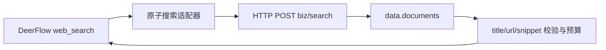

# 讯飞原子搜索服务接入评估

日期：2026-10-26。来源为用户提供的《讯飞搜索服务API说明 .docx》与同名 PDF（30 页），不是网络检索资料。以下能力、价格和限流均是附件中的说明，不是账号实测或当前公开报价。

## 结论

**建议优先评估直接用该原子服务适配 DeerFlow `web_search`，替代此前 WebSocket 搜索智能体任务链。** 文档给出明确的 HTTP POST、查询/过滤参数及结构化来源，响应结构与此前真实任务链返回的 `response2.data.documents` 一致。这支持字段映射，但不证明此前任务链一定使用了同一个 endpoint、账号或 pipeline。

**该文档仍没有定义 `web_fetch(url)`。** `full_text=true` 表示尝试为搜索结果附带正文，不保证存在，不是对任意指定 URL 的独立提取。不能因“可以返回全文”就将同一 Search 接口同时注册为 Fetch，也未证明 PDF 支持。

本次读取文档、核对 PDF 参数表及图片形式的语言表，离线解析文档响应 JSON 并验证 title/url/snippet 映射成功；未使用凭据或调用远端服务。提取文本、相关 PDF 页图及离线归一化样本位于被 Git 忽略的 `outputs/iflytek-atomic-search-review-20261026/`。

## 与智能体任务链的区别

| 维度 | 先前搜索智能体 | 本次原子搜索服务 |
| --- | --- | --- |
| 入口 | 企业平台 WebSocket chat 任务链 | HTTP `POST /biz/search` |
| 查询字段 | payload.input.a16d12e1fad.query | name，文档限制 100 字以内 |
| 来源数据 | 流中的 response2 / netSearch2 | 单次 JSON 的 data.documents |
| 其他输出 | text、output.text 等回答流，存在重复通道 | 文档定义来源、摘要、可选正文与分类等字段 |
| 参数控制 | deepseek/history，来源策略不明确 | limit、sites、time_range、full_text、open_rerank 等 |
| 接入收益 | 要处理流、结束帧、来源与回答分离 | 可直接消费来源，省去任务链后续回答输出和文本流消费 |
| 尚不能承诺 | 完整耗时、底层实际选择与额外计费 | 真实质量、延迟、授权、计费细则及内部是否调用其他模型 |



不应预设原子服务完全不使用模型：文档包含重排、分类等步骤，其内部实现没有公开。可以确认的是，附件合同不要求客户端再等待一段生成回答作为 Search 的输出。

## 地址与鉴权

| 方式 | 文档地址 | 凭据 |
| --- | --- | --- |
| HMAC-SHA256 | `https://cbm-search-api.cn-huabei-1.xf-yun.com/biz/search` | APIKey、APISecret，签名 host/date/POST 请求行，鉴权在查询参数中 |
| Bearer | `https://search-api-open.cn-huabei-1.xf-yun.com/biz/search` | Authorization: Bearer APIPASSWORD |

Bearer 路径的完整地址按文档所列 base 与 `/biz/search` 拼接，尚未连通性验证。建议优先确认该路径的账号授权及 APIPASSWORD，避免签名 URL 的额外日志处理；HMAC 可作为另一部署配置。文档说明 APIPASSWORD 可由 HTTP 凭据获取，或用对应 WebSocket APIKey/APISecret 按 `ak:sk` 拼接，实际账号形式需由提供方确认。不能将此前企业任务链的 App Secret 直接视为本原子服务凭据。

HMAC 的日期必须 GMT/UTC，文档允许最大 300 秒时钟偏差。保留 HTTPS、证书及主机名校验；不照搬示例 HTTP 地址或重定向选项，也不打印签名 URL。SDK 示范和鉴权说明混有 WebSocket 101 文案，对本接口仍应按 HTTP POST + JSON 处理。

## 请求与响应映射

推荐首轮中文搜索按参数表构造以下请求，凭据通过服务端运行时配置，不让模型指定账号、端点或 pipeline：

```json
{
  "appId": "运行时配置的原子服务 appId",
  "uId": "由宿主生成的隔离用户标识",
  "business": "deerflow",
  "pipeline_name": "fl_agg_search_pro",
  "name": "Python asyncio TaskGroup 官方文档",
  "limit": 5,
  "full_text": false,
  "open_rerank": true
}
```

| DeerFlow 配置/输出 | 原子服务字段 | 约束 |
| --- | --- | --- |
| query | name | 文档写 100 字以内；应明确超长输入处理，不能沿用 DeepSeek 的 128 字限制 |
| max_results | limit | 整数，默认 5；附件未给最大值，先使用小值 |
| 域名过滤 | sites | 域名数组，不带协议或 www；按文档接受顶级/二级域名，需实测 Python 官方站的过滤是否适用 |
| 日期范围 | time_range | YYYY-MM-DD..YYYY-MM-DD，区间两端包含 |
| title | data.documents[].name | 字符串校验 |
| url | data.documents[].url | 使用该条实际来源，不从模型文本补造 |
| snippet | data.documents[].summary | 缺失时可对 content 做限长摘取并标明来源 |
| 可选正文 | data.documents[].content | 仅 full_text=true 时尝试获取，可能为空或不完整 |
| 来源元数据 | site_name / published_date / extract_date / meta | 日期和元数据可缺失，保留供应商含义 |

`sid` 在参数表为可选，格式有特定规则；首轮不传，由服务端生成，避免直接填任意 UUID。`data.more_documents` 是较后相关结果，不应盲目拼进 Top K；如确需使用，应明确数量、顺序及去重规则。

业务成功应联合检查 HTTP、success、err_code 和响应结构。字段表将 success 写为 string，但正常示例和此前真实任务链结果为布尔 true，适配时需按真实接口验证，避免用字符串真假值绕过业务错误。得分类字段被文档明确标注会随策略调整，不应作为生产的固定阈值或跨供应商排序依据。

## 全文、覆盖和多语种的边界

- `full_text=true` 仅在搜索结果上请求正文；正文为空时文档要求降级摘要。不得把降级摘要标为全文读取成功。
- 文档未提供独立 url 参数、目标状态、最终跳转 URL、正文截断或 PDF 支持保证。本次不能补造 Fetch 合同。
- 中文服务说明使用站点白名单及文本审核，站点以国内备案和部分境外学术站点为主。可能影响国外官方技术文档的覆盖；这是待验证因素，不能直接断言它就是前次官方来源 0/9 的根因。
- 多语种链路为 `fl_agg_search_overseas`，extraInfo 是 JSON 字符串，例如 `{"lang":"en"}`。PDF 第 14 页为图片语言表，英语 en、日语 jp；不要擅自换成另一套语言编码。
- 文档明确多语种链路不支持重排序和内容审核。不能把中文链路同一套参数及能力宣称原样用于多语种模式。

## 文档中的示例不一致

1. 费用段提到 pro/max/overseas，中文请求表却列 pro/lite。max 是否可用、lite 价格和权限需确认，不能仅按价格段直接启用 max。
2. 参数表 limit 是 int，示例 SDK 却传字符串；应按表使用整数并验证实际行为。
3. 参数表 business 必填，Python SDK 请求却漏传。首轮应补齐 business。
4. sid 参数表为可选，Python 注释写必填；采用参数表的可选语义，不构造无效 SID。
5. 多语种参数表要求 uId，但请求例子用 deviceId 且漏 uId；先确认实际协议，不静默替换标识。
6. Python 示例的 disable_crawler 与 disable_highlight 注释相互错位，且两个字段未列入核心参数表。不要默认照抄；尤其不能在未确认语义时一边要求正文一边无意关闭实时抓取。
7. Nginx 例子把 Host 值写成带 `http://` 的字符串，不能直接照搬。HMAC 的主机、路径和请求方法必须与上游验签协议一致。
8. Python 调用未配置超时和 HTTP 状态检查；生产适配器需增加总预算、响应大小、错误脱敏、取消及业务状态检查。

## 文档价格与规模估算

文档将以下列为约价、按 appId 归属业务线结算；并非当前账号账单、合同报价或此前智能体任务链的费用。

| pipeline | 附件约价/次 | 每月 30 万次的单纯乘法估算 |
| --- | ---: | ---: |
| fl_agg_search_pro | ¥0.008 | ¥2400 |
| fl_agg_search_max | ¥0.012 | ¥3600 |
| fl_agg_search_overseas | ¥0.025 | ¥7500 |

计算假设 30 万次均按该单价计费，不包含重试、折扣、额外费用或税费差异。附件未说明失败/空结果是否计费、full_text 是否影响价格、limit/返回页数是否影响账单，需要业务确认，不能套用 DeepSeek 的成功请求计费规则。

文档默认 QPS=5，正式采用需工单登记，QPS 不足另申请，并写明不在现网压测。30 万次均匀分布在 30 天的平均仅约 0.116 QPS，但这不说明峰值也满足默认额度。没有执行容量测试。

## 接入建议与待验证项

优先做原子 Search 单独适配，模型继续调用 `web_search(query)`，从配置选择本供应商，不修改现有重复工具去重或自动回退机制。Fetch 继续保留独立服务，实现上不要将 Search 的可选全文包装为 Fetch。

文档声明该接口参数面向集团内部业务，外部转售/对外开放需另行确认。DeerFlow 应保持服务器端凭据与参数控制，不把原始服务或运营参数直接开放给最终用户；这是接口适用范围说明，不意味着本次只读评估需要额外批准。

下一轮最有价值的是少量原子 API 测试：

1. 公共问题，limit=5、full_text=false，确认来源结构和业务成功合同。
2. 相同问题 full_text=true，测正文覆盖、长度及实际增量费用。
3. 官方文档问题与 sites 过滤，分别检验中文 pro 和获得授权的 overseas，不先假设可以绕过白名单。
4. 对同一来源检查 content 是否为空或截断，并与原网页核对，仍不将其当成独立 URL Fetch。
5. 验证空结果、鉴权、配额和错误返回；只做受控功能验证，不做现网压测。

当前没有新增凭据、脚本、适配器或线上配置，也没有提交、推送或调用接口。

## 原子接口 URL 探索测试脚本

用户随后选择在测试环境自行运行。新增 `scripts/probe_iflytek_atomic_search.py`，Python 3.10+、仅标准库，不依赖之前的 WebSocket 脚本。当前已执行无网络自测及 Ruff 检查，尚未收到原子接口的真实测试结果。没有在本机尝试复用智能体 App Secret，也没有新注册适配器。

将脚本复制到测试环境后运行：

```bash
python3 probe_iflytek_atomic_search.py --self-test
python3 probe_iflytek_atomic_search.py \
  --auth bearer \
  --app-id '原子搜索服务的appId' \
  --business deerflow \
  --pipeline fl_agg_search_pro \
  --output iflytek-atomic-url-probe
```

运行时隐藏输入 APIPASSWORD；也可安全注入 `IFLYTEK_SEARCH_API_PASSWORD`。若只获得 HMAC 凭据，改为 `--auth hmac`，隐藏输入 APIKey、APISecret，或分别使用 `IFLYTEK_SEARCH_API_KEY`、`IFLYTEK_SEARCH_API_SECRET`。`IFLYTEK_SEARCH_APP_ID` 可代替 app-id 参数。凭据须属于本原子服务，不能擅用此前任务链的应用身份。额外企业 CA 使用 `--ca-file`。网络使用直接连接，不读取环境代理；需要代理的部署应单独确认可达路径，不能通过关闭 TLS 校验解决。

默认顺序执行 5 次请求，每次 limit=5、open_rerank=true；不传自造 SID，不传 disable_crawler 等协议未明确的参数：

| 样本文件 | 请求内容 | 观察目的 |
| --- | --- | --- |
| keyword_summary.json | 年度业绩关键词，full_text=false | 验证搜索与摘要基线 |
| keyword_content.json | 相同关键词，full_text=true | 比较搜索附带正文 |
| url_cnooc.json | 只将之前的确切业绩 HTML URL 放入 name，full_text=true | 探索 URL 作为查询时是否命中原页并返回正文 |
| url_python.json | 将 Python asyncio 官方文档 URL 放入 name，full_text=true | 第二个站点对照 |
| url_negative_candidate.json | 海油同域名的随机不存在路径候选 | 观察是否返回无关页面；脚本未自行访问源站，不能断言源站必为 404 |

如有测试方可控制的公开 HTML，可追加 `--probe-url 'https://公开站点/短路径' --expected-marker '仅放在网页正文里的随机标记'`。标记只用于本地结果检查，不发给搜索接口；新增第 6 次请求。URL 受文档 name 长度限制，须不超过 100 字符。确认页面内容和访问日志可进一步区分真实读取与缓存，脚本自身不会部署页面或证明抓取实时性。

输出目录拒绝覆盖；保存每次脱敏 JSON 请求、HTTP 状态、响应 JSON、耗时和分析，以及 summary.json。关注 `exact_url_hits`、`exact_url_content_hits` 和可选的 `marker_in_exact_url_content`，这些指标只针对 data.documents，不将 more_documents 混入前列结果。带 content 的非目标页面不能当作 Fetch 成功。

脚本默认每个调用最多约 30 秒预算检查，连接/读取的 socket 超时不超过 15 秒，总时限检查位于读取循环，可能被正在进行的单次读取延后；响应累计上限 2 MiB。TLS/主机名验证开启、HTTP 重定向禁用、顺序调用间隔至少 0.25 秒，不压测、不自动重试。HTTP 401/402/403/429 时停止后续样本。异常只记类名，不打印带签名 URL 的原始异常。

脚本保留业务响应，但对已知凭据、签名及常见身份/推理字段脱敏；它不是任意业务隐私的自动识别器，分享前仍需检查正文。默认 5 次的文档 pro 单价乘法约为 ¥0.04，不是实际账单或免收费承诺。

**判断边界：** 脚本通过文档公开的 `name=URL` 测试已知 Search 接口，不猜测新 endpoint 或未公开 url 字段。即使返回相同 URL 的 content，也只证明搜索命中了该页并附带内容，不自动建立独立 Fetch 合同；搜索结果可能来自缓存、可能被截短或缺失。返回码 0 只表示已执行样本的 HTTP/业务/结构检查成功，不代表 Fetch 验收通过。若精确 URL 不命中或只返回其他页面，应明确记录该探索路径不满足按 URL 读取需求。
