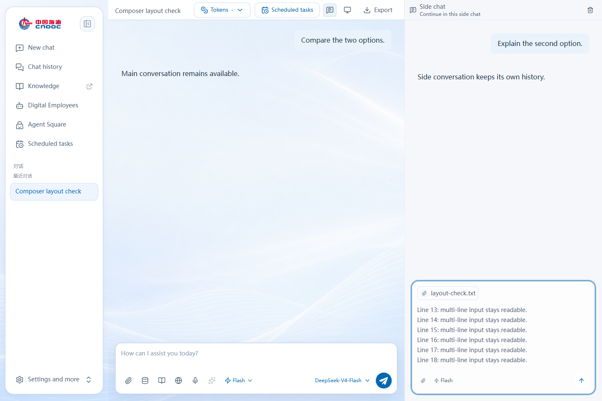
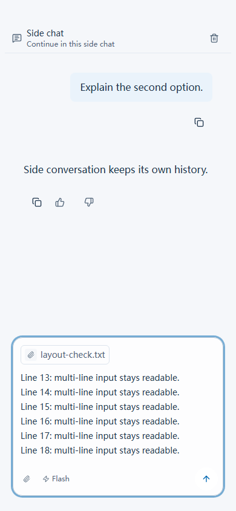

# Frontend 242: side-chat composer and background

The released side-chat fix makes input start at the normal left inset, keeps long
text vertically scrollable, uses the main conversation's attachment and mode
hints, and gives the side conversation an opaque theme background. Upload limits,
model selection, authentication and main-chat appearance are unchanged.

The build used enterprise source `b95b481f95380065e688d97b995b3603f8adf68a`.
This submission is based on enterprise `1feb6b76482d835fd0f5dfd28e089ac795010a8a`
and preserves the colleague's later backend changes. Its only production source
change is `frontend/src/components/workspace/sidecar/sidecar-panel.tsx`.
The intentional successor is registered in
`release/sidechat-frontend-source-20261106/SOURCE.json`; historical inventories
and original operator receipts remain unchanged.

## Released build and production observation

The immutable build evidence is in
`release/sidechat-skillhub-security-20261105-r1/`. Its historical directory name
does not imply a SkillHub deployment: this submission contains frontend evidence
only. The separate native SkillHub authentication remediation remains unfinished.

- Image manifest: `sha256:172243f3abbb8c5a2ebff0242d4386f19ef63e9c9c9cffe9b238cbcfe6159ab3`.
- Image config: `sha256:0e24234e305f54a1e0aa160281ee7a463925b526ae358fbb66053fefd71ed821`.
- Source delta: one of 982 frontend build inputs changed; 981 preserved.
- Operator activation: Frontend 241 to 242, operation `b6eb864391124ae79231049ecc74c517`.
- Both node cache Jobs verified 12 files with `imagePullPolicy: Never`.
- Both replacement Pods passed source, nine static-asset, local HTTP and endpoint checks.
- Gateway 408, Provisioner 86, Runner 58 and both Nginx deployment specifications
  remained unchanged. No database or model/provider request was made by activation.

`activation-20261106-r1/OPERATOR-FIELD.json` records the supplied terminal summary.
The private server report was reported as 35,820 bytes with SHA256
`520583281155c8d5b37a3c7419eee70c81621a72de0519b5a9b3ec7b6635e3e3`;
that full private file was not downloaded or independently rehashed here.
This archive is evidence of a completed release, not a request to run its tools.

## Browser acceptance and its limits

The operator confirmed the desktop side-chat UI works. Their initial answer was
“桌面和手机均正常”, followed by “手机端应该没有侧边对话”. The original acceptance
record is preserved; `BROWSER-ACCEPTANCE-CLARIFICATION.json` supersedes its scope.
**Production mobile side-chat acceptance is not separately confirmed.**

Mobile has no desktop-style split sidebar. Source supports opening a restored
existing side conversation through More / Open side chat in a Sheet, and only
shows that trigger when a sidecar thread exists. The 390px automated test uses
synthetic restored history to exercise that path. It does not prove users can
start a side conversation on a real phone or establish production acceptance.

The final ARM64 image passed 10 Chromium checks across 1440px and 390px, covering
composer alignment, 18-line scrolling, attachment inset/draft retention, shared
hints and mode menu, references, history restoration, stale-thread recovery and
deletion. These tests used mocked local APIs; authentication was disabled only in
the isolated test container, not in the image or production. The original run
used line reporting, so no per-case structured report is claimed.

## Preload follow-up

The original 0015 preloader passed. On datax-02, import and unpack passed but the
fixed 200-command limit stopped final reference readback. The original failure
and marker were retained. The separate read-only recheck validated 13 content
blobs, 11 snapshot ancestors, CRI visibility and all 31 protected references,
then activation performed fresh node and runtime checks. It did not reimport,
retag or delete any image.

Original delivered scripts are preserved under `preload-as-delivered/`, with
`packager-as-used.py`. The future generator's independent regression reproduces
the 197/207-command paths and bounds additional read-only verification. That
future generator revision was not used to reimport either production node.

## Validation

TypeScript, modified-file ESLint/Prettier and the optimized Next.js build passed
before release. The final image passed the 10 browser checks described above.
The 20 cache-recheck, 25 activation and 11 package tests passed locally again
while preparing this submission. Activation includes a real Node fixture check;
its earlier Linux qualification skipped that fixture where Node was absent.

Source provenance rejection tests and the existing historical source verifiers
must run on the submitted commit. The CI workflow also executes the three offline
deployment-helper suites. Tests use synthetic transports and must never execute
archived activation against production.

No new model/OA business-call acceptance, SkillHub remediation, Gateway rollout,
or production-wide source alignment is claimed by this frontend release.
